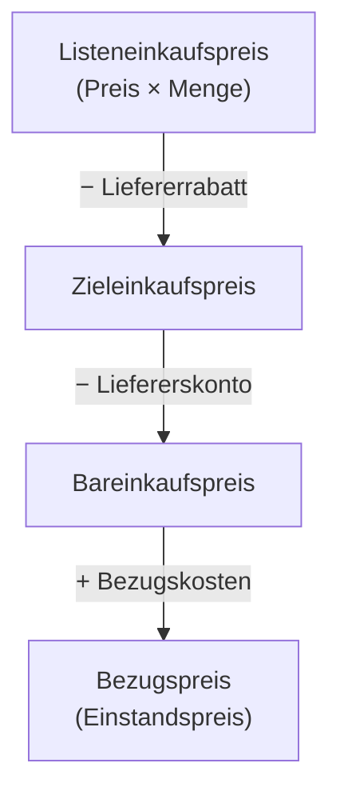

## Worum geht es?

Bevor ein Unternehmen Hardware kauft, holt es mehrere Angebote ein. Der **quantitative**
Angebotsvergleich beantwortet eine einzige Frage: **Was kostet uns die Ware am Ende wirklich, wenn
sie bei uns angekommen ist?** Dieser Betrag heißt [Bezugspreis](glossar:bezugspreis) (auch
Einstandspreis).

Das ist Teil 1 des Angebotsvergleichs. Teil 2 – der **qualitative** Vergleich mit der
Nutzwertanalyse – folgt in der nächsten Lektion. In der Prüfung kommen beide oft zusammen vor:
erst rechnen, dann bewerten.

Beispiel: Die ArchivTech GmbH braucht **10 Notebooks** für den Vertrieb. Drei Händler haben
Angebote geschickt.

## Wie funktioniert es?

### Das Schema der Bezugskalkulation

| Schritt | Bedeutung |
| --- | --- |
| Listeneinkaufspreis | Preis laut Angebot × Menge, netto |
| − [Rabatt](glossar:rabatt) | Preisnachlass, z. B. Mengen- oder Treuerabatt, gilt sofort |
| = Zieleinkaufspreis | so viel, wenn man innerhalb des Zahlungsziels zahlt (z. B. 30 Tage) |
| − [Skonto](glossar:skonto) | Nachlass für schnelle Zahlung (z. B. 2 % bei Zahlung innerhalb 10 Tagen) |
| = Bareinkaufspreis | so viel, wenn man schnell zahlt |
| + Bezugskosten | Versand, Verpackung, Versicherung, Zoll |
| = Bezugspreis | tatsächliche Kosten der Beschaffung |

Wichtig: Jeder Prozentsatz bezieht sich auf den Betrag **direkt darüber**. Skonto wird also vom
Zieleinkaufspreis berechnet, nicht vom Listenpreis.

### Rechenbeispiel: drei Angebote für 10 Notebooks

| | Angebot A | Angebot B | Angebot C |
| --- | --- | --- | --- |
| Preis je Stück | 899,00 € | 849,00 € | 929,00 € |
| Rabatt | 10 % | 5 % | 15 % |
| Skonto | 2 % | – | 3 % |
| Bezugskosten | 49,00 € pauschal | frei Haus | 9,90 € je Stück |

**Angebot A**

1. Listeneinkaufspreis: 10 × 899,00 € = 8.990,00 €
2. − 10 % Rabatt: 8.990,00 € × 0,10 = 899,00 € → Zieleinkaufspreis **8.091,00 €**
3. − 2 % Skonto: 8.091,00 € × 0,02 = 161,82 € → Bareinkaufspreis **7.929,18 €**
4. + Bezugskosten 49,00 € → Bezugspreis **7.978,18 €**

**Angebot B**

1. Listeneinkaufspreis: 10 × 849,00 € = 8.490,00 €
2. − 5 % Rabatt: 424,50 € → Zieleinkaufspreis **8.065,50 €**
3. kein Skonto → Bareinkaufspreis **8.065,50 €**
4. frei Haus → Bezugspreis **8.065,50 €**

**Angebot C**

1. Listeneinkaufspreis: 10 × 929,00 € = 9.290,00 €
2. − 15 % Rabatt: 1.393,50 € → Zieleinkaufspreis **7.896,50 €**
3. − 3 % Skonto: 7.896,50 € × 0,03 = 236,895 € ≈ 236,90 € → Bareinkaufspreis **7.659,60 €**
4. + Bezugskosten 10 × 9,90 € = 99,00 € → Bezugspreis **7.758,60 €**

### Ergebnis des Vergleichs

| Ergebnis | Angebot A | Angebot B | Angebot C |
| --- | --- | --- | --- |
| Bezugspreis gesamt | 7.978,18 € | 8.065,50 € | **7.758,60 €** |
| je Notebook | 797,82 € | 806,55 € | **775,86 €** |
| Rang | 2 | 3 | **1** |

Das Angebot mit dem **höchsten** Listenpreis ist am Ende das **günstigste**.

> **Halten wir kurz fest:**
>
> 1. Reihenfolge: Rabatt → Skonto → Bezugskosten.
> 2. Jeder Prozentsatz wirkt auf das Zwischenergebnis davor.
> 3. Verglichen wird der Bezugspreis, nicht der Listenpreis.

## Warum ist es so?

Warum diese feste Reihenfolge? Weil sie abbildet, **wann im Ablauf** welcher Nachlass entsteht:
Der Rabatt steht schon im Kaufvertrag, Skonto gibt es erst beim Bezahlen, und die Bezugskosten
fallen zusätzlich an, unabhängig vom Warenwert.

Warum wird Skonto nicht vom Listenpreis berechnet?

Skonto belohnt das schnelle Bezahlen der **Rechnung**. Auf der Rechnung steht aber schon der
rabattierte Betrag (der Zieleinkaufspreis). Also kann sich Skonto nur auf diesen Betrag beziehen.
Würde man es vom Listenpreis rechnen, gäbe man einen Nachlass auf Geld, das ohnehin nicht
gezahlt wird.

Und warum gibt ein Lieferant überhaupt Skonto?

Weil schnelles Geld für ihn wertvoll ist: Er muss weniger Kredit aufnehmen, hat weniger Risiko,
dass die Rechnung gar nicht bezahlt wird, und muss weniger Mahnungen schreiben. Für den Käufer ist
Skonto deshalb meist ein sehr gutes Geschäft – 2 % für 20 Tage früheres Zahlen entsprechen
hochgerechnet auf ein Jahr einem Zinssatz von über 30 %.

Warum vergleichen Unternehmen Nettopreise ohne Umsatzsteuer?

Unternehmen bekommen die gezahlte Umsatzsteuer als **Vorsteuer** vom Finanzamt zurück. Die Steuer ist
für sie also ein durchlaufender Posten und kein Kostenfaktor. Für eine Privatperson zählt dagegen
der Bruttopreis.

## Praxisbezug im Betrieb

- In größeren Unternehmen erstellt der Einkauf solche Vergleiche, die IT liefert die technische
  Anforderung (z. B. „mindestens 16 GB RAM, USB-C mit DisplayPort“). Als FiSi musst du die
  Zahlen trotzdem nachvollziehen können – oft bist du derjenige, der die Angebote einholt.
- Bei Rahmenverträgen sind Rabatte schon eingepreist; dann zählen vor allem Lieferzeit, Service und
  Garantie – und damit der qualitative Vergleich.
- Bei Servern und Rechenzentrums-Hardware kommen oft erhebliche Bezugskosten dazu (Spedition,
  Einbringung ins Rechenzentrum, Versicherung). Wer nur Listenpreise vergleicht, liegt leicht
  daneben.

## Typische Prüfungsfalle

- **Skonto vom Listenpreis berechnen** statt vom Zieleinkaufspreis.
- **Bezugskosten rabattieren:** Versand wird nicht um Rabatt oder Skonto gemindert.
- **Pauschale und Stückkosten verwechseln:** „9,90 € je Stück“ bei 10 Stück sind 99 €.
- **Zu früh runden:** Erst am Ende jeder Zeile auf Cent runden, nicht schon die Prozentsätze.
- **Nur den Preis werten:** Fragt die Aufgabe nach einer **Empfehlung**, gehört eine kurze
  Begründung dazu – und oft der Hinweis, dass auch qualitative Kriterien zählen.

## Nicht verwechseln

| Begriff | Wann | Bezugsgröße |
| --- | --- | --- |
| Rabatt | bei Vertragsabschluss | Listeneinkaufspreis |
| Skonto | bei schneller Zahlung | Zieleinkaufspreis |
| Bonus | nachträglich, z. B. Jahresumsatz | Umsatz eines Zeitraums |
| Bezugspreis | Ergebnis | – |

## Merksatz

**Liste minus Rabatt ist Ziel, Ziel minus Skonto ist Bar, Bar plus Bezugskosten ist der Bezugspreis
– und nur der wird verglichen.**
