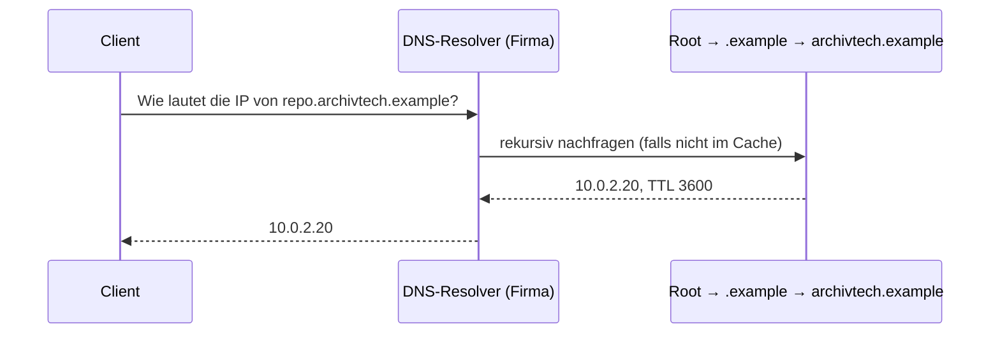

## Worum geht es?

Auf Schicht 7 arbeiten die Protokolle, die du täglich benutzt – oft ohne es zu merken. In der
Prüfung musst du sie **zuordnen**: Wofür ist es da? Welcher Port? TCP oder UDP?

Dieses Kapitel zeigt die wichtigsten Dienste und am Ende eine **Merktabelle**.

## Wie funktioniert es?

### DNS: Namen in Adressen übersetzen

**[DNS](glossar:dns)** übersetzt `repo.archivtech.example` in eine IP-Adresse.

- Der Resolver merkt sich die Antwort so lange, wie die **TTL** sagt (hier 3600 s = 1 Stunde).
  Der zuständige Server legt die TTL fest.
- Wichtige Einträge: **A** (IPv4), **AAAA** (IPv6), **CNAME** (Alias), **MX** (Mailserver),
  **PTR** (Rückwärts: IP → Name).
- Port **53**, meist UDP, bei großen Antworten TCP.

### DHCP: Adressen automatisch verteilen

**[DHCP](glossar:dhcp)** gibt einem neuen Rechner IP-Adresse, Maske, Gateway und DNS-Server.

| Schritt | Nachricht | Richtung |
| --- | --- | --- |
| D | **Discover**: „Gibt es einen DHCP-Server?“ | Client → alle (Broadcast) |
| O | **Offer**: „Nimm 10.0.1.57“ | Server → Client |
| R | **Request**: „Ich nehme 10.0.1.57“ | Client → alle (Broadcast) |
| A | **Ack**: „Bestätigt, 8 Stunden gültig“ | Server → Client |

Eselsbrücke **DORA**. Die Adresse ist **geliehen** (Lease) und wird rechtzeitig verlängert.
UDP, Server Port **67**, Client Port **68**.

Warum ist der Request ein Broadcast, obwohl der Server schon bekannt ist?

Es könnten mehrere DHCP-Server Angebote geschickt haben. Mit dem Broadcast erfahren **alle**, welches
Angebot der Client annimmt. Die anderen geben ihre angebotene Adresse wieder frei.

### Web und Fernzugriff: HTTP, HTTPS, SSH

- **HTTP** (Port 80) überträgt Webseiten und API-Aufrufe im **Klartext**.
- **HTTPS** (Port 443) ist HTTP innerhalb von **TLS**: verschlüsselt, mit Zertifikat geprüft.
- **SSH** (Port 22) ist die verschlüsselte Kommandozeile auf entfernten Servern, auch für
  Dateiübertragung (`scp`, SFTP) und Git.

Telnet (Port 23) und FTP (Ports 20/21) übertragen Passwörter im Klartext – heute nicht mehr einsetzen.

### E-Mail: Senden und Abholen

| Protokoll | Aufgabe | Port (Klartext / TLS) |
| --- | --- | --- |
| SMTP | Mail **senden** und zwischen Servern weiterleiten | 25 (Server), 587 Einlieferung mit STARTTLS / 465 |
| IMAP | Mail **lesen**, bleibt auf dem Server, mehrere Geräte | 143 / 993 |
| POP3 | Mail **abholen** und meist lokal speichern | 110 / 995 |

### Dateien im Netz: SMB und NFS

| Protokoll | typisch | Port |
| --- | --- | --- |
| SMB | Windows-Freigaben, auch NAS (`\\server\freigabe`) | 445 TCP |
| NFS | Linux-/Unix-Freigaben, z. B. für das Archiv-Storage | 2049 |

### Die Merktabelle

| Protokoll | Port | TCP/UDP | Zweck |
| --- | ---: | --- | --- |
| FTP | 20/21 | TCP | Dateiübertragung (unverschlüsselt) |
| SSH | 22 | TCP | sichere Fernwartung |
| SMTP | 25 / 587 / 465 | TCP | Mail senden |
| DNS | 53 | UDP (+TCP) | Namensauflösung |
| DHCP | 67/68 | UDP | Adressvergabe |
| HTTP | 80 | TCP | Web |
| IMAP | 143 / 993 | TCP | Mail lesen |
| HTTPS | 443 | TCP | Web über TLS |
| SMB | 445 | TCP | Windows-Freigaben |
| NFS | 2049 | TCP/UDP | Unix-Freigaben |
| RDP | 3389 | TCP | Windows-Remotedesktop |

> **Halten wir kurz fest:**
>
> 1. DNS: Name → IP, Port 53, Cache-Dauer = TTL in Sekunden.
> 2. DHCP: DORA, Lease, UDP 67/68.
> 3. SMTP sendet, IMAP und POP3 holen ab.

## Warum ist es so?

Feste, bekannte Ports sind wie Hausnummern für Dienste: Ein Browser weiß ohne Nachfrage, dass er
für HTTPS an Port 443 klopfen muss.

Warum braucht E-Mail zwei Protokolle?

SMTP ist zum **Zustellen** gebaut: Ein Server schiebt die Mail zum nächsten, bis sie im Postfach
liegt. Abholen ist eine andere Aufgabe: anmelden, Ordner lesen, als gelesen markieren. Dafür gibt es
IMAP und POP3.

## Praxisbezug im Betrieb

- **„Der Server ist nicht erreichbar“:** `dig repo.archivtech.example` prüft DNS, `curl -v https://…`
  zeigt TLS und HTTP.
- **Firewall-Freigaben** beantragst du mit Protokoll und Port – etwa „TCP 443 von Jenkins zum
  Artefakt-Repository“.
- **DNS-Änderung wirkt nicht sofort:** Caches halten den alten Eintrag bis zum Ablauf der TTL. Vor
  einem Umzug die TTL rechtzeitig senken.

## Typische Prüfungsfalle

- **DNS-TTL falsch verstanden:** Die TTL ist eine feste Gültigkeitsdauer ab Abruf, kein Zähler für
  „nicht benutzt“.
- **DHCP-Reihenfolge:** Discover, Offer, Request, Ack – nicht Request zuerst.
- **IMAP und SMTP vertauscht:** SMTP = senden, IMAP = lesen.
- **HTTPS als eigenes Protokoll:** Es ist HTTP über TLS.
- **Ports verwechselt:** 22 SSH, 53 DNS, 80 HTTP, 443 HTTPS – diese vier sitzen am sichersten.

## Nicht verwechseln

| Begriff | Bedeutung |
| --- | --- |
| DNS | Name → IP-Adresse |
| DHCP | verteilt IP-Konfiguration automatisch |
| ARP | IP → MAC im lokalen Netz |
| SMTP | Mail senden und weiterleiten |
| IMAP | Mail auf dem Server lesen und verwalten |
| POP3 | Mail herunterladen |
| SMB | Dateifreigaben, vor allem Windows |
| NFS | Dateifreigaben, vor allem Linux/Unix |

## Merksatz

**DNS übersetzt, DHCP verteilt (DORA), SMTP verschickt, IMAP liest – und 22, 53, 80, 443 kennst du
im Schlaf.**
