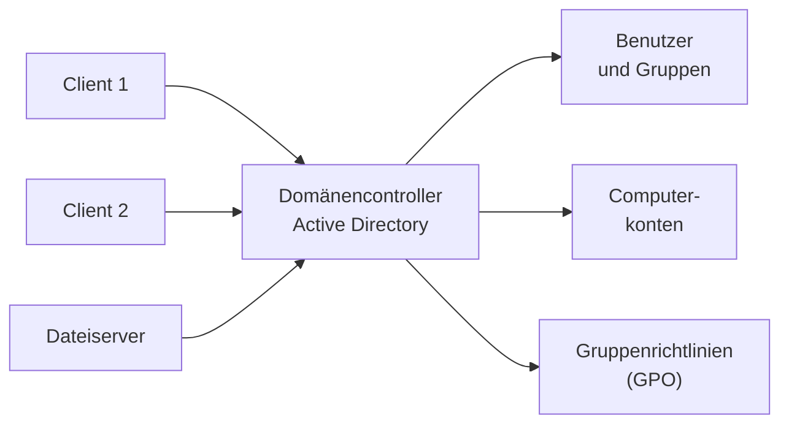

## Worum geht es?

In kleinen Netzen hat jeder Rechner eigene Benutzerkonten. Ab einer gewissen Größe ist das nicht mehr
zu verwalten. Eine **[Domäne](glossar:domaene)** verwaltet Benutzer, Rechner und Regeln **zentral** –
in Windows-Umgebungen mit **Active Directory (AD)**.

- Client-Server gegenüber Peer-to-Peer
- Was eine Domäne bietet
- Schritte, um einen Client in die Domäne aufzunehmen

## Wie funktioniert es?

### Client-Server oder Peer-to-Peer?

| | Client-Server | Peer-to-Peer (Arbeitsgruppe) |
| --- | --- | --- |
| Rollen | Server stellt Dienste bereit, Clients nutzen sie | alle gleichberechtigt |
| Verwaltung | zentral | an jedem Rechner einzeln |
| Größe | beliebig | wenige Rechner |
| Beispiel | Domäne, Dateiserver, Mailserver | Heimnetz, kleines Büro |

### Was eine Domäne bietet

- **Single Sign-on:** einmal anmelden, überall in der Domäne arbeiten
- **zentrale Konten:** Ein gesperrtes Konto ist sofort überall gesperrt
- **Gruppenrichtlinien:** Einstellungen wie Passwortregeln oder Laufwerke zentral verteilen
- **Rechte über Gruppen:** Abteilung „Buchhaltung“ bekommt Zugriff auf ihren Ordner

### Einen Windows-Client aufnehmen

| Schritt | Was | Warum |
| --- | --- | --- |
| 1 | IP-Konfiguration prüfen, **DNS-Server = Domänencontroller** | Der Client findet die Domäne über DNS |
| 2 | eindeutigen **Computernamen** vergeben | wird zum Computerkonto im AD |
| 3 | Systemeinstellungen → Domäne `archivtech.example` eintragen | Beitritt starten |
| 4 | Anmeldedaten eines Kontos **mit Beitrittsrecht** eingeben | nicht jeder darf Rechner aufnehmen |
| 5 | **Neustart** | Richtlinien werden angewendet |
| 6 | mit Domänenkonto anmelden und testen | Laufwerke, Richtlinien, Zugriff |

Auch Linux-Server können beitreten, auf RHEL etwa mit `realm join archivtech.example`.

> **Halten wir kurz fest:**
>
> 1. Domäne = zentrale Verwaltung von Benutzern, Rechnern und Richtlinien (Active Directory).
> 2. Vor dem Beitritt: DNS muss auf den Domänencontroller zeigen.
> 3. Beitritt braucht ein berechtigtes Konto und einen Neustart.

## Warum ist es so?

Zentrale Verwaltung heißt: eine Änderung, sofort überall wirksam. Wer das Unternehmen verlässt, wird an
einer Stelle gesperrt statt an 50 Rechnern.

Warum ist DNS beim Beitritt so wichtig?

Der Client sucht den Domänencontroller über spezielle DNS-Einträge (SRV-Records). Zeigt sein DNS auf
den Router oder einen öffentlichen DNS-Server, kennt dieser die interne Domäne nicht – der Beitritt
scheitert mit „Domäne nicht gefunden“. Das ist der häufigste Fehler.

## Praxisbezug im Betrieb

- **Neue Mitarbeitende:** Konto im AD anlegen, in Gruppen aufnehmen – Rechte und Laufwerke kommen
  automatisch.
- **Linux und AD:** Server melden Benutzer über SSSD am AD an, Gruppen steuern sudo-Rechte.
- **Uhrzeit:** Weicht die Uhr des Clients zu stark ab, schlägt die Anmeldung (Kerberos) fehl.

## Typische Prüfungsfalle

- **DNS auf den Router gestellt:** Domäne wird nicht gefunden.
- **Kein Neustart:** Richtlinien greifen erst danach.
- **Arbeitsgruppe und Domäne verwechselt:** Arbeitsgruppe = dezentral, Domäne = zentral.
- **Lokales Admin-Konto genügt:** Für den Beitritt braucht es ein Domänenkonto mit Beitrittsrecht.

## Nicht verwechseln

| Begriff | Bedeutung |
| --- | --- |
| Domäne | zentral verwalteter Verbund von Benutzern und Rechnern |
| Domänencontroller | Server, der das Active Directory bereitstellt |
| Arbeitsgruppe | Peer-to-Peer, jeder Rechner verwaltet sich selbst |
| Gruppenrichtlinie (GPO) | zentral verteilte Einstellungen |
| Single Sign-on | einmal anmelden, viele Dienste nutzen |

## Merksatz

**Einmal zentral statt fünfzigmal einzeln: DNS auf den Domänencontroller, berechtigtes Konto,
Neustart – und schon gelten Konten und Richtlinien der Domäne.**
