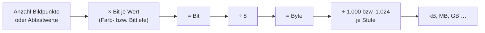

## Worum geht es?

„Wie groß wird die Datei?“ – laut Kommentar zur Katalogänderung kam das „gefühlt in jeder Prüfung“
dran, bisher rund **29 Punkte**. Die Formeln sind einfach. Fehler passieren fast immer bei den **Einheiten**.

- Rastergrafik und Scan: Pixel × Farbtiefe
- Audio: Abtastrate × Bittiefe × Kanäle × Zeit
- Video: Bildgröße × Bilder pro Sekunde × Zeit

Alle Rechnungen hier gelten **unkomprimiert** – so fragt die Prüfung meistens.

## Wie funktioniert es?

### Das große Bild

Rechne zuerst in **Bit oder Byte**, ganz am Ende in die gewünschte Einheit um.

### Bild: Pixel mal Farbtiefe

Ein Foto für das Archiv: **4000 × 3000 Pixel**, **24 Bit** Farbtiefe (je 8 Bit Rot, Grün, Blau).

1. Pixel: 4000 × 3000 = **12.000.000**
2. Byte je Pixel: 24 Bit ÷ 8 = **3 Byte**
3. Datenmenge: 12.000.000 × 3 = **36.000.000 Byte**
4. = **36 MB** (dezimal) bzw. 36.000.000 ÷ 1.048.576 = **34,33 MiB** (binär)

Welche Umrechnung gilt, sagt die Aufgabe – ohne Vorgabe meist dezimal.

### Scan: erst Pixel aus Zoll und dpi

Ein A4-Blatt wird mit **300 dpi** (Punkte pro Zoll) und 24 Bit gescannt. A4 = 210 × 297 mm, 1 Zoll
= 25,4 mm.

1. Breite: 210 ÷ 25,4 × 300 = 2.480,3 → **2.480 Pixel**
2. Höhe: 297 ÷ 25,4 × 300 = 3.507,9 → **3.508 Pixel**
3. Pixel: 2.480 × 3.508 = **8.699.840**
4. Datenmenge: 8.699.840 × 3 Byte = **26.099.520 Byte ≈ 26,1 MB**

Bei 600 dpi verdoppeln sich Breite und Höhe – die Datenmenge **vervierfacht** sich.

### Audio: Abtastrate mal Bittiefe mal Kanäle

Audio in CD-Qualität: **44.100 Hz**, **16 Bit**, **2 Kanäle** (Stereo). Wie groß ist eine Minute?

1. Bit pro Sekunde: 44.100 × 16 × 2 = **1.411.200 bit/s**
2. Mal 60 Sekunden: **84.672.000 Bit**
3. ÷ 8 = **10.584.000 Byte ≈ 10,6 MB** pro Minute

### Video: Einzelbilder mal Bildrate

**Full HD** (1920 × 1080), 24 Bit, **25 Bilder pro Sekunde**, **10 Sekunden**, unkomprimiert:

1. Pixel je Bild: 1920 × 1080 = **2.073.600**
2. Byte je Bild: 2.073.600 × 3 = **6.220.800**
3. Bilder: 25 × 10 = **250**
4. Datenmenge: 6.220.800 × 250 = **1.555.200.000 Byte ≈ 1,56 GB**

Zehn Sekunden, anderthalb Gigabyte – deshalb wird Video praktisch immer komprimiert.

> **Halten wir kurz fest:**
>
> 1. Bild: Breite × Höhe × Farbtiefe. Scan: erst mm → Zoll → Pixel.
> 2. Audio: Abtastrate × Bittiefe × Kanäle × Sekunden.
> 3. Video: Pixel × Farbtiefe × Bilder pro Sekunde × Sekunden. Am Ende durch 8 teilen.

## Warum ist es so?

Digital heißt: Ein Bild wird in Punkte zerlegt, ein Ton in einzelne Messwerte. Jeder Punkt, jeder
Messwert braucht eine feste Anzahl Bits. Die Datenmenge ist deshalb einfach **Anzahl × Bits**.

Warum gerade 44.100 Hz bei Audio?

Menschen hören bis etwa 20.000 Hz. Nach dem Abtasttheorem (Nyquist-Shannon) muss man mehr als doppelt
so oft messen wie die höchste Frequenz, um sie wiederherstellen zu können. 44.100 Hz liegen knapp
über 2 × 20.000 Hz.

Was macht Kompression mit der Rechnung?

Komprimierte Formate (JPEG, MP3, H.264) speichern nicht jeden Punkt einzeln. Gibt die Aufgabe einen
**Kompressionsfaktor** an, teilst du am Ende einfach dadurch: 36 MB bei Faktor 10 ergibt 3,6 MB.
Verlustfreie Kompression (PNG, ZIP) spart weniger, verliert aber nichts.

## Praxisbezug im Betrieb

- **Archivplanung:** 10 Millionen gescannte A4-Seiten in Farbe und 300 dpi wären unkomprimiert rund
  261 TB. Darum archiviert man komprimiert, etwa als PDF/A.
- **Speicher für Videoüberwachung** wird genau so überschlagen – mit Kompressionsfaktor.
- **Plausibilität:** Weicht eine Dateigröße stark von der Rechnung ab, war oft ein falsches Format
  oder eine falsche Auflösung eingestellt.

## Typische Prüfungsfalle

- **Bit und Byte vergessen:** 24 Bit Farbtiefe = 3 Byte, nicht 24 Byte.
- **mm statt Zoll:** dpi bezieht sich auf **Zoll** (25,4 mm).
- **Kanäle vergessen:** Stereo = 2 Kanäle, also doppelt so viel wie Mono.
- **dpi verdoppelt = doppelte Größe:** Falsch – die Fläche wächst, also **vierfach**.
- **Einheit am Ende:** Lies, ob MB (1.000²) oder MiB (1.024²) gefragt ist.

## Nicht verwechseln

| Begriff | Bedeutung |
| --- | --- |
| Auflösung (Pixel) | Breite × Höhe eines Bildes, z. B. 1920 × 1080 |
| dpi / ppi | Punkte pro Zoll beim Scannen oder Drucken |
| Farbtiefe | Bit pro Pixel, z. B. 24 Bit = 16,7 Mio. Farben |
| Abtastrate | Messungen pro Sekunde bei Audio (Hz) |
| Bittiefe (Audio) | Bit pro Messwert, z. B. 16 Bit |
| Bildrate | Bilder pro Sekunde (fps) |

## Merksatz

**Anzahl mal Bits, dann durch acht: Pixel mal Farbtiefe, Abtastrate mal Bittiefe mal Kanäle – und
beim Scan erst Millimeter in Zoll.**
