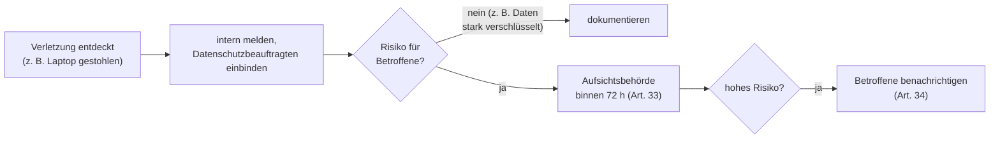

## Worum geht es?

Die DSGVO gibt jeder Person **Rechte** gegenüber Unternehmen, die ihre Daten verarbeiten. Der Katalog
2025 rückt diese **Betroffenenrechte** ausdrücklich in den Fokus – ebenso **Anonymisierung** und
**Pseudonymisierung**.

Und wenn doch etwas passiert: Was ist bei einer **Datenpanne** zu tun?

## Wie funktioniert es?

### Die Betroffenenrechte

| Artikel | Recht | Die Person kann … |
| ---: | --- | --- |
| 13, 14 | Information | bei der Erhebung erfahren, was mit ihren Daten passiert |
| 15 | Auskunft | fragen, **ob** und **welche** Daten gespeichert sind, wozu und wie lange |
| 16 | Berichtigung | falsche Daten korrigieren lassen |
| 17 | Löschung („Recht auf Vergessenwerden“) | Löschung verlangen, z. B. wenn der Zweck entfallen ist |
| 18 | Einschränkung | Verarbeitung vorläufig sperren lassen |
| 20 | Datenübertragbarkeit | Daten in gängigem, maschinenlesbarem Format erhalten |
| 21 | Widerspruch | einer Verarbeitung (z. B. Werbung) widersprechen |
| 77 | Beschwerde | sich bei der Aufsichtsbehörde beschweren |

**Frist** (Art. 12 Abs. 3): Antwort **innerhalb eines Monats**, bei komplexen Fällen um zwei weitere
Monate verlängerbar – mit Begründung.

### Grenzen des Löschrechts

Löschen geht nicht immer: Wenn ein Gesetz die **Aufbewahrung** verlangt (etwa für Rechnungen), werden
die Daten **gesperrt** statt gelöscht und nach Ablauf der Frist entfernt.

### Anonymisierung und Pseudonymisierung

| | Pseudonymisierung | Anonymisierung |
| --- | --- | --- |
| Was passiert | Namen werden durch Kennzeichen ersetzt | Personenbezug wird endgültig entfernt |
| Zurückführbar? | **ja**, mit getrennt aufbewahrter Zusatzinfo | **nein**, auch nicht mit Zusatzwissen |
| DSGVO gilt? | **ja**, weiterhin personenbezogen | **nein** (ErwG 26) |
| Beispiel | „Kunde K-4711“ statt „Max Muster“, Zuordnungstabelle beim Datenschutz | „37 % der Kunden aus Hamburg“ |

Pseudonymisierung ist eine **Schutzmaßnahme** (Art. 32), Anonymisierung beendet den Datenschutzbezug.

### Datenpanne: was jetzt?

- Die **72 Stunden** laufen ab **Bekanntwerden**.
- **Dokumentiert** wird jede Panne – auch die, die nicht gemeldet werden muss.
- Bußgelder (Art. 83) reichen bis **20 Mio. € oder 4 %** des weltweiten Jahresumsatzes, je nachdem,
  was höher ist.

> **Halten wir kurz fest:**
>
> 1. Rechte: Auskunft, Berichtigung, Löschung, Einschränkung, Übertragbarkeit, Widerspruch;
>    Antwort binnen eines Monats.
> 2. Pseudonym = zurückführbar, DSGVO gilt; anonym = nicht zurückführbar, DSGVO gilt nicht.
> 3. Datenpanne mit Risiko: 72 h an die Aufsichtsbehörde.

## Warum ist es so?

Rechte nützen nur, wenn man sie durchsetzen kann. Deshalb gibt es Fristen, Aufsichtsbehörden und
spürbare Bußgelder.

Warum ist echte Anonymisierung so schwer?

Oft reichen wenige Merkmale, um eine Person wiederzuerkennen: Postleitzahl, Geburtsdatum und
Geschlecht zusammen sind in vielen Fällen eindeutig. Wer nur den Namen löscht, hat meist nur
pseudonymisiert. Echte Anonymisierung fasst Daten zusammen oder entfernt so viel, dass kein Rückschluss
mehr möglich ist.

## Praxisbezug im Betrieb

- **Auskunftsanfrage:** Auch Backups und Archive können betroffen sein – wissen, wo welche Daten
  liegen.
- **Löschkonzept:** Für jedes System festlegen, wann was gelöscht wird, auch im Archiv.
- **Verlorener Laptop:** Mit vollständiger Festplattenverschlüsselung ist das Risiko meist gering –
  dokumentieren muss man es trotzdem.

## Typische Prüfungsfalle

- **Pseudonymisierte Daten als anonym:** Sie bleiben personenbezogen.
- **72 Stunden an die Betroffenen:** Die 72 h gelten für die **Aufsichtsbehörde**.
- **Löschung trotz Aufbewahrungspflicht:** Dann sperren statt löschen.
- **Auskunft nur über das Ob:** Auch Zweck, Empfänger, Dauer und Herkunft gehören dazu.

## Nicht verwechseln

| Begriff | Bedeutung |
| --- | --- |
| Auskunft (Art. 15) | Welche Daten habt ihr über mich? |
| Löschung (Art. 17) | Daten entfernen |
| Einschränkung (Art. 18) | Daten sperren, nicht mehr nutzen |
| Widerspruch (Art. 21) | einer Verarbeitung widersprechen |
| Pseudonymisierung | Kennzeichen statt Name, umkehrbar |
| Anonymisierung | Personenbezug endgültig weg |

## Merksatz

**Fragen, berichtigen, löschen, sperren, mitnehmen, widersprechen – Antwort binnen eines Monats.
Pseudonym bleibt Datenschutz, anonym nicht, und eine Panne geht in 72 Stunden zur Behörde.**
