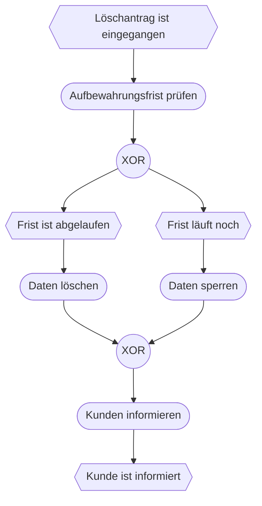

## Worum geht es?

> **Zusatzthema:** EPK und BPMN stehen nicht ausdrücklich im Katalog 2025. Manche Prüfungsstellen
> haben sie früher abgefragt – darum gibt es dieses Kapitel als Absicherung (Entscheidung E-10).

Beide Notationen zeichnen **Geschäftsprozesse**: Wer tut was, wann, unter welcher Bedingung?

| | EPK | BPMN |
| --- | --- | --- |
| Herkunft | Deutschland (SAP, ARIS), 1992 | internationaler Standard (OMG, ISO) |
| Kern | Ereignis → Funktion → Ereignis | Ereignisse, Aktivitäten, Gateways in Pools |
| verbreitet in | deutschen Lehrbüchern, SAP-Umfeld | Prozessmanagement, Workflow-Software |

## Wie funktioniert es?

### EPK: die Bausteine

| Element | Darstellung | Bedeutung |
| --- | --- | --- |
| Ereignis | Sechseck | Zustand: „Antrag ist eingegangen“ |
| Funktion | Rechteck mit runden Ecken | Tätigkeit: „Antrag prüfen“ |
| Konnektor | Kreis mit **XOR**, **∧** (UND), **∨** (ODER) | Verzweigen und Zusammenführen |
| Organisationseinheit (eEPK) | Ellipse mit senkrechtem Strich | wer die Funktion ausführt |

### EPK: die Regeln

1. Beginnt und endet mit einem **Ereignis**.
2. **Ereignis und Funktion wechseln sich ab.**
3. Nach einem Ereignis darf **kein XOR- oder ODER-Split** folgen – ein Ereignis kann nichts entscheiden.
   Die Entscheidung trifft eine Funktion.

### EPK: Beispiel Löschantrag

### BPMN: die Bausteine

| Element | Darstellung | Bedeutung |
| --- | --- | --- |
| Startereignis | dünner Kreis | Prozess beginnt |
| Endereignis | dicker Kreis | Prozess endet |
| Aufgabe (Task) | Rechteck mit runden Ecken | Tätigkeit |
| exklusives Gateway | Raute mit **X** | genau ein Weg |
| paralleles Gateway | Raute mit **+** | alle Wege gleichzeitig |
| Pool / Lane | große Bahn / Unterteilung | Organisation / Rolle |
| Sequenzfluss | durchgezogener Pfeil | Reihenfolge innerhalb eines Pools |
| Nachrichtenfluss | gestrichelter Pfeil | Nachricht zwischen Pools |

Derselbe Löschantrag in BPMN: Start (Antrag eingegangen) → Aufgabe „Frist prüfen“ → X-Gateway →
„löschen“ oder „sperren“ → X-Gateway → „Kunden informieren“ → Ende. Kunde und ArchivTech wären zwei
**Pools**, verbunden durch Nachrichtenflüsse.

> **Halten wir kurz fest:**
>
> 1. EPK: Ereignis (Sechseck) und Funktion wechseln sich ab, Start und Ende sind Ereignisse.
> 2. Kein XOR/ODER direkt nach einem Ereignis – entscheiden kann nur eine Funktion.
> 3. BPMN: Kreise für Ereignisse, Rauten für Gateways, Pools und Lanes für Zuständigkeiten.

## Warum ist es so?

Prozesse sollen nicht nur Menschen verstehen, sondern oft auch Software ausführen. BPMN ist deshalb
genauer definiert und kann direkt in Workflow-Systemen laufen. Die EPK ist einfacher und wurde vor
allem für die Dokumentation von Abläufen in ERP-Systemen genutzt.

Und wie unterscheidet sich das vom UML-Aktivitätsdiagramm?

Die Ideen sind ähnlich: Schritte, Verzweigungen, Parallelität, Zuständigkeiten. Das
Aktivitätsdiagramm kommt aus der Softwareentwicklung, EPK und BPMN aus der Geschäftsprozessmodellierung.
Für den Katalog 2025 ist das **Aktivitätsdiagramm** maßgeblich.

## Praxisbezug im Betrieb

- **Prozessdokumentation** im Qualitätsmanagement nutzt häufig BPMN.
- **Workflow-Engines** führen BPMN-Modelle direkt aus.
- **ERP-Einführungen** arbeiten teils noch mit EPK-Modellen.

## Typische Prüfungsfalle

- **EPK startet mit einer Funktion:** Start und Ende sind immer Ereignisse.
- **XOR nach einem Ereignis:** nicht erlaubt.
- **BPMN-Gateway ohne Symbol:** X = exklusiv, + = parallel.
- **Sequenzfluss zwischen Pools:** Zwischen Pools gibt es nur Nachrichtenflüsse.

## Nicht verwechseln

| Begriff | Bedeutung |
| --- | --- |
| Ereignis (EPK) | Zustand, der eintritt oder erreicht ist |
| Funktion (EPK) | Tätigkeit, die etwas verändert |
| XOR / UND / ODER | genau einer / alle / mindestens einer |
| Pool (BPMN) | Prozessbeteiligter, z. B. Organisation |
| Lane (BPMN) | Rolle innerhalb eines Pools |

## Merksatz

**EPK: Ereignis, Funktion, Ereignis – und nur Funktionen entscheiden. BPMN: Kreis startet und endet,
Raute entscheidet, Pools trennen die Beteiligten.**
