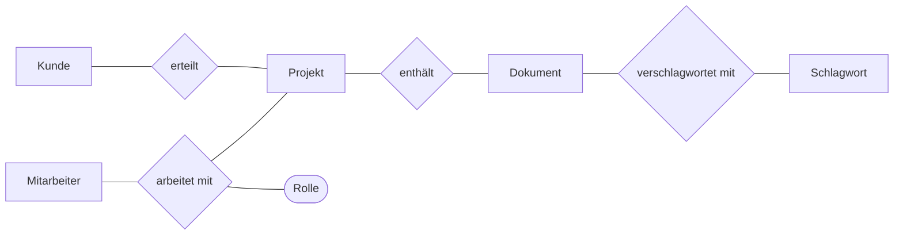

## Worum geht es?

Bevor eine Datenbank entsteht, klären wir drei Fragen:

- **Welche Dinge** speichern wir?
- **Was** wissen wir über sie?
- **Wie** hängen sie zusammen?

Die Antwort ist das [Entity-Relationship-Modell](glossar:erm) (ERM): ein Bauplan der Daten, noch ohne
Tabellen oder SQL.

ERM war in den bisherigen Prüfungen das **zweitstärkste Einzelthema** (42 Punkte). Seit 2025 gehört
SQL nicht mehr zur AP1 – das ERM und die Grundlagen relationaler Datenbanken aber schon.

Beispiel: Die ArchivTech GmbH will ein kleines System, das festhält, **welche Dokumente zu welchem
Kundenprojekt gehören, wer an welchem Projekt mitarbeitet und mit welchen Schlagworten Dokumente
verschlagwortet sind.**

## Wie funktioniert es?

### Die Bausteine

| Baustein | Bedeutung | Darstellung (Chen) | Beispiel |
| --- | --- | --- | --- |
| [Entität](glossar:entitaet) | ein einzelnes, unterscheidbares Ding | – | das Projekt „Turbinenhalle Nord“ |
| Entitätstyp | Gruppe gleichartiger Entitäten | Rechteck | Projekt |
| [Attribut](glossar:attribut) | Eigenschaft eines Entitätstyps | Ellipse | Projektname, Startdatum |
| Schlüsselattribut | identifiziert jede Entität eindeutig | Ellipse, **unterstrichen** | ProjektNr |
| Beziehungstyp | Zusammenhang zwischen Entitätstypen | Raute | „gehört zu“, „arbeitet mit“ |
| [Kardinalität](glossar:kardinalitaet) | wie viele Entitäten beteiligt sein können | Zahl/Buchstabe an der Linie | 1, n, m |

### Das große Bild: unser Archiv-Modell

Mit Kardinalitäten gelesen:

| Beziehung | Kardinalität | Gelesen |
| --- | --- | --- |
| Kunde **erteilt** Projekt | 1 : n | Ein Kunde erteilt mehrere Projekte, ein Projekt gehört zu genau einem Kunden. |
| Projekt **enthält** Dokument | 1 : n | Ein Projekt enthält viele Dokumente, ein Dokument gehört zu genau einem Projekt. |
| Mitarbeiter **arbeitet mit an** Projekt | n : m | Ein Mitarbeiter arbeitet an mehreren Projekten, an einem Projekt arbeiten mehrere Mitarbeiter. Die **Rolle** (z. B. Projektleitung) gehört zur Beziehung, nicht zu einer Seite. |
| Dokument **verschlagwortet mit** Schlagwort | n : m | Ein Dokument hat mehrere Schlagworte, ein Schlagwort passt zu vielen Dokumenten. |

Attribute (Auswahl): Kunde (<u>KundenNr</u>, Name, Ort) · Projekt (<u>ProjektNr</u>, Bezeichnung,
Start) · Dokument (<u>DokumentNr</u>, Titel, Format, Größe) · Mitarbeiter (<u>PersonalNr</u>, Name) ·
Schlagwort (<u>SchlagwortNr</u>, Begriff).

### Kardinalitäten richtig bestimmen

Trick: **Für jede Richtung einzeln fragen** – „Wie viele B kann **ein** A haben?“ und umgekehrt.

1. „Wie viele Projekte kann **ein** Kunde erteilen?“ → mehrere → **n** auf der Projektseite.
2. „Zu wie vielen Kunden gehört **ein** Projekt?“ → genau einem → **1** auf der Kundenseite.
3. Ergebnis: Kunde 1 : n Projekt.

Oft verlangt: die **(min,max)-Notation**. Sie erlaubt auch „keins“:

- Ein Kunde erteilt **(0,n)** Projekte – ein neuer Kunde hat noch keins.
- Ein Projekt gehört zu **(1,1)** Kunde.

Nimm die Notation, die die Aufgabe verlangt, und bleib innerhalb eines Modells dabei.

> **Halten wir kurz fest:**
>
> 1. Rechteck = Entitätstyp, Raute = Beziehung, Ellipse = Attribut, unterstrichen = Schlüssel.
> 2. Kardinalität immer aus beiden Richtungen fragen.
> 3. Ein Attribut, das nur durch das Zusammenspiel zweier Entitäten Sinn ergibt (Rolle, Menge), hängt
>    an der Beziehung.

### Vom ERM zu Tabellen (relationales Modell)

Erst im **nächsten** Schritt wird aus dem ERM ein Tabellenentwurf. Dabei entstehen die
[Fremdschlüssel](glossar:fremdschluessel):

| Beziehung | Umsetzung in Tabellen |
| --- | --- |
| 1 : n | Der [Primärschlüssel](glossar:primaerschluessel) der 1-Seite wandert als Fremdschlüssel in die Tabelle der n-Seite. |
| n : m | Eigene **Zwischentabelle** mit beiden Fremdschlüsseln; zusammen bilden sie den Primärschlüssel. Beziehungsattribute (Rolle) kommen dorthin. |
| 1 : 1 | Fremdschlüssel in eine der beiden Tabellen (eindeutig), oder beide zu einer Tabelle zusammenfassen. |

Für unser Archiv ergibt das (Primärschlüssel unterstrichen, Fremdschlüssel mit ↑):

- Kunde (<u>KundenNr</u>, Name, Ort)
- Projekt (<u>ProjektNr</u>, Bezeichnung, Start, ↑KundenNr)
- Dokument (<u>DokumentNr</u>, Titel, Format, Größe, ↑ProjektNr)
- Mitarbeiter (<u>PersonalNr</u>, Name)
- Mitarbeit (<u>↑PersonalNr, ↑ProjektNr</u>, Rolle)
- Schlagwort (<u>SchlagwortNr</u>, Begriff)
- Verschlagwortung (<u>↑DokumentNr, ↑SchlagwortNr</u>)

> **Halten wir kurz fest:**
>
> 1. Im ERM gibt es **keine** Fremdschlüssel – die Linie zur Raute zeigt den Zusammenhang.
> 2. 1 : n → Fremdschlüssel auf die n-Seite.
> 3. n : m → Zwischentabelle mit zusammengesetztem Primärschlüssel.

## Warum ist es so?

Warum erst ein ERM und nicht gleich Tabellen? Weil man **erst verstehen muss, was gespeichert wird,
bevor man entscheidet, wie**.

Das ERM können auch Fachleute lesen: „Ein Projekt gehört zu genau einem Kunden“ versteht jeder im
Vertrieb – Fremdschlüssel nicht.

Warum braucht n : m eine eigene Zwischentabelle?

Eine Tabellenzelle soll genau **einen** Wert enthalten (erste Normalform). Würde man in die Tabelle
Dokument eine Spalte „Schlagworte“ mit „Turbine, Statik, Halle“ schreiben, könnte man nicht sauber
danach suchen, nichts eindeutig ändern und keine Eigenschaften der einzelnen Zuordnung speichern.
Die Zwischentabelle macht aus jeder Zuordnung eine eigene Zeile.

Und warum ist der Primärschlüssel der Zwischentabelle zusammengesetzt?

Eine Zeile in „Verschlagwortung“ ist erst durch **beide** Werte eindeutig: Dokument 17 kann mehrere
Schlagworte haben, Schlagwort 4 mehrere Dokumente – aber die Kombination (17, 4) darf es nur einmal
geben. Der zusammengesetzte Schlüssel verhindert damit doppelte Zuordnungen schon durch die
Datenbank selbst.

Warum wandert der Fremdschlüssel bei 1 : n auf die n-Seite?

Weil jede Zeile auf der n-Seite genau **einen** Partner hat: Jedes Projekt hat genau einen Kunden,
also passt eine Spalte KundenNr in die Projekttabelle. Andersherum müsste der Kunde eine Liste von
Projektnummern speichern – und das wäre wieder mehr als ein Wert pro Zelle.

## Praxisbezug im Betrieb

- Archivsysteme sind im Kern solche Modelle: Dokument, Version, Projekt, Kunde, Aufbewahrungsfrist,
  Schlagwort. Wer das ERM versteht, versteht auch, warum ein Archivsystem bestimmte Pflichtfelder
  verlangt.
- Auch wenn ein System eine Nicht-SQL-Datenbank nutzt, beginnt die Planung oft mit denselben
  Fragen: Welche Objekte gibt es, wie hängen sie zusammen, was identifiziert ein Objekt eindeutig?
- Für Automatisierung (z. B. ein Python-Skript, das Metadaten importiert) musst du wissen, welche
  Daten zuerst angelegt sein müssen: erst Kunde, dann Projekt, dann Dokument – die Reihenfolge folgt
  aus den Fremdschlüsseln.

## Typische Prüfungsfalle

- **Fremdschlüssel ins ERM zeichnen:** Ein Attribut „KundenNr“ beim Projekt gehört ins
  Tabellenmodell, nicht ins ERM. Im ERM zeigt die Beziehung den Zusammenhang.
- **Kardinalität nur in eine Richtung prüfen** – und dann 1 : n mit n : 1 vertauschen.
- **Beziehungsattribut an eine Entität hängen:** „Rolle“ beim Mitarbeiter ist falsch, wenn dieselbe
  Person in Projekt A Leitung und in Projekt B Mitarbeit hat.
- **Dieselbe Information doppelt modellieren:** Gibt es eine Beziehung „Lieferant liefert Artikel“,
  braucht der Artikel kein zusätzliches Attribut „Lieferant“.
- **Schlüssel vergessen:** Jeder Entitätstyp braucht ein unterstrichenes Schlüsselattribut.

## Nicht verwechseln

| ERM (konzeptionell) | Relationales Modell (Tabellen) |
| --- | --- |
| Entitätstyp | Tabelle (Relation) |
| Entität | Zeile (Datensatz, Tupel) |
| Attribut | Spalte |
| Schlüsselattribut | Primärschlüssel |
| Beziehung (Raute) | Fremdschlüssel oder Zwischentabelle |
| keine Fremdschlüssel | Fremdschlüssel verweisen auf Primärschlüssel |

## Merksatz

**Im ERM: Rechteck, Raute, Ellipse, Schlüssel unterstrichen, Kardinalität aus beiden Richtungen.
In Tabellen: 1 : n gibt der n-Seite den Fremdschlüssel, n : m bekommt eine Zwischentabelle.**
