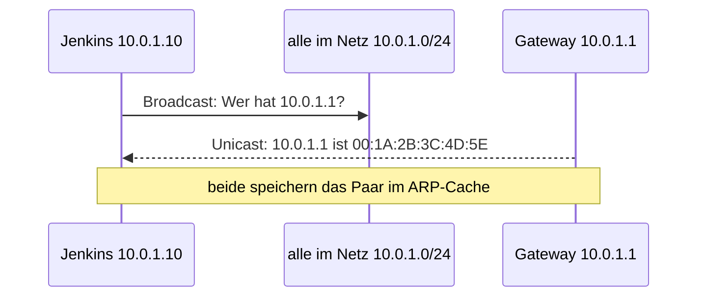

## Worum geht es?

Ein Jenkins-Server schickt ein Build-Artefakt an das Artefakt-Repository in einem anderen Netz.
Unterwegs arbeiten vier Protokolle zusammen:

| Schicht | Protokoll | Frage |
| ---: | --- | --- |
| 4 | TCP oder UDP | An **welches Programm** (Port)? Zuverlässig oder schnell? |
| 3 | IP | An **welchen Rechner** im großen Netz? |
| 2 | Ethernet + ARP | An **welche Netzwerkkarte** im lokalen Netz? |

Dieses Kapitel verfolgt das Paket von unten nach oben.

## Wie funktioniert es?

### Ethernet und MAC-Adresse

Im lokalen Netz werden Frames an **[MAC-Adressen](glossar:mac-adresse)** geschickt.

- 48 Bit, hexadezimal geschrieben: `3C:52:82:1A:7F:09`
- vom Hersteller fest in die Netzwerkkarte geschrieben (lässt sich per Software ändern)
- Ein Switch merkt sich, an welchem Port welche MAC hängt, und leitet gezielt weiter.

Analogie: Die MAC ist der **Personalausweis** der Netzwerkkarte, die IP-Adresse ihre **Postanschrift**.

### ARP: von der IP zur MAC

Der Jenkins-Server kennt die IP-Adresse des Ziels – aber für den Frame braucht er eine MAC.
**[ARP](glossar:arp)** findet sie:

1. Die **Anfrage** ist ein **Broadcast** an alle.
2. Nur der Gesuchte **antwortet** – per **Unicast**.
3. Das Paar IP–MAC landet für eine Weile im **ARP-Cache**.

Liegt das Ziel in einem anderen Netz, fragt der Rechner per ARP nach der MAC des **Gateways**, nicht
nach der des Ziels.

### IP: Wegsuche über Router

**IP** bringt Pakete über Netzgrenzen. Jeder Router liest die Ziel-IP und entscheidet über seine
Routing-Tabelle, wohin es weitergeht.

Dabei ändern sich unterwegs:

| Feld | ändert sich je Router? | Warum |
| --- | --- | --- |
| Quell- und Ziel-IP | nein (ohne NAT) | Ende-zu-Ende-Adressen |
| Quell- und Ziel-MAC | **ja** | gelten nur im jeweiligen lokalen Netz |
| TTL | **ja**, minus 1 | Schutz vor Endlosschleifen |

Die **[TTL](glossar:ttl)** (Time to Live) startet z. B. bei 64. Jeder Router zieht 1 ab. Bei 0 wird
das Paket verworfen und der Absender per ICMP benachrichtigt. `traceroute` nutzt genau das.

### TCP und UDP: Ports und Zuverlässigkeit

Auf Schicht 4 sagt der **[Port](glossar:port)**, welches Programm gemeint ist: `10.0.2.20:443` =
Rechner 10.0.2.20, Dienst HTTPS.

| | [TCP](glossar:tcp) | UDP |
| --- | --- | --- |
| Verbindung | Aufbau per Drei-Wege-Handschlag | keine, einfach senden |
| Zuverlässigkeit | Bestätigung, Wiederholung, Reihenfolge | keine Garantie |
| Tempo | langsamer, mehr Overhead | schnell, wenig Overhead |
| typisch | HTTPS, SSH, Mail, Dateiübertragung | DNS-Abfragen, DHCP, Video, VoIP |

Der Drei-Wege-Handschlag: **SYN** → **SYN-ACK** → **ACK**. Erst danach fließen Daten.

> **Halten wir kurz fest:**
>
> 1. ARP: Anfrage Broadcast, Antwort Unicast, Ergebnis im ARP-Cache.
> 2. Je Router: neue MACs, TTL minus 1, gleiche IPs.
> 3. TCP zuverlässig mit Handschlag, UDP schnell ohne Garantie.

## Warum ist es so?

MAC-Adressen sind **flach** wie Ausweisnummern: Sie sagen nichts darüber, wo ein Gerät steht. Für das
lokale Netz reicht das. Für die ganze Welt braucht es **hierarchische** Adressen mit Netzanteil – IP.

Warum gibt es überhaupt UDP, wenn TCP zuverlässiger ist?

Bei einem Videoanruf hilft ein verspätet nachgeliefertes Bild niemandem – lieber weiter. Und eine
DNS-Abfrage ist so klein, dass ein Handschlag länger dauern würde als die Frage selbst. Fehlt die
Antwort, fragt das Programm einfach noch einmal.

Warum schützt die TTL vor Endlosschleifen?

Ist ein Router falsch konfiguriert, können zwei Router ein Paket ewig hin- und herschicken. Ohne TTL
würden solche Pakete das Netz nach und nach verstopfen. Mit TTL stirbt jedes Paket nach einer
begrenzten Zahl von Sprüngen (Hops).

## Praxisbezug im Betrieb

- **Erster Ping geht verloren:** Oft ist das die ARP-Auflösung – der Rechner muss die MAC erst
  erfragen.
- **`ip neigh`** (Linux) bzw. **`arp -a`** zeigt den ARP-Cache, **`traceroute`** die Router auf dem
  Weg.
- **`ss -tulpn`** zeigt auf einem RHEL-Server, welche Programme auf welchen TCP- und UDP-Ports lauschen.

## Typische Prüfungsfalle

- **ARP-Antwort als Broadcast:** Nur die Anfrage geht an alle, die Antwort direkt zurück.
- **MAC des Ziels in fremdem Netz:** Gesucht wird die MAC des **Gateways**.
- **IP-Adressen ändern sich je Router:** Nein – nur die MACs (NAT ist ein Sonderfall am Übergang
  ins Internet).
- **TTL als Zeit in Sekunden:** Bei IP zählt sie in der Praxis **Hops**. Die TTL im DNS ist etwas
  anderes.

## Nicht verwechseln

| Begriff | macht … |
| --- | --- |
| ARP | IP-Adresse → MAC-Adresse, nur im lokalen Netz |
| DNS | Name → IP-Adresse (`repo.archivtech.example` → `10.0.2.20`) |
| NAT | tauscht private gegen öffentliche IP am Übergang ins Internet |
| TTL im IP-Paket | Hop-Zähler, minus 1 je Router |
| TTL im DNS | Sekunden, die ein Eintrag im Cache gültig bleibt |
| MAC-Adresse | Hardware-Adresse, gilt im lokalen Netz |
| IP-Adresse | logische Adresse, gilt Ende zu Ende |

## Merksatz

**ARP fragt alle und hört eine Antwort. Unterwegs wechseln die MACs, die IPs bleiben, und die TTL
zählt runter – TCP sichert ab, UDP schickt einfach los.**
