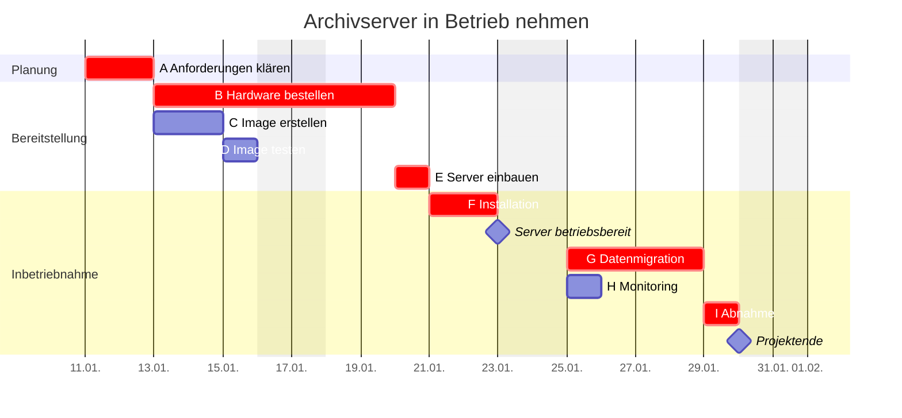

## Worum geht es?

Der Netzplan ist genau, aber schwer zu lesen. Das **[Gantt-Diagramm](glossar:gantt-diagramm)** zeigt
denselben Plan als **Balken auf einem Kalender**. Jeder sieht auf einen Blick, was wann passiert.

- Ein Balken je Vorgang, seine **Länge** ist die Dauer.
- **[Meilensteine](glossar:meilenstein)** markieren wichtige Zeitpunkte.
- Wir übertragen den Netzplan des Archivserver-Projekts. Start: **Montag, 11.01.2027**.

## Wie funktioniert es?

### Das Projekt als Gantt-Diagramm

- **Hervorgehobene Balken:** der kritische Pfad aus dem Netzplan.
- **Rauten:** Meilensteine – sie haben keine Dauer.
- **Wochenenden** zählen nicht mit. 15 Arbeitstage enden am **Freitag, 29.01.2027**.

### So überträgst du den Netzplan

1. **Zeitachse** zeichnen: Tage oder Wochen, Arbeitstage beachten.
2. **Je Vorgang eine Zeile**, am besten in der Reihenfolge des PSP.
3. **Balken** bei FAZ beginnen lassen, Länge = Dauer.
4. **Puffer** auf Wunsch als gestrichelte Verlängerung bis SEZ.
5. **Meilensteine** als Raute an ihren Zeitpunkt setzen.

| Vorgang | FAZ → Kalender | Dauer | Ende |
| --- | --- | ---: | --- |
| A | Tag 0 → Mo 11.01. | 2 | Di 12.01. |
| B | Tag 2 → Mi 13.01. | 5 | Di 19.01. |
| C | Tag 2 → Mi 13.01. | 2 | Do 14.01. |
| F | Tag 8 → Do 21.01. | 2 | Fr 22.01. |
| G | Tag 10 → Mo 25.01. | 4 | Do 28.01. |
| I | Tag 14 → Fr 29.01. | 1 | Fr 29.01. |

### Netzplan oder Gantt – wann was?

| Frage | Netzplan | Gantt-Diagramm |
| --- | --- | --- |
| Abhängigkeiten genau zeigen | ✔ | nur mit Pfeilen |
| Puffer und kritischen Pfad berechnen | ✔ | ✘ |
| Termine im Kalender zeigen | ✘ | ✔ |
| Fortschritt verfolgen (Soll/Ist) | schwer | ✔ |
| für Kunden und Chefs | schwer lesbar | ✔ |

> **Halten wir kurz fest:**
>
> 1. Gantt = Balken auf der Zeitachse, Länge = Dauer.
> 2. Meilensteine haben die Dauer 0 und werden als Raute gezeichnet.
> 3. Netzplan zum Rechnen, Gantt zum Zeigen und Verfolgen.

## Warum ist es so?

Menschen erfassen Längen schneller als Zahlen. Ein langer Balken fällt sofort auf, eine „5“ in einem
Kasten nicht.

Warum braucht es Meilensteine, wenn es doch Balken gibt?

Ein Meilenstein ist ein **Prüfpunkt**: Ist „Server betriebsbereit“ zum geplanten Termin erreicht?
Er hat keine Dauer, weil er nichts tut – er stellt fest. An Meilensteinen wird oft entschieden, ob
es weitergeht, und manchmal hängen Zahlungen daran.

## Praxisbezug im Betrieb

- **Statusmeeting:** Ein Gantt-Diagramm mit Ist-Fortschritt zeigt in Sekunden, was hängt.
- **Werkzeuge:** Projektsoftware, Tabellenkalkulation oder die Roadmap-Ansicht im Ticketsystem.
- **Feiertage und Urlaub** gehören in den Kalender, sonst stimmen die Termine nicht.

## Typische Prüfungsfalle

- **Wochenende mitgezählt:** Rechnet die Aufgabe mit Arbeitstagen, verschiebt das Wochenende jedes
  Ende.
- **Balken beim SAZ begonnen:** Normal beginnt der Balken beim **frühesten** Anfang (FAZ).
- **Meilenstein mit Dauer:** Ein Meilenstein ist ein Zeitpunkt, kein Vorgang.
- **Abhängigkeit missachtet:** F darf erst beginnen, wenn D **und** E fertig sind.

## Nicht verwechseln

| Begriff | Bedeutung |
| --- | --- |
| Gantt-Diagramm | Balken je Vorgang auf einer Zeitachse |
| Netzplan | Kästen und Pfeile, Berechnung von Puffern und kritischem Pfad |
| Meilenstein | Zeitpunkt mit besonderer Bedeutung, Dauer 0 |
| Vorgang | Tätigkeit mit Dauer |

## Merksatz

**Netzplan zum Rechnen, Gantt zum Zeigen: Balken ab FAZ, Länge gleich Dauer – und der Meilenstein
ist eine Raute ohne Dauer.**
