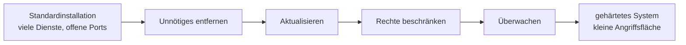

## Worum geht es?

Ein frisch installiertes Betriebssystem ist auf **Bequemlichkeit** eingestellt: viele Dienste,
großzügige Rechte, Standardkonten. **[Härtung](glossar:haertung)** dreht das um: Alles, was nicht
gebraucht wird, kommt weg.

- Härtungsmaßnahmen für Server und Clients
- **Personal Firewall** gegenüber Netzwerk-Firewall
- Firewall-Regeln lesen und anpassen

## Wie funktioniert es?

### Das Prinzip: Angriffsfläche verkleinern



Jeder Dienst, jeder offene Port, jedes Konto ist eine mögliche Tür. Weniger Türen, weniger
Einbruchsmöglichkeiten.

### Härtungsmaßnahmen

| Bereich | Maßnahme |
| --- | --- |
| Dienste | nicht benötigte Dienste und Programme deinstallieren oder deaktivieren |
| Updates | Sicherheitsupdates zeitnah einspielen, automatisiert prüfen |
| Konten | Standardpasswörter ändern, Gastkonten deaktivieren, keine geteilten Admin-Konten |
| Rechte | **Prinzip der minimalen Rechte**: im Alltag ohne Adminrechte arbeiten |
| Fernzugang | SSH statt Telnet, Root-Login per SSH verbieten, Schlüssel statt Passwort |
| Netzwerk | Firewall mit Standardregel „alles verbieten, was nicht erlaubt ist“ |
| Protokolle | Logs aktivieren und zentral sammeln |
| Schnittstellen | ungenutzte USB-Ports oder Autostart von Datenträgern sperren |

### Personal Firewall und Netzwerk-Firewall

| | Personal Firewall | Netzwerk-Firewall |
| --- | --- | --- |
| läuft auf | dem einzelnen Rechner | eigenem Gerät zwischen Netzen |
| schützt | genau diesen Rechner, auch im fremden WLAN | ganze Netze, z. B. LAN gegen Internet |
| kennt | **Programme** auf dem Rechner | IP-Adressen, Ports, Verbindungen |
| Beispiel | Windows-Defender-Firewall, firewalld | Firewall am Internetzugang |

Die Personal Firewall kann deshalb **einem Programm** den Internetzugriff verbieten – das kann eine
Netzwerk-Firewall nicht.

### Regeln lesen und anpassen

Eine Firewall-Regel beantwortet: **Welcher Verkehr, von wo, wohin, erlaubt oder verboten?**

| Nr. | Richtung | Programm / Port | Quelle | Aktion |
| ---: | --- | --- | --- | --- |
| 1 | eingehend | TCP 22 (SSH) | 10.0.1.0/24 (Admin-Netz) | erlauben |
| 2 | ausgehend | `updater.exe` | beliebig | blockieren |
| 3 | eingehend | alles andere | beliebig | blockieren |

Regeln werden meist **von oben nach unten** geprüft – die erste passende gilt.

Auf RHEL mit firewalld zum Beispiel:

```bash
firewall-cmd --permanent --add-rich-rule='rule family="ipv4" source address="10.0.1.0/24" service name="ssh" accept'
firewall-cmd --permanent --remove-service=ssh
firewall-cmd --reload
```

> **Halten wir kurz fest:**
>
> 1. Härtung = Angriffsfläche verkleinern: Unnötiges weg, aktuell halten, Rechte minimal.
> 2. Personal Firewall schützt einen Rechner und kennt Programme; Netzwerk-Firewall schützt Netze.
> 3. Grundregel: alles verbieten, nur Nötiges erlauben.

## Warum ist es so?

Angreifer suchen automatisiert nach offenen Ports und bekannten Lücken. Ein Dienst, der nicht läuft,
kann nicht angegriffen werden – das ist wirksamer als jede nachträgliche Absicherung.

<details>
<summary>Warum SSH statt Telnet?</summary>

Telnet überträgt alles im Klartext, auch das Passwort. Jeder, der den Verkehr mitschneidet, liest es
mit. SSH verschlüsselt die gesamte Verbindung und prüft zusätzlich, ob der Server echt ist.

</details>

<details>
<summary>Warum Personal Firewall, wenn es doch eine Netzwerk-Firewall gibt?</summary>

Die Netzwerk-Firewall schützt nur an der Grenze. Ist ein Rechner **im** Netz infiziert, kann er
Nachbarn angreifen, ohne dass die Grenzfirewall etwas sieht. Notebooks sind außerdem oft in fremden
Netzen unterwegs. Die Personal Firewall schützt den Rechner überall.

</details>

## Praxisbezug im Betrieb

- **Server-Images** werden einmal gehärtet und dann für alle neuen VMs genutzt.
- **Container** gelten als gehärtet, wenn sie nur das Nötigste enthalten und nicht als root laufen.
- **Prüfwerkzeuge** vergleichen Systeme mit Härtungsvorgaben, etwa den CIS-Benchmarks.

## Typische Prüfungsfalle

- **Härtung = Virenscanner installieren:** Härtung entfernt vor allem Unnötiges.
- **Personal Firewall schützt das ganze Netz:** Sie schützt nur ihren Rechner.
- **Regelreihenfolge ignoriert:** Steht „alles blockieren“ ganz oben, greift nichts darunter.
- **Admin im Alltag:** Verstößt gegen das Prinzip der minimalen Rechte.

## Nicht verwechseln

| Begriff | Bedeutung |
| --- | --- |
| Härtung | Angriffsfläche eines Systems verkleinern |
| Personal Firewall | Firewall auf dem einzelnen Rechner, programmbezogen |
| Netzwerk-Firewall | Firewall zwischen Netzen |
| Paketfilter | prüft IP-Adressen und Ports einzelner Pakete |
| Stateful Inspection | merkt sich Verbindungen und lässt Antworten automatisch zu |
| Prinzip der minimalen Rechte | nur die Rechte, die für die Aufgabe nötig sind |

## Merksatz

**Was nicht läuft, kann nicht angegriffen werden. Unnötiges weg, Updates drauf, Rechte klein – und die
Firewall verbietet alles, was nicht ausdrücklich erlaubt ist.**
