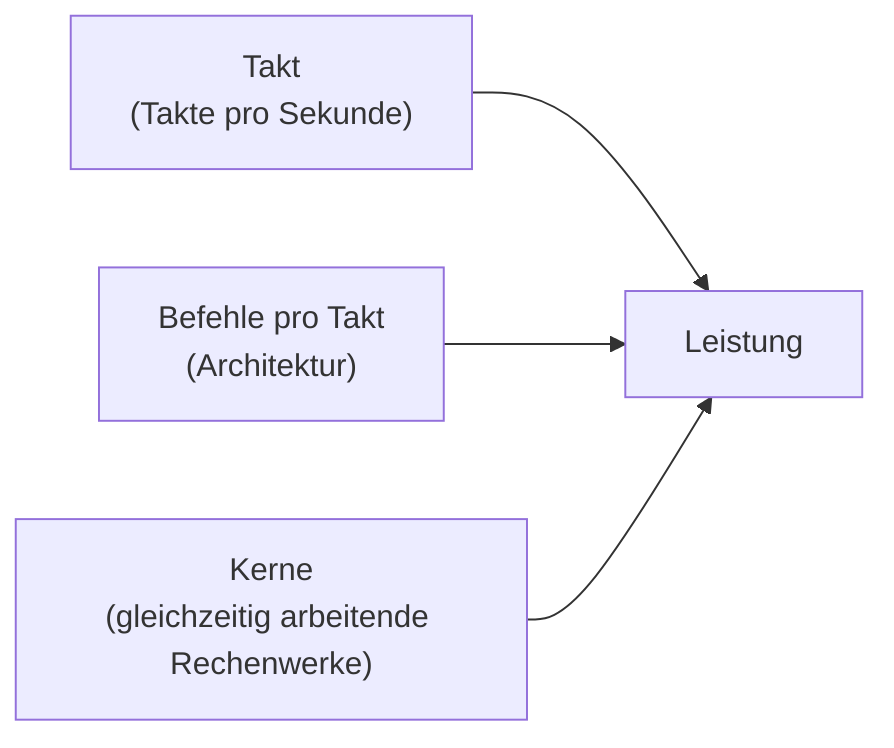

## Worum geht es?

In Prüfungsaufgaben bekommst du oft ein Datenblatt oder zwei Angebote und sollst entscheiden:
Reicht dieser Prozessor? Wie viel Arbeitsspeicher braucht der Arbeitsplatz? Was bedeuten
„8 Kerne / 16 Threads, 3,8–5,1 GHz, 32 MB L3“ oder „2 × 16 GB DDR5-5600“?

Diese Lektion zeigt, **was jede Kennzahl misst und warum sie für die Leistung zählt** – an den beiden
Arbeitsplätzen der ArchivTech GmbH: Frau Yilmaz (Office, Videokonferenz) und Herr Becker (Python,
Docker-Container, große Dateien).

## Wie funktioniert es?

### Was die CPU eigentlich tut

Die [CPU](glossar:cpu) holt Befehle und Daten aus dem Arbeitsspeicher, führt sie aus und schreibt
Ergebnisse zurück – Milliarden Mal pro Sekunde. Wie viel sie schafft, hängt von drei Dingen ab:

**Leistung ≈ Takt × Befehle pro Takt × genutzte Kerne**

### Die Kennzahlen der CPU

| Kennzahl | Bedeutung | Worauf achten |
| --- | --- | --- |
| Kerne | eigenständige Rechenwerke | mehr Kerne helfen nur, wenn die Software parallel arbeitet (Container, Compiler, Virtualisierung) |
| Threads | gleichzeitig bearbeitbare Befehlsströme; mit [SMT](glossar:smt) zwei pro Kern | ein zweiter Thread pro Kern bringt meist nur einen Teil Mehrleistung, nicht das Doppelte |
| Takt (GHz) | Takte pro Sekunde; 4 GHz = 4 Milliarden | Basistakt (Dauerlast) und Turbotakt (kurzzeitig) unterscheiden |
| [Cache](glossar:cache) (L1/L2/L3) | sehr schneller Zwischenspeicher auf dem Chip | großer L3-Cache hilft bei vielen Datenzugriffen |
| [TDP](glossar:tdp) (Watt) | Wärmeleistung, für die die Kühlung ausgelegt sein muss | kein exakter Stromverbrauch; im Turbo kann die CPU kurz mehr aufnehmen |
| Sockel | mechanischer und elektrischer Anschluss | muss zum Mainboard passen (siehe Lektion „Der PC von innen“) |
| integrierte Grafik | Grafikeinheit in der CPU | reicht für Office, Video, mehrere Monitore |

**Halten wir kurz fest:**

1. Takt allein sagt wenig – zwei CPUs mit 4 GHz können sehr unterschiedlich schnell sein.
2. Kerne helfen nur bei paralleler Arbeit.
3. TDP ist eine Kühlungsangabe, keine Verbrauchsmessung.

### Der Arbeitsspeicher

Der [Arbeitsspeicher](glossar:ram) (RAM) hält alles, woran gerade gearbeitet wird: Betriebssystem,
Programme, geöffnete Dateien, laufende Container. Er ist **flüchtig** – ohne Strom ist der Inhalt weg.

| Kennzahl | Bedeutung |
| --- | --- |
| Kapazität (GB) | wie viel gleichzeitig „auf dem Tisch“ liegen kann |
| Typ: [DDR4 / DDR5](glossar:ddr5) | Generation; nicht untereinander austauschbar (andere Kerbe im Modul) |
| Datenrate (MT/s) | Übertragungen pro Sekunde je Datenleitung, z. B. DDR5-5600 = 5600 MT/s |
| Kanäle | Desktop meist [Dual-Channel](glossar:dual-channel): zwei Module arbeiten parallel |
| Bauform | DIMM (Desktop), SO-DIMM (Notebook), oft auch fest verlötet |
| [ECC](glossar:ecc) | erkennt und korrigiert Bitfehler – Standard bei Servern |

### Rechenbeispiel: Wie viel Daten schafft der RAM?

Ein Speichermodul überträgt **64 Bit = 8 Byte** pro Übertragung. Die Bandbreite ist:

**Bandbreite = Datenrate × Busbreite**

Herr Beckers Workstation hat 2 × 16 GB DDR5-5600 im Dual-Channel:

1. Ein Kanal: 5600 × 10⁶ Übertragungen/s × 8 Byte = 44.800 × 10⁶ Byte/s = **44,8 GB/s**
2. Zwei Kanäle (Dual-Channel): 2 × 44,8 GB/s = **89,6 GB/s**
3. Zum Vergleich ein älteres DDR4-3200-Modul im Single-Channel: 3200 × 10⁶ × 8 Byte = **25,6 GB/s**

Steckt Herr Becker nur **ein** 32-GB-Modul statt zwei 16-GB-Modulen ein, hat er dieselbe
Kapazität, aber nur die halbe Bandbreite.

**Halten wir kurz fest:**

1. Bandbreite = Datenrate (MT/s) × 8 Byte je Kanal.
2. Zwei gleiche Module in den richtigen Steckplätzen verdoppeln die Bandbreite.
3. Kapazität entscheidet, ob alles in den RAM passt – Bandbreite, wie schnell er liefert.

### Wie viel RAM braucht welcher Arbeitsplatz?

Faustwerte für die Planung (keine Norm, prüfe immer die Anforderungen der Software):

| Arbeitsplatz | RAM | Begründung |
| --- | --- | --- |
| Office, Browser, Videokonferenz | 16 GB | viele Browser-Tabs und Teams/Zoom brauchen mehr, als man denkt |
| Entwicklung mit Containern und IDE | 32–64 GB | jeder Container und jede VM belegt eigenen Speicher |
| CAD, große Datenmengen | 32 GB und mehr | je nach Modellgröße |

## Warum ist es so?

Warum gibt es überhaupt so viele Speicherstufen – Cache, RAM, SSD? Weil **schneller Speicher teuer
und klein, großer Speicher langsam** ist. Jede Stufe puffert für die nächste.

Warum braucht die CPU einen Cache, wenn es doch RAM gibt?

Ein Zugriff auf den Arbeitsspeicher dauert in der Größenordnung von 80–100 Nanosekunden. In dieser
Zeit könnte ein Kern mit 4 GHz mehrere Hundert Takte lang rechnen – er würde also die meiste Zeit
warten. Der Cache liegt direkt auf dem Chip und antwortet in wenigen Nanosekunden. Weil Programme
dieselben Daten oft kurz nacheinander wieder brauchen (z. B. in Schleifen), landet ein großer Teil
der Zugriffe im Cache.

Und warum ist der Cache dann nicht einfach so groß wie der RAM?

Cache besteht aus SRAM: sehr schnell, aber pro Bit braucht er mehrere Transistoren und viel
Chipfläche. RAM ist DRAM: ein Transistor und ein Kondensator je Bit – klein und billig, aber
langsamer, und er muss ständig aufgefrischt werden. Ein Cache in RAM-Größe wäre unbezahlbar und
würde nicht auf den Chip passen.

Warum bringt ein zweiter Thread pro Kern nicht die doppelte Leistung?

Bei SMT (bei Intel „Hyper-Threading“) teilen sich zwei Threads die Rechenwerke **eines** Kerns.
Das lohnt sich, weil ein Thread oft auf Daten wartet und das Rechenwerk in der Zeit frei wäre.
Wenn aber beide Threads gleichzeitig rechnen wollen, müssen sie sich abwechseln. Deshalb sind
8 Kerne mit 16 Threads deutlich langsamer als echte 16 Kerne.

## Praxisbezug im Betrieb

- **Frau Yilmaz:** 6–8 Kerne mit integrierter Grafik, 16 GB RAM als 2 × 8 GB (Dual-Channel).
  Mehr Kerne bringen bei Office kaum etwas; das Geld ist in einer guten SSD und einem guten Monitor
  besser angelegt.
- **Herr Becker:** 8 oder mehr Kerne, 32 GB als 2 × 16 GB; die Container und der Build-Server-
  Ersatz auf dem eigenen Rechner profitieren von Kernen und RAM.
- **Server und Build-Agenten** (z. B. Jenkins-Knoten, OpenShift-Worker) bekommen **ECC-RAM**:
  Bei vielen Gigabyte und Dauerbetrieb sind einzelne Bitfehler realistisch, und ein unbemerkter
  Fehler in archivierten Konstruktionsdaten wäre teuer.

## Typische Prüfungsfalle

- **MT/s mit MHz verwechseln:** DDR heißt *Double Data Rate* – zwei Übertragungen pro Takt.
  DDR5-5600 läuft mit 2800 MHz Takt, schafft aber 5600 Millionen Übertragungen pro Sekunde.
  Rechne die Bandbreite mit den **MT/s**.
- **Arbeitsspeicher und Datenspeicher verwechseln:** „Der PC hat 512 GB Speicher“ meint die SSD,
  nicht den RAM.
- **Nur die Kapazität vergleichen:** 1 × 32 GB und 2 × 16 GB haben dieselbe Kapazität, aber
  unterschiedliche Bandbreite.
- **„Mehr GHz = schneller“:** Nur innerhalb derselben CPU-Generation einigermaßen vergleichbar.

## Nicht verwechseln

| Begriff | Misst | Einheit |
| --- | --- | --- |
| Takt | Takte pro Sekunde | GHz |
| Datenrate RAM | Übertragungen pro Sekunde | MT/s |
| Bandbreite | Datenmenge pro Sekunde | GB/s |
| Kapazität | wie viel gespeichert werden kann | GB |
| Kern | Rechenwerk (Hardware) | Anzahl |
| Thread | Befehlsstrom (Software/SMT) | Anzahl |

## Merksatz

**Kerne für parallele Arbeit, Takt und Architektur für Einzelleistung, Cache gegen das Warten –
und beim RAM: Kapazität entscheidet, ob es passt, Dual-Channel, wie schnell es fließt.**
