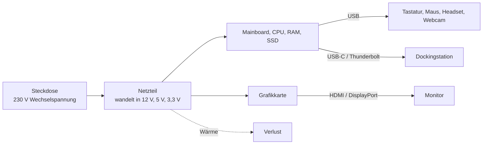

## Worum geht es?

Ein PC allein ist noch kein Arbeitsplatz. Es fehlen Stromversorgung, Bildausgabe und alles, was
Mensch und Maschine verbindet. In der AP1 kommen dazu typische Fragen wie: „Welche Leistung nimmt
der PC aus der Steckdose auf?“, „Welcher Anschluss eignet sich für einen 4K-Monitor mit 60 Hz?“,
„Warum lädt das Notebook am USB-C-Port, aber der Monitor bleibt schwarz?“

Weiter mit der ArchivTech GmbH: Frau Yilmaz bekommt zwei Monitore und eine Dockingstation am
Notebook, Herr Becker eine Workstation mit Grafikkarte. Und im Serverraum wartet ein KVM-Switch.

## Wie funktioniert es?

### Das große Bild: Energie rein, Bild und Daten raus

### Das Netzteil

Das **Netzteil** wandelt die Wechselspannung aus der Steckdose (230 V) in die Gleichspannungen, die
der PC braucht (vor allem 12 V, außerdem 5 V und 3,3 V). Dabei geht immer ein Teil als Wärme
verloren. Wie viel, beschreibt der [Wirkungsgrad](glossar:wirkungsgrad):

**Wirkungsgrad η = abgegebene Leistung ÷ aufgenommene Leistung**

**Rechenbeispiel:** Herr Beckers Workstation braucht unter Last 300 W (das, was die Komponenten
bekommen). Das Netzteil hat bei dieser Last einen Wirkungsgrad von 90 %.

1. Aufgenommene Leistung aus der Steckdose: P_auf = P_ab ÷ η = 300 W ÷ 0,90 = **333,3 W**
2. Verlust als Wärme: 333,3 W − 300 W = **33,3 W**
3. Bei 8 Stunden Last an 220 Arbeitstagen: 0,3333 kW × 8 h × 220 = **586,6 kWh** im Jahr
4. Bei 0,30 € pro kWh: 586,6 kWh × 0,30 €/kWh = **175,98 €** Stromkosten im Jahr

Die Effizienzklassen nach [80 PLUS](glossar:80-plus) geben Mindestwirkungsgrade bei 20 %, 50 % und
100 % Last vor (Werte für 115-V-Netze; die Stufen für 230-V-Netze liegen jeweils etwas höher):

| Stufe | 20 % Last | 50 % Last | 100 % Last |
| --- | --- | --- | --- |
| Bronze | 82 % | 85 % | 82 % |
| Silver | 85 % | 88 % | 85 % |
| Gold | 87 % | 90 % | 87 % |
| Platinum | 90 % | 92 % | 89 % |
| Titanium | 92 % | 94 % | 90 % |

**Dimensionierung:** Leistung aller Komponenten zusammenzählen und eine Reserve einplanen. Den besten
Wirkungsgrad haben Netzteile bei etwa der halben Nennlast – ein 1000-W-Netzteil für einen
Office-PC mit 80 W Bedarf arbeitet im ineffizienten Bereich.

**Halten wir kurz fest:**

1. Aufgenommene Leistung = abgegebene Leistung ÷ Wirkungsgrad.
2. Die Differenz ist Wärme – sie kostet Strom und muss weggekühlt werden.
3. Netzteil nicht maßlos überdimensionieren; am effizientesten um die halbe Last.

### Grafik: integriert oder eigene Karte?

| | Integrierte Grafik (in der CPU) | Grafikkarte (dediziert) |
| --- | --- | --- |
| Speicher | nutzt den Arbeitsspeicher mit | eigener Grafikspeicher (VRAM) |
| Leistung | reicht für Office, Video, mehrere Monitore | für 3D, CAD, Videoschnitt, KI-Berechnungen |
| Strom/Wärme | gering | hoch, oft eigener Stromanschluss vom Netzteil |
| Steckplatz | keiner nötig | PCIe x16 |

### Monitore: Kennzahlen und Anschlüsse

| Kennzahl | Bedeutung | Beispiel |
| --- | --- | --- |
| Auflösung | Bildpunkte waagerecht × senkrecht | Full HD 1920 × 1080, WQHD 2560 × 1440, 4K UHD 3840 × 2160 |
| Diagonale | in Zoll; 1 Zoll = 2,54 cm | 27 Zoll ≈ 68,6 cm |
| Bildwiederholrate | Bilder pro Sekunde | 60 Hz Büro, 120 Hz+ flüssiger |
| Panel | Bauart | IPS: gute Farben und Blickwinkel · VA: hoher Kontrast · TN: schnell, aber blickwinkelabhängig |
| Pixeldichte | Bildpunkte pro Zoll (ppi) | bestimmt, wie scharf Schrift wirkt |

**Rechenbeispiel Pixeldichte:** ppi = √(Breite² + Höhe²) ÷ Diagonale

- 24 Zoll Full HD: √(1920² + 1080²) ÷ 24 = 2202,9 ÷ 24 ≈ **92 ppi**
- 27 Zoll WQHD: √(2560² + 1440²) ÷ 27 = 2937,2 ÷ 27 ≈ **109 ppi**

Der 27-Zoll-WQHD-Monitor ist also größer **und** schärfer – gut für Herrn Beckers Pläne.

**Bildanschlüsse und ihre Datenraten:**

| Anschluss | Signal | Maximale Datenrate (gerundet) | Hinweis |
| --- | --- | --- | --- |
| VGA | analog | – | veraltet, unscharf bei hohen Auflösungen |
| DVI | digital (teils analog) | – | veraltet |
| HDMI 2.0 | digital | 18 Gbit/s | 4K mit 60 Hz |
| HDMI 2.1 | digital | 48 Gbit/s | 4K mit 120 Hz, 8K |
| DisplayPort 1.4 | digital | 32,4 Gbit/s | Standard bei Business-Monitoren, Daisy-Chain möglich |
| DisplayPort 2.1 | digital | bis 80 Gbit/s | sehr hohe Auflösungen und Raten |

### USB, USB-C und Thunderbolt

| Bezeichnung | Datenrate |
| --- | --- |
| USB 2.0 | 480 Mbit/s |
| USB 3.2 Gen 1 (früher USB 3.0) | 5 Gbit/s |
| USB 3.2 Gen 2 | 10 Gbit/s |
| USB 3.2 Gen 2×2 | 20 Gbit/s |
| USB4 | 40 Gbit/s (Version 2.0: bis 80 Gbit/s) |
| Thunderbolt 4 | 40 Gbit/s |

**[USB-C](glossar:usb-c) ist nur die Steckerform.** Was über eine USB-C-Buchse geht, hängt davon ab, was dahinter
eingebaut ist: nur USB 2.0, USB 3.2, USB4/Thunderbolt, Laden mit USB Power Delivery und/oder
Bildausgabe (DisplayPort Alt Mode). Bei Frau Yilmaz' Notebook muss die Buchse **Bildausgabe**
unterstützen, sonst bleiben die Monitore an der Dockingstation schwarz.

**Rechenbeispiel Übertragung:** Herr Becker kopiert ein Projektarchiv mit 50 GB auf eine externe SSD.

- über USB 3.2 Gen 1: 50 GB = 50 × 8 = 400 Gbit; 400 Gbit ÷ 5 Gbit/s = **80 s** (theoretisch)
- über USB 2.0: 400.000 Mbit ÷ 480 Mbit/s ≈ **833 s ≈ 14 min**

In der Praxis ist es langsamer (Protokoll-Overhead, Geschwindigkeit der SSD), aber die Größenordnung
zeigt den Unterschied.

### Peripherie und KVM-Switch

Peripherie sind alle Geräte außerhalb des Rechners: **Eingabe** (Tastatur, Maus, Scanner, Webcam,
Mikrofon), **Ausgabe** (Monitor, Drucker, Lautsprecher), **Ein- und Ausgabe** (Headset, Touchscreen).

Ein [KVM-Switch](glossar:kvm-switch) (Keyboard, Video, Mouse) verbindet **eine** Tastatur, **einen**
Monitor und **eine** Maus mit **mehreren** Rechnern; per Taste oder Tastenkombination wird
umgeschaltet. Im Rechenzentrum sitzt er oft zusammen mit einer **KVM-Konsole** – einem ausziehbaren
Fach im Rack mit Monitor, Tastatur und Touchpad (meist 1 Höheneinheit). **IP-KVM** überträgt Bild
und Eingaben übers Netzwerk, sodass man einen Server aus der Ferne bedienen kann, sogar im
UEFI-Setup, bevor ein Betriebssystem läuft.

**Halten wir kurz fest:**

1. Für Bildschirme: DisplayPort oder HDMI; die Version entscheidet über Auflösung und Hz.
2. USB-C sagt nichts über Geschwindigkeit oder Bildausgabe – das Datenblatt der Buchse zählt.
3. KVM = ein Satz Tastatur/Monitor/Maus für mehrere Rechner; IP-KVM auch aus der Ferne.

## Warum ist es so?

Warum erzeugt ein Netzteil überhaupt Verluste? Weil **jede Umwandlung von Energie Wärme kostet** –
Bauteile wie Transistoren, Spulen und Gleichrichter haben elektrische Widerstände, und Strom durch
einen Widerstand erzeugt Wärme.

Warum braucht ein PC Gleichspannung, wenn aus der Steckdose Wechselspannung kommt?

Digitale Schaltungen arbeiten mit festen Spannungspegeln: „an“ und „aus“ müssen stabil
unterscheidbar sein. Wechselspannung mit 50 Hz ändert 100-mal pro Sekunde ihre Richtung (zweimal je
Periode) – damit würde jedes Bit flackern. Das Netzteil richtet die Spannung gleich, glättet sie und regelt sie auf exakt
12 V, 5 V und 3,3 V.

Und warum ist der Wirkungsgrad bei halber Last am besten?

Ein Teil der Verluste ist fest (Steuerelektronik, Lüfter, Schaltverluste) und fällt auch bei wenig
Last an – bei kleiner Last ist dieser feste Anteil im Verhältnis groß. Bei sehr hoher Last steigen
dagegen die Verluste an den Widerständen stark an, weil sie mit dem Quadrat des Stroms wachsen
(P = I² · R). Dazwischen liegt der günstigste Bereich.

Warum hat USB-C so viele mögliche Fähigkeiten?

USB-C wurde als **ein** Stecker für alles entworfen: Daten, Laden und Bild, verdrehsicher. Die
Hersteller entscheiden aber, welche Funktionen sie hinter der Buchse einbauen, weil jede Funktion
Chips, Platz und Kosten bedeutet. Deshalb sieht man der Buchse nicht an, was sie kann – nur am
Symbol daneben oder im Datenblatt.

## Praxisbezug im Betrieb

- **Dockingstation für Frau Yilmaz:** Notebook-Buchse mit USB4/Thunderbolt oder DisplayPort Alt
  Mode, Dock mit zwei DisplayPort-Ausgängen, Netzwerkanschluss und Ladung per USB Power Delivery –
  ein Kabel für alles.
- **Stromkosten im Blick:** Bei 50 Arbeitsplätzen machen 30 W Unterschied pro Gerät schnell mehrere
  Hundert Euro im Jahr aus – ein Argument für effiziente Netzteile und energiesparende Geräte.
- **Serverraum:** Statt an jeden Server einen Monitor zu hängen, gibt es eine KVM-Konsole im Rack;
  für Fernwartung kommt IP-KVM oder die Fernwartungsschnittstelle des Servers (z. B. iDRAC, iLO,
  IPMI) zum Einsatz.

## Typische Prüfungsfalle

- **Wirkungsgrad falsch herum anwenden:** Aus der Steckdose kommt **mehr**, als die Komponenten
  bekommen. Also teilen (300 W ÷ 0,9), nicht malnehmen (300 W × 0,9).
- **Gbit/s und GB/s mischen:** Datenraten von Schnittstellen sind in Bit, Dateigrößen in Byte.
  Vor dem Rechnen umrechnen (× 8 bzw. ÷ 8).
- **„USB-C = schnell“:** USB-C ist ein Stecker, kein Standard.
- **TDP der CPU als Netzteilleistung nehmen:** Für die Dimensionierung zählen alle Komponenten
  plus Reserve.

## Nicht verwechseln

| Begriff | Was es ist |
| --- | --- |
| USB-C | Steckerform |
| USB 3.2 / USB4 | Übertragungsstandard (Geschwindigkeit) |
| Thunderbolt | Schnittstellenstandard von Intel, nutzt USB-C-Stecker |
| DisplayPort Alt Mode | Bildsignal über eine USB-C-Buchse |
| KVM-Switch | Umschalter für Tastatur, Bild, Maus |
| KVM-Konsole | Monitor + Tastatur als Rack-Einschub |

## Merksatz

**Aus der Steckdose kommt immer mehr, als im PC ankommt (P_auf = P_ab ÷ η); beim Anschluss zählt der
Standard hinter der Buchse, nicht ihre Form.**
