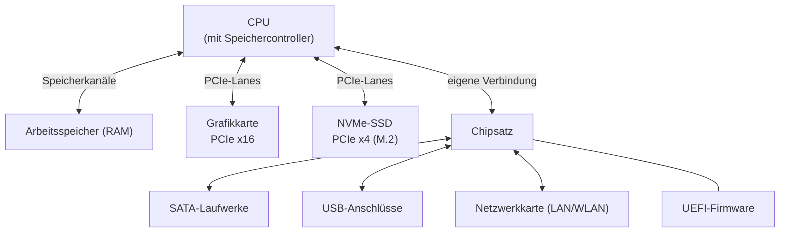

## Worum geht es?

Ein IT-Arbeitsplatz steht und fällt mit der Hardware – und genau dazu kommen in der AP1 die meisten
Punkte (Hardware ist der punktstärkste Themencluster). Typische Aufgaben: „Wählen Sie für die
Mitarbeiterin einen passenden PC aus und begründen Sie“, „Erläutern Sie, warum das Mainboard X
nicht zur CPU Y passt“, „Berechnen Sie die Übertragungsrate“.

In dieser Lektion schauen wir uns erst den **ganzen PC als System** an – wer redet mit wem, über
welche Leitung, wie schnell. Die einzelnen Bauteile (CPU, RAM, Netzteil, Anschlüsse) nehmen wir uns
in den nächsten Lektionen genauer vor.

Unser durchgehendes Beispiel: Die fiktive **ArchivTech GmbH** archiviert Konstruktionspläne für
Industriekunden. Du richtest zwei Arbeitsplätze ein:

- **Büro-Arbeitsplatz** für Frau Yilmaz aus dem Vertrieb (Office, E-Mail, Videokonferenzen)
- **Entwickler-Workstation** für Herrn Becker (Python, Docker-Container, große PDF- und CAD-Dateien)

## Wie funktioniert es?

### Das große Bild

So fließen die Daten in einem aktuellen PC. Merk dir vor allem: **Die CPU hängt direkt an RAM,
Grafikkarte und schneller SSD – alles andere läuft über den Chipsatz.**

Gehen wir Schritt für Schritt durch, was passiert, wenn Herr Becker eine 2-GB-CAD-Datei öffnet:

1. Die **CPU** bekommt vom Betriebssystem den Auftrag „lies die Datei“.
2. Die Datei liegt auf der **NVMe-SSD**. Die SSD hängt über PCIe-Lanes direkt an der CPU und
   schiebt die Daten in den **Arbeitsspeicher**.
3. Die CPU verarbeitet die Daten aus dem RAM (den sie über ihren eingebauten Speichercontroller
   erreicht).
4. Das Ergebnis – die Zeichnung – rechnet die **Grafikkarte** in ein Bild um und schickt es an den
   Monitor.
5. Maus und Tastatur (USB) und das Netzwerk melden sich über den **Chipsatz**.

**Halten wir kurz fest:**

1. Die CPU ist das Zentrum, sie redet direkt mit RAM, Grafik und schneller SSD.
2. Der Chipsatz ist der „Verteiler“ für alles Langsamere: USB, SATA, Netzwerk, Audio.
3. Daten werden nie direkt von der SSD aus verarbeitet, sondern erst in den RAM geladen.

### Das Mainboard: die Platine, auf der alles steckt

Das **Mainboard** (Hauptplatine) verbindet alle Komponenten. Darauf findest du:

| Bauteil | Aufgabe |
| --- | --- |
| CPU-Sockel | Steckplatz für den Prozessor – muss **genau** zur CPU passen |
| RAM-Steckplätze | für die Speichermodule (DIMM am Desktop) |
| PCIe-Steckplätze | für Grafikkarte, Netzwerkkarten, Erweiterungen |
| M.2-Steckplätze | für NVMe-SSDs (über PCIe angebunden) |
| SATA-Anschlüsse | für 2,5"- und 3,5"-Laufwerke |
| Chipsatz | verteilt USB, SATA, weitere PCIe-Lanes, Netzwerk |
| Spannungswandler (VRM) | bereiten die Spannung für die CPU auf |
| Firmware-Chip | enthält das [UEFI](glossar:uefi) (früher BIOS) |
| I/O-Blende | Anschlüsse auf der Rückseite: USB, Netzwerk, Audio, Monitor |

### Formfaktoren: Wie groß ist das Mainboard?

Der **Formfaktor** legt Größe, Befestigungslöcher und Lage der Anschlüsse fest – und damit, welches
Gehäuse passt.

| Formfaktor | Größe | Typischer Einsatz |
| --- | --- | --- |
| ATX | 305 × 244 mm | Tower, viele Steckplätze |
| Micro-ATX | 244 × 244 mm | kompakter Büro-PC |
| Mini-ITX | 170 × 170 mm | Mini-PC, nur ein PCIe-Steckplatz |

### Die Verbindungen: Wie schnell ist welche Leitung?

Für Rechenaufgaben brauchst du die Datenraten. [PCI Express](glossar:pcie) arbeitet mit **Lanes**
(Spuren); mehrere Lanes werden gebündelt (x1, x4, x8, x16). Jede Generation verdoppelt die Rate.

| Verbindung | Datenrate (je Richtung, gerundet) |
| --- | --- |
| PCIe 3.0, je Lane | ca. 1 GB/s |
| PCIe 4.0, je Lane | ca. 2 GB/s |
| PCIe 5.0, je Lane | ca. 4 GB/s |
| SATA III | 6 Gbit/s, nutzbar ca. 600 MB/s |

**Rechenbeispiel:** Die SSD in Herrn Beckers Workstation steckt in einem M.2-Platz mit
**PCIe 4.0 x4**.

- Rate der Verbindung: 4 Lanes × ca. 2 GB/s = **ca. 8 GB/s** (genau: 4 × 1,969 GB/s = 7,88 GB/s)
- Dieselbe Datei über SATA III: höchstens ca. 0,6 GB/s – also **gut 13-mal langsamer**
- Die 2-GB-CAD-Datei braucht über PCIe 4.0 x4 theoretisch 2 GB ÷ 7,88 GB/s ≈ **0,25 s**, über
  SATA 2 GB ÷ 0,6 GB/s ≈ **3,3 s**

In der Praxis bremst meist die SSD selbst – aber die Schnittstelle setzt die Obergrenze.

**Halten wir kurz fest:**

1. PCIe wird in Lanes gezählt, jede Generation verdoppelt die Rate je Lane.
2. Rate der Verbindung = Lanes × Rate je Lane.
3. SATA ist bei rund 600 MB/s gedeckelt; NVMe über PCIe ist ein Vielfaches schneller.

## Warum ist es so?

Warum hängt nicht einfach alles gleichberechtigt an einer Leitung? Weil **Geschwindigkeit Nähe
braucht**: Je kürzer und direkter die Verbindung, desto schneller und mit weniger Verzögerung
können Daten fließen.

Warum sitzen RAM, Grafik und SSD direkt an der CPU?

Das sind die Teile, mit denen die CPU ständig und in großen Mengen Daten austauscht. Früher lief
auch der Arbeitsspeicher über einen separaten Baustein (die „Northbridge“) – jeder Umweg kostete
Zeit. Heute ist der Speichercontroller in der CPU selbst eingebaut, ebenso ein Teil der PCIe-Lanes.

Und warum gibt es dann überhaupt noch einen Chipsatz?

Weil eine CPU nur eine begrenzte Zahl an Anschlussleitungen (Pins und Lanes) hat. Für die vielen
langsamen Geräte (USB, SATA, Audio, Netzwerk) wäre es Verschwendung, wertvolle CPU-Lanes zu
belegen. Der Chipsatz bündelt sie und reicht sie über eine einzige Verbindung an die CPU weiter –
wie ein Verteilerkasten im Haus, an dem viele kleine Leitungen hängen, die gemeinsam über ein
dickes Kabel versorgt werden.

Warum muss der Sockel genau zur CPU passen?

Jede CPU-Generation hat eine bestimmte Anzahl und Anordnung von Kontakten und erwartet bestimmte
Spannungen und Signale. Passt der Sockel mechanisch nicht, geht sie gar nicht hinein. Passt er
mechanisch, aber der Chipsatz kennt die CPU nicht, startet der PC nicht oder erst nach einem
Firmware-Update. Deshalb heißt es bei der Auswahl immer: **CPU, Sockel und Chipsatz gemeinsam
prüfen.**

## Praxisbezug im Betrieb

- **Büro-Arbeitsplatz Frau Yilmaz:** Ein kompakter Micro-ATX- oder Mini-PC reicht; die Grafik in
  der CPU genügt für Office und Videokonferenzen. Wichtiger als Rechenleistung sind eine SSD,
  genug RAM, leiser Betrieb und die passenden Monitor-Anschlüsse.
- **Workstation Herr Becker:** Viel RAM für Container, eine schnelle NVMe-SSD für große Dateien,
  freie PCIe-Steckplätze (z. B. für eine zweite Netzwerkkarte).
- **Im Rechenzentrum** steckt dieselbe Logik in Servern, nur größer: mehr Speicherkanäle, mehr
  PCIe-Lanes für Netzwerk- und Speicherkarten, oft zwei CPUs auf einem Board. Wenn du einen
  Server in ein Rack einbaust, ist die Frage „Welche Karte steckt an welchen Lanes?“ dieselbe.

## Typische Prüfungsfalle

- **Bit und Byte bei Datenraten verwechseln:** SATA wird mit 6 **Gbit**/s angegeben, SSDs mit
  MB/s bzw. GB/s. Bevor du vergleichst, alles auf dieselbe Einheit bringen.
- **„Die SSD ist schneller, weil sie M.2 ist“:** M.2 ist nur die **Bauform** des Steckplatzes.
  Ein M.2-Platz kann auch nur SATA führen – dann ist die SSD nicht schneller als eine 2,5"-SATA-SSD.
  Entscheidend ist, ob die SSD **NVMe über PCIe** nutzt.
- **Kompatibilität nur halb prüfen:** Bei „Passt die CPU auf das Board?“ immer Sockel **und**
  Chipsatz nennen.

## Nicht verwechseln

| Begriff | Was es ist | Was es nicht ist |
| --- | --- | --- |
| M.2 | Bauform/Steckplatz | keine Geschwindigkeitsangabe |
| NVMe | Protokoll für SSDs über PCIe | kein Steckplatz |
| Chipsatz | Verteiler für langsamere Geräte | nicht der Prozessor |
| Formfaktor | Maße und Lochbild des Boards | keine Leistungsklasse |

## Merksatz

**Die CPU redet direkt mit RAM, Grafik und NVMe-SSD; alles Langsamere läuft über den Chipsatz –
und Sockel plus Chipsatz entscheiden, welche CPU passt.**
