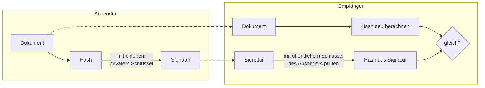

## Worum geht es?

Verschlüsselung schützt die **Vertraulichkeit**. Drei weitere Werkzeuge beantworten andere Fragen:

| Werkzeug | Frage |
| --- | --- |
| [Hashwert](glossar:hashfunktion) | Wurden die Daten **verändert**? |
| [Digitale Signatur](glossar:digitale-signatur) | **Wer** hat das geschickt – und ist es unverändert? |
| [Zertifikat](glossar:zertifikat) | Gehört dieser öffentliche Schlüssel **wirklich** zu diesem Server? |

Zusammen machen sie aus einer verschlüsselten Verbindung eine **vertrauenswürdige**: HTTPS.

## Wie funktioniert es?

### Hashfunktion: der Fingerabdruck

Eine Hashfunktion macht aus beliebig vielen Daten einen Wert **fester Länge**:

| Eingabe | SHA-256 (gekürzt) |
| --- | --- |
| `ArchivTech` | `ae581b52…` |
| `Archivtech` | `03c4a63a…` |
| 50-GB-Archivdatei | ebenfalls 64 Hex-Zeichen |

Eigenschaften einer kryptografischen Hashfunktion:

1. **Einweg:** Aus dem Hash lässt sich die Eingabe nicht zurückrechnen.
2. **Feste Länge:** SHA-256 liefert immer 256 Bit = 64 Hex-Zeichen.
3. **Lawineneffekt:** Ein Zeichen anders – völlig anderer Hash.
4. **Kollisionsresistent:** Zwei Eingaben mit gleichem Hash zu finden, ist praktisch unmöglich.

Empfohlen: **SHA-256** oder stärker. **MD5** und **SHA-1** gelten als gebrochen und taugen nicht mehr
für Sicherheitszwecke.

### Hashes im Einsatz

- **Integrität prüfen:** Der Hersteller veröffentlicht den SHA-256 eines ISO-Images. Du berechnest
  ihn nach dem Download (`sha256sum rhel.iso`) – stimmt er, ist die Datei unverändert.
- **Passwörter speichern:** Gespeichert wird nur der Hash. Beim Login wird die Eingabe gehasht und
  verglichen.
- Für Passwörter gehört ein zufälliger **Salt** dazu, und ein absichtlich **langsames** Verfahren
  (z. B. Argon2id, bcrypt). Sonst knacken Angreifer gestohlene Hashes mit vorberechneten Tabellen.

### Digitale Signatur

Die Signatur dreht die Schlüssel der asymmetrischen Verschlüsselung um:

Stimmen beide Hashes überein, ist bewiesen:

- **Integrität:** Das Dokument ist unverändert.
- **Authentizität:** Nur der Besitzer des privaten Schlüssels kann die Signatur erzeugt haben.

### Zertifikat und Zertifizierungsstelle (CA)

Woher weißt du, dass ein öffentlicher Schlüssel wirklich zu `archivtech.example` gehört? Ein
**Zertifikat** bestätigt das.

- Inhalt (X.509): Name (Domain), öffentlicher Schlüssel, Gültigkeitszeitraum, Aussteller.
- Eine **Zertifizierungsstelle (CA)** prüft den Antragsteller und **signiert** das Zertifikat.
- Dein Browser vertraut einer Liste von **Stamm-CAs** und prüft die Kette: Server-Zertifikat →
  Zwischen-CA → Stamm-CA.

Analogie: Das Zertifikat ist ein **Personalausweis** für den Schlüssel, die CA das **Bürgeramt**, das
ihn ausstellt.

### Alles zusammen: HTTPS

1. Server schickt sein **Zertifikat**.
2. Browser prüft **Signatur der CA**, Domain und Gültigkeit.
3. Beide vereinbaren einen **Sitzungsschlüssel** (asymmetrisch).
4. Daten laufen **symmetrisch** verschlüsselt, jede Nachricht mit **Prüfwert** gegen Veränderung.

> **Halten wir kurz fest:**
>
> 1. Hash = Einweg-Fingerabdruck fester Länge, prüft Integrität.
> 2. Signatur = Hash, mit dem **privaten** Schlüssel des Absenders signiert, mit seinem
>    **öffentlichen** geprüft.
> 3. Zertifikat = von einer CA signierte Bestätigung: Dieser Schlüssel gehört zu diesem Namen.

## Warum ist es so?

Verschlüsselung allein hilft nicht, wenn du mit dem **falschen** Partner sprichst. Ein Angreifer in
der Mitte könnte dir seinen eigenen öffentlichen Schlüssel unterschieben. Zertifikate verhindern das.

Warum signiert man den Hash und nicht das ganze Dokument?

Asymmetrische Rechnungen sind langsam. Ein Hash ist immer klein (z. B. 32 Byte), egal ob das Dokument
1 KB oder 10 GB groß ist. Weil schon die kleinste Änderung einen anderen Hash ergibt, schützt die
Signatur des Hashs trotzdem das ganze Dokument.

Warum hasht man Passwörter absichtlich langsam?

Für dich ist eine halbe Sekunde beim Login egal. Ein Angreifer, der Milliarden Passwörter durchprobieren
will, braucht dann Jahrhunderte statt Stunden. Der Salt sorgt dafür, dass gleiche Passwörter
verschiedene Hashes bekommen.

## Praxisbezug im Betrieb

- **Artefakte und Container-Images** werden über ihren SHA-256-Digest eindeutig referenziert, etwa
  `image@sha256:…`.
- **Abgelaufene Zertifikate** sind ein Klassiker für Störungen – Ablaufdaten überwachen.
- **Interne CA:** Viele Firmen betreiben eine eigene CA für interne Dienste; deren Stammzertifikat
  wird auf alle Firmenrechner verteilt.

## Typische Prüfungsfalle

- **Hash als Verschlüsselung:** Ein Hash lässt sich nicht entschlüsseln – er ist nicht umkehrbar.
- **Signatur mit dem öffentlichen Schlüssel erstellt:** Signiert wird mit dem **privaten**, geprüft
  mit dem **öffentlichen**.
- **Signatur macht geheim:** Nein – sie sichert Integrität und Absender, nicht Vertraulichkeit.
- **MD5 empfohlen:** MD5 und SHA-1 sind für Sicherheit ungeeignet.

## Nicht verwechseln

| Ziel | Werkzeug | Schlüssel |
| --- | --- | --- |
| Vertraulichkeit | Verschlüsselung | öffentlicher Schlüssel des **Empfängers** |
| Integrität | Hashwert | keiner |
| Integrität + Absender | digitale Signatur | **privater** Schlüssel des Absenders |
| Echtheit eines Schlüssels | Zertifikat | Signatur der CA |

## Merksatz

**Hash ist ein Fingerabdruck ohne Rückweg. Signiert wird privat, geprüft öffentlich – und das
Zertifikat ist der Ausweis, den die CA dem Schlüssel ausstellt.**
