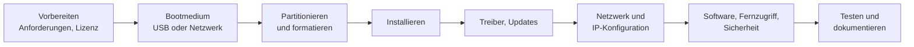

## Worum geht es?

Ein neuer Arbeitsplatz oder Server muss vom leeren Gerät bis zur ersten Anmeldung eingerichtet werden.
Die Prüfung fragt nach dem **Ablauf** und nach Entscheidungen unterwegs: Wie partitionieren? Feste
oder automatische IP? Wie greife ich später aus der Ferne zu?

## Wie funktioniert es?

### Der Ablauf



### Partitionieren: ein Beispiel

Ein Archivserver mit 2 Platten (GPT, UEFI):

| Partition | Größe | Dateisystem | Zweck |
| --- | ---: | --- | --- |
| EFI-Systempartition | 600 MiB | FAT32 | Bootloader (UEFI-Vorgabe) |
| /boot | 1 GiB | XFS | Kernel |
| / | 50 GiB | XFS | Betriebssystem |
| swap | 8 GiB | swap | Auslagerung |
| /data (2. Platte) | Rest | XFS | Archivdaten |

**Daten getrennt vom System** – so lässt sich das System neu installieren, ohne Daten anzufassen.

### IP-Konfiguration: statisch oder DHCP?

| | statisch | DHCP |
| --- | --- | --- |
| geeignet für | Server, Drucker, Netzwerkgeräte | Clients |
| Vorteil | Adresse ändert sich nie | kein Aufwand, keine Doppelvergabe |
| Nachteil | Pflegeaufwand, Tippfehler | Adresse kann wechseln (außer Reservierung) |

Statisch einzutragen sind: **IP-Adresse mit Präfix**, **Gateway**, **DNS-Server** – für IPv4 und
IPv6. Auf RHEL zum Beispiel:

```bash
nmcli con mod eth0 ipv4.method manual ipv4.addresses 10.0.2.20/24 \
  ipv4.gateway 10.0.2.1 ipv4.dns 10.0.2.53
nmcli con up eth0
```

### Fernzugriff einrichten

| Verfahren | System | Port | Hinweis |
| --- | --- | ---: | --- |
| SSH | Linux (auch Windows) | 22 | Kommandozeile, Schlüssel statt Passwort |
| RDP (Remotedesktop) | Windows | 3389 | grafisch, nur im internen Netz oder über VPN |
| VNC | plattformübergreifend | 5900 | grafisch, unbedingt verschlüsselt tunneln |

Fernzugänge **nie direkt ins Internet** öffnen, sondern über VPN oder einen Sprungserver.

### KI-Software

Der Katalog nennt auch die Einrichtung von **KI-Software**, etwa Assistenten in Office oder in der
Entwicklungsumgebung. Wichtig: Datenschutz (welche Daten gehen an den Anbieter?), Lizenz,
Unternehmensrichtlinie.

> **Halten wir kurz fest:**
>
> 1. Ablauf: vorbereiten, booten, partitionieren, installieren, aktualisieren, Netzwerk, testen.
> 2. System und Daten auf getrennte Partitionen.
> 3. Server statisch, Clients per DHCP; Fernzugriff nur verschlüsselt und nicht offen im Internet.

## Warum ist es so?

Eine saubere Struktur spart später Arbeit: Wenn das System kaputt ist, sind die Daten sicher. Wenn
die IP-Adresse des Servers feststeht, finden ihn alle Dienste zuverlässig.

<details>
<summary>Warum installiert man nicht jeden Rechner von Hand?</summary>

Bei 50 Arbeitsplätzen wäre das fehleranfällig und langsam. Man nutzt **Images** oder automatische
Installation (z. B. Kickstart bei RHEL, Softwareverteilung bei Windows). Jeder Rechner wird gleich –
das erleichtert Support und Sicherheit.

</details>

## Praxisbezug im Betrieb

- **Installationsprotokoll** führen: Version, Partitionen, IP, Benutzer, installierte Software.
- **Reservierung im DHCP** ist ein Mittelweg: feste Adresse, aber zentral verwaltet.
- **Nach der Installation:** Updates, Härtung, Monitoring und Backup einrichten.

## Typische Prüfungsfalle

- **Updates vergessen:** Direkt nach der Installation ist das System oft veraltet.
- **Gateway oder DNS fehlt:** Ohne Gateway kein anderes Netz, ohne DNS keine Namen.
- **RDP ins Internet freigegeben:** großes Sicherheitsrisiko.
- **Alles auf eine Partition:** Neuinstallation gefährdet die Daten.

## Nicht verwechseln

| Begriff | Bedeutung |
| --- | --- |
| Partitionieren | Platte in Bereiche aufteilen |
| Formatieren | Dateisystem anlegen |
| statische IP | von Hand fest eingetragen |
| DHCP-Reservierung | fester Eintrag im DHCP-Server für eine MAC-Adresse |
| RDP | grafischer Fernzugriff auf Windows |
| SSH | verschlüsselte Kommandozeile |

## Merksatz

**Erst Platte aufteilen, dann installieren, dann aktualisieren. Server bekommen feste Adressen, Clients
DHCP – und Fernzugriff läuft nur verschlüsselt.**
