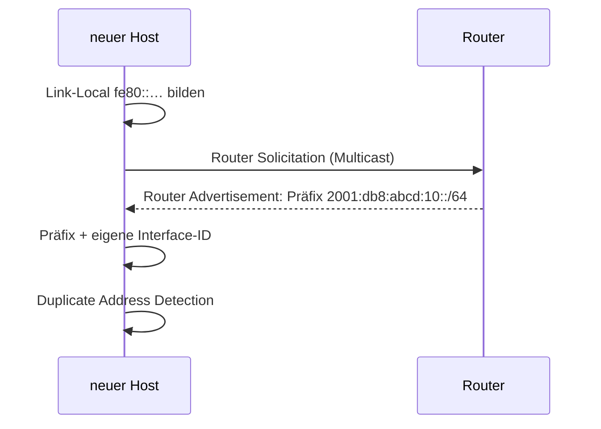

## Worum geht es?

Bei IPv4 rechnest du Hosts und Masken. Bei IPv6 ist das **einfacher**: Jedes Subnetz ist /64. Die
Frage ist nur, **wie viele** Subnetze du aus deinem Präfix bilden kannst – und wie Geräte ihre
Adresse bekommen.

- Subnetze aus einem /48 oder /56 bilden
- SLAAC: Adressen ohne DHCP-Server
- NDP: der Nachfolger von ARP

## Wie funktioniert es?

### Das große Bild: drei Teile

| Bits | 48 | 16 | 64 |
| --- | --- | --- | --- |
| Teil | **Präfix vom Provider** | **Subnetz-ID** | **Interface-ID** |
| Beispiel | `2001:db8:abcd` | `0010` | `3e52:82ff:fe1a:7f09` |

- Ein Unternehmen bekommt üblicherweise ein **/48**, ein Privatanschluss ein **/56**.
- Die Bits zwischen Präfix und /64 sind **deine** Subnetz-ID.

### Rechenbeispiel: Subnetze aus einem /48

Die ArchivTech hat **2001:db8:abcd::/48**.

1. Subnetz-Bits: 64 − 48 = **16**
2. Anzahl Subnetze: 2¹⁶ = **65.536**
3. Sie unterscheiden sich im **4. Block**:

| Subnetz | Präfix |
| ---: | --- |
| 1 | 2001:db8:abcd:**0**::/64 |
| 2 | 2001:db8:abcd:**1**::/64 |
| … | … |
| 256 | 2001:db8:abcd:**ff**::/64 |
| 65.536 | 2001:db8:abcd:**ffff**::/64 |

Praktisch: Die Subnetz-ID kann die **VLAN-Nummer** spiegeln – VLAN 10 → `2001:db8:abcd:10::/64`.

### Rechenbeispiel: ein /56

Ein Außenstandort bekommt **2001:db8:abcd:1200::/56**.

- Subnetz-Bits: 64 − 56 = **8** → 2⁸ = **256** Subnetze
- von `2001:db8:abcd:1200::/64` bis `2001:db8:abcd:12ff::/64`

Formel für alle Fälle: **Anzahl /64-Subnetze = 2^(64 − Präfixlänge)**.

### SLAAC: Adresse ohne DHCP

Bei der **[SLAAC](glossar:slaac)** (Stateless Address Autoconfiguration) baut sich ein Gerät seine
Adresse selbst:

Die Interface-ID entsteht **zufällig** (Datenschutz) oder aus der MAC-Adresse (**EUI-64**).

So wird aus der MAC eine EUI-64-Interface-ID

MAC `3c:52:82:1a:7f:09`:

1. In der Mitte `ff:fe` einfügen: `3c:52:82:ff:fe:1a:7f:09`
2. Im ersten Byte das 7. Bit umdrehen: `3c` = `00111100` → `00111110` = `3e`
3. Ergebnis: `3e52:82ff:fe1a:7f09`, als Link-Local `fe80::3e52:82ff:fe1a:7f09`

Weil die MAC dann in jeder Adresse steckt, lässt sich ein Gerät über Netze hinweg verfolgen. Darum
nutzen Betriebssysteme heute meist zufällige Interface-IDs (RFC 8981).

### NDP ersetzt ARP

Das **Neighbor Discovery Protocol** (NDP, Teil von ICMPv6) übernimmt:

| Aufgabe | IPv4 | IPv6 (NDP) |
| --- | --- | --- |
| IP → MAC | ARP (Broadcast) | Neighbor Solicitation (Multicast) |
| Router finden | DHCP-Option / manuell | Router Advertisement |
| Doppelte Adresse erkennen | – | Duplicate Address Detection |

Wer zusätzlich zentrale Kontrolle will – etwa DNS-Server oder feste Zuordnung – nutzt **DHCPv6**.

> **Halten wir kurz fest:**
>
> 1. Subnetz = /64. Anzahl Subnetze = 2^(64 − Präfixlänge).
> 2. SLAAC: Präfix vom Router (RA) + Interface-ID vom Host.
> 3. NDP ersetzt ARP und arbeitet mit Multicast statt Broadcast.

## Warum ist es so?

Mit 64 Bit Interface-ID kann sich jedes Gerät eine Adresse ausdenken, ohne mit anderen zu kollidieren
– die Wahrscheinlichkeit ist winzig, und DAD prüft trotzdem nach. Ein zentraler Server ist dafür
nicht mehr nötig.

Warum immer /64, auch wenn ein Subnetz nur zehn Geräte hat?

SLAAC setzt eine 64-Bit-Interface-ID voraus. Kleinere Subnetze würden die Autokonfiguration brechen.
Bei 2¹²⁸ Adressen ist das keine Verschwendung, sondern Absicht: Planung wird einfach, weil jedes
Subnetz gleich groß ist.

## Praxisbezug im Betrieb

- **Adressplan:** Subnetz-ID = VLAN-Nummer macht Pläne lesbar; dokumentiere sie im IPAM wie bei IPv4.
- **`ip -6 route`** zeigt das per Router Advertisement gelernte Standard-Gateway (eine `fe80::`-Adresse).
- **Server** bekommen meist feste Adressen oder DHCPv6-Reservierungen, Clients nutzen SLAAC.

## Typische Prüfungsfalle

- **Hosts pro Subnetz rechnen wie bei IPv4:** Bei IPv6 fragt man nach der Anzahl Subnetze, Hosts
  sind 2⁶⁴ – ohne „minus 2“, weil es keinen Broadcast gibt.
- **Subnetz-Bits falsch gezählt:** /48 → /64 sind 16 Bit, nicht 64.
- **Subnetz im falschen Block:** Bei /48 ändert sich der **4.** Block.
- **NDP mit Broadcast:** IPv6 nutzt Multicast.
- **SLAAC braucht DHCP:** Nein – die Router-Ankündigung reicht.

## Nicht verwechseln

| Begriff | Bedeutung |
| --- | --- |
| Präfix | vom Provider zugeteilter Netzanteil, z. B. /48 |
| Subnetz-ID | Bits zwischen Präfix und /64, frei planbar |
| Interface-ID | letzte 64 Bit, identifiziert die Schnittstelle |
| SLAAC | Host bildet Adresse selbst aus Router-Präfix |
| DHCPv6 | Server verteilt Adressen oder Zusatzinfos |
| NDP | ersetzt ARP, findet Nachbarn und Router per Multicast |
| EUI-64 | Interface-ID aus der MAC-Adresse |

## Merksatz

**Jedes Subnetz ist /64, die Bits davor sind deine Subnetz-ID: 2 hoch (64 minus Präfix). Der Router
sagt das Präfix, der Host baut den Rest – und NDP löst ARP ab.**
