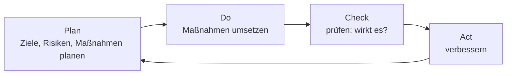

## Worum geht es?

Sicherheit ist kein Projekt, das irgendwann fertig ist. Angriffe ändern sich, Systeme ändern sich.
Ein **[ISMS](glossar:isms)** (Informationssicherheitsmanagementsystem) sorgt dafür, dass Sicherheit
**dauerhaft** gesteuert wird.

- Kern des ISMS: der **PDCA-Zyklus**
- Werkzeug zur Priorisierung: die **Risikomatrix**
- Der Katalog verlangt: ISMS **kennen und unterstützen**, Risiken mit Matrix **klassifizieren**

## Wie funktioniert es?

### Der PDCA-Zyklus

Zum ISMS gehören außerdem:

- eine **Sicherheitsleitlinie**, von der Geschäftsleitung unterschrieben
- klare **Rollen**, z. B. der Informationssicherheitsbeauftragte
- **Dokumentation**: Sicherheitskonzept, Richtlinien, Nachweise

### Risiko = Wahrscheinlichkeit × Schaden

Ein **Risiko** entsteht, wenn eine **Bedrohung** auf eine **Schwachstelle** trifft. Bewertet wird es
in zwei Dimensionen:

| Stufe | Eintrittswahrscheinlichkeit | Schadensauswirkung |
| ---: | --- | --- |
| 1 | selten (alle paar Jahre) | vernachlässigbar |
| 2 | mittel (einmal im Jahr) | begrenzt |
| 3 | häufig (mehrmals im Jahr) | beträchtlich |
| 4 | sehr häufig (monatlich) | existenzbedrohend |

**Risikowert = Wahrscheinlichkeit × Schaden**, also zwischen 1 und 16.

### Die Risikomatrix

| Schaden ↓ / Wahrscheinlichkeit → | 1 selten | 2 mittel | 3 häufig | 4 sehr häufig |
| --- | :---: | :---: | :---: | :---: |
| **4 existenzbedrohend** | 4 mittel | 8 hoch | 12 sehr hoch | 16 sehr hoch |
| **3 beträchtlich** | 3 gering | 6 mittel | 9 hoch | 12 sehr hoch |
| **2 begrenzt** | 2 gering | 4 mittel | 6 mittel | 8 hoch |
| **1 vernachlässigbar** | 1 gering | 2 gering | 3 gering | 4 mittel |

Die Grenzen zwischen gering, mittel, hoch legt jedes Unternehmen selbst fest.

### Rechenbeispiel: drei Risiken der ArchivTech

| Risiko | W | S | Wert | Einstufung |
| --- | ---: | ---: | ---: | --- |
| Ransomware über Phishing-Mail | 3 | 4 | 12 | sehr hoch |
| Ausfall einer Festplatte im Archiv | 4 | 2 | 8 | hoch |
| Brand im Rechenzentrum | 1 | 4 | 4 | mittel |

Zuerst kümmert man sich um die **sehr hohen** Risiken.

### Vier Wege, mit einem Risiko umzugehen

| Strategie | Bedeutung | Beispiel |
| --- | --- | --- |
| **vermeiden** | Tätigkeit aufgeben | keine Makros in Office-Dokumenten zulassen |
| **vermindern** | Wahrscheinlichkeit oder Schaden senken | Schulungen, Backups, Mailfilter |
| **übertragen** | an Dritte abgeben | Cyber-Versicherung, Dienstleister |
| **akzeptieren** | bewusst tragen | Brand: Restrisiko nach Brandschutz |

Was nach allen Maßnahmen übrig bleibt, ist das **Restrisiko**. Die Geschäftsleitung muss es bewusst
akzeptieren.

> **Halten wir kurz fest:**
>
> 1. ISMS = Sicherheit als Dauerprozess nach PDCA, getragen von der Leitung.
> 2. Risiko = Eintrittswahrscheinlichkeit × Schadensauswirkung, eingeordnet in der Matrix.
> 3. Behandlung: vermeiden, vermindern, übertragen, akzeptieren.

## Warum ist es so?

Kein Unternehmen kann alle Risiken beseitigen. Die Matrix zeigt, **wo** das Geld am meisten bewirkt.
Ein seltener Brand mit riesigem Schaden und häufige kleine Ausfälle können gleich wichtig sein.

Warum muss die Geschäftsleitung das ISMS tragen?

Sicherheit kostet Geld, Zeit und manchmal Bequemlichkeit. Ohne Rückendeckung der Leitung werden
Maßnahmen bei der ersten Beschwerde zurückgenommen. Außerdem haftet die Geschäftsleitung für
Versäumnisse – deshalb entscheidet sie auch über das Restrisiko.

## Praxisbezug im Betrieb

- **Unterstützen heißt:** Vorfälle melden, Richtlinien einhalten, Hinweise auf Schwachstellen geben,
  an Audits mitwirken.
- **Change-Prozess:** Bei größeren Änderungen fragt das ISMS nach neuen Risiken.
- **Nach einem Vorfall:** Check und Act – was lernen wir daraus?

## Typische Prüfungsfalle

- **Risiko nur als Wahrscheinlichkeit:** Immer beide Achsen bewerten.
- **Akzeptieren ohne Begründung:** Akzeptieren ist eine bewusste Entscheidung der Leitung.
- **Übertragen = Risiko weg:** Versicherung zahlt, der Schaden passiert trotzdem.
- **ISMS als Software:** Ein ISMS ist ein Managementsystem aus Regeln, Rollen und Prozessen.

## Nicht verwechseln

| Begriff | Bedeutung |
| --- | --- |
| Bedrohung | mögliche Ursache eines Schadens (Phishing, Brand) |
| Schwachstelle | Lücke, die eine Bedrohung ausnutzen kann (ungeschulte Mitarbeitende) |
| Risiko | Wahrscheinlichkeit × Schaden |
| Restrisiko | was nach den Maßnahmen bleibt |
| Schutzbedarf | Wie schlimm wäre ein Schaden? (ohne Wahrscheinlichkeit) |

## Merksatz

**Plan, Do, Check, Act – immer wieder. Risiko ist Wahrscheinlichkeit mal Schaden, und jedes Risiko wird
vermieden, vermindert, übertragen oder bewusst akzeptiert.**
