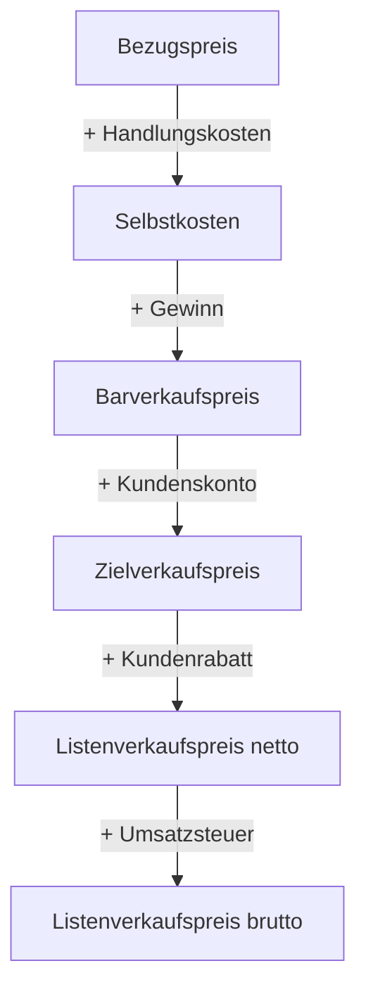

## Worum geht es?

Im Angebotsvergleich hast du ausgerechnet, was Ware im **Einkauf** kostet: den Bezugspreis. Jetzt
drehen wir die Seite um: Zu welchem Preis **verkaufen** wir, damit Kosten gedeckt sind und Gewinn
bleibt?

- Das ist die **Verkaufskalkulation** (Vorwärtskalkulation).
- Sie ist der erste Teil von „Kosten berechnen“ – rund **33 Punkte** in den bisherigen Prüfungen.
- Beispiel: Die ArchivTech GmbH verkauft einem Kunden eine **Speicher-Appliance** für sein Archiv.
  Bezugspreis: **4.000,00 €**.

## Wie funktioniert es?

### Das Schema auf einen Blick

| Stufe | Bedeutung |
| --- | --- |
| [Handlungskosten](glossar:handlungskostenzuschlag) | Gemeinkosten: Miete, Gehälter im Vertrieb, IT, Verwaltung |
| [Selbstkosten](glossar:selbstkosten) | alles, was die Ware uns kostet – ohne Gewinn |
| Barverkaufspreis | was wir haben wollen, wenn der Kunde sofort und mit Skonto zahlt |
| Zielverkaufspreis | Preis bei Zahlung im Zahlungsziel, vor Rabatt |
| [Listenverkaufspreis](glossar:listenverkaufspreis) | Preis auf dem Angebot, vor Rabatt |

### Rechenbeispiel: Speicher-Appliance

Vorgaben: Handlungskostenzuschlag 25 %, Gewinnzuschlag 12 %, Kundenskonto 2 %, Kundenrabatt 10 %,
Umsatzsteuer 19 %.

| Schritt | Rechnung | Betrag |
| --- | --- | ---: |
| Bezugspreis | gegeben | 4.000,00 € |
| + Handlungskosten 25 % | 4.000,00 × 0,25 | 1.000,00 € |
| = Selbstkosten | | 5.000,00 € |
| + Gewinn 12 % | 5.000,00 × 0,12 | 600,00 € |
| = Barverkaufspreis | | 5.600,00 € |
| + Kundenskonto 2 % | 5.600,00 ÷ 0,98 × 0,02 | 114,29 € |
| = Zielverkaufspreis | 5.600,00 ÷ 0,98 | 5.714,29 € |
| + Kundenrabatt 10 % | 5.714,29 ÷ 0,90 × 0,10 | 634,92 € |
| = Listenverkaufspreis netto | 5.714,29 ÷ 0,90 | 6.349,21 € |
| + Umsatzsteuer 19 % | 6.349,21 × 0,19 | 1.206,35 € |
| = Listenverkaufspreis brutto | | **7.555,56 €** |

Handlungskosten und Gewinn rechnest du **auf** den Betrag. Skonto und Rabatt rechnest du **aus dem
Hundert** heraus – warum, zeigt der nächste Schritt.

### Skonto und Rabatt: aus dem Hundert rechnen

Der Kunde zieht Rabatt und Skonto später **vom höheren Preis** ab. Also muss der höhere Preis so
gewählt sein, dass nach dem Abzug genau unser Wunschbetrag übrig bleibt.

- Nach 2 % Skonto bleiben **98 %** übrig. Diese 98 % sollen 5.600,00 € sein.
- 100 % = 5.600,00 ÷ 0,98 = **5.714,29 €**

Rechnest du stattdessen 5.600,00 × 1,02 = 5.712,00 €, fehlen dir nach dem Skonto 2,24 €:
5.712,00 − 2 % = 5.597,76 €.

### Die Probe: so zieht der Kunde ab

| Schritt | Rechnung | Betrag |
| --- | --- | ---: |
| Listenverkaufspreis netto | | 6.349,21 € |
| − Kundenrabatt 10 % | 6.349,21 × 0,10 | 634,92 € |
| = Zielverkaufspreis | | 5.714,29 € |
| − Kundenskonto 2 % | 5.714,29 × 0,02 | 114,29 € |
| = Barverkaufspreis | | **5.600,00 €** ✔ |

Genau unser Wunschbetrag: Kosten gedeckt, 600,00 € Gewinn.

Warum heißt der Abschlag in der Probe „vom Hundert“?

Der Kunde rechnet vom Preis, der auf dem Angebot steht – das ist sein Grundwert, also 100 %. Wir
kennen beim Kalkulieren aber nur den Betrag **nach** dem Abzug. Darum rechnen wir „im Hundert“
(98 % = 5.600,00 €) zurück auf 100 %. Beide Richtungen beschreiben denselben Abschlag.

> **Halten wir kurz fest:**
>
> 1. Handlungskosten und Gewinn: **auf** den Betrag (× 1,25, × 1,12).
> 2. Kundenskonto und Kundenrabatt: **aus dem Hundert** (÷ 0,98, ÷ 0,90).
> 3. Erst Skonto, dann Rabatt – umgekehrt zur Reihenfolge, in der der Kunde abzieht.

## Warum ist es so?

Jede Stufe beantwortet eine eigene Frage: Was kostet die Ware? Was kostet der Betrieb drumherum?
Was wollen wir verdienen? Was räumen wir dem Kunden ein?

Warum ein pauschaler Zuschlag für die Handlungskosten?

Miete, Buchhaltung oder Vertrieb lassen sich keinem einzelnen Gerät zuordnen. Man verteilt sie
deshalb mit einem Prozentsatz auf den Wareneinsatz: Handlungskosten des Jahres ÷ Wareneinsatz des
Jahres × 100. Liegen die Handlungskosten bei 250.000 € und der Wareneinsatz bei 1.000.000 €,
ergibt das 25 %.

Warum gibt man überhaupt Rabatt und Skonto, wenn man sie vorher aufschlägt?

Rabatt ist ein Verkaufsargument: „10 % Projektrabatt“ wirkt besser als ein niedrigerer Listenpreis.
Skonto bringt schnelleres Geld, das senkt Kreditkosten und Ausfallrisiko. Weil beides eingepreist ist,
kostet es den Verkäufer nichts extra.

## Praxisbezug im Betrieb

- **Angebote im Systemhaus:** Hardware wird so kalkuliert, Dienstleistung mit Stundensätzen –
  das folgt im nächsten Kapitel.
- **Tabellenkalkulation:** Das Schema als Vorlage spart Fehler. Rundung auf Cent erst beim Ergebnis
  jeder Stufe.
- **Netto denken:** Zwischen Unternehmen wird mit **Nettopreisen** verhandelt, die Umsatzsteuer
  kommt nur auf die Rechnung.

## Typische Prüfungsfalle

- **Skonto oder Rabatt aufgeschlagen statt herausgerechnet:** × 1,02 statt ÷ 0,98 ist falsch.
- **Reihenfolge vertauscht:** Erst Skonto (auf den Barverkaufspreis), dann Rabatt.
- **Gewinn auf den Bezugspreis:** Der Gewinnzuschlag bezieht sich auf die **Selbstkosten**.
- **Umsatzsteuer mitgerechnet, wo netto gefragt ist:** Lies, ob netto oder brutto verlangt ist.
- **Ohne Probe abgegeben:** Mit der Rückrechnung findest du jeden dieser Fehler in einer Minute.

## Nicht verwechseln

| Begriff | Bedeutung |
| --- | --- |
| Bezugspreis | Einkauf: was die Ware bis ins Lager kostet |
| Selbstkosten | Bezugspreis + Handlungskosten, noch ohne Gewinn |
| Barverkaufspreis | Selbstkosten + Gewinn |
| Zielverkaufspreis | Barverkaufspreis + Kundenskonto |
| Listenverkaufspreis | Zielverkaufspreis + Kundenrabatt, steht im Angebot |
| Liefererrabatt / -skonto | bekommen **wir** beim Einkauf |
| Kundenrabatt / -skonto | geben **wir** beim Verkauf |

## Merksatz

**Kosten und Gewinn obendrauf, Skonto und Rabatt aus dem Hundert – und die Probe von oben nach unten
muss genau beim Barverkaufspreis landen.**
