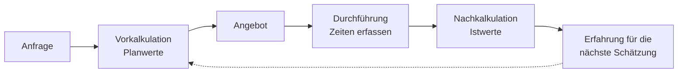

## Worum geht es?

Hardware hat einen Bezugspreis. Aber was kostet eine **Stunde Arbeit**? Und lag man mit der
Schätzung richtig, wenn das Projekt vorbei ist?

- Der **[Stundensatz](glossar:stundensatz)** verteilt alle Kosten eines Mitarbeiters auf die Stunden,
  die man dem Kunden berechnen kann.
- Die **[Vorkalkulation](glossar:vorkalkulation)** rechnet **vor** dem Auftrag mit geschätzten
  Werten – daraus entsteht das Angebot.
- Die **[Nachkalkulation](glossar:nachkalkulation)** rechnet **danach** mit den echten Werten.

Beispiel: Die ArchivTech GmbH installiert die Speicher-Appliance beim Kunden und migriert seine Daten.

## Wie funktioniert es?

### Das große Bild

Die Nachkalkulation ist kein Selbstzweck: Ihre Erkenntnisse machen die **nächste** Vorkalkulation
genauer.

### Schritt 1: Stundensatz berechnen

Ein Systemtechniker der ArchivTech kostet im Jahr (Annahmen):

| Posten | Betrag pro Jahr |
| --- | ---: |
| Personalkosten (Gehalt inkl. Arbeitgeberanteile) | 60.000 € |
| anteilige Gemeinkosten (Büro, Fahrzeug, Lizenzen, Verwaltung) | 30.000 € |
| **Kosten gesamt** | **90.000 €** |

Davon sind **1.500 Stunden** beim Kunden abrechenbar.

- Selbstkosten je Stunde = 90.000 € ÷ 1.500 h = **60,00 €/h**
- \+ Gewinnzuschlag 15 % = 60,00 × 1,15 = **69,00 €/h** (Verrechnungssatz netto)

Woher kommen die 1.500 Stunden?

| Rechnung | Stunden |
| --- | ---: |
| 52 Wochen × 40 h | 2.080 |
| − 30 Urlaubstage × 8 h | 240 |
| − 10 Feiertage × 8 h | 80 |
| − 10 Krankheitstage × 8 h | 80 |
| = Anwesenheit | 1.680 |
| − interne Zeit (Schulung, Meetings, Verwaltung) | 180 |
| = **abrechenbare Stunden** | **1.500** |

Würde man durch 2.080 teilen, käme nur 43,27 €/h heraus – und jede Stunde beim Kunden wäre ein
Verlust.

### Schritt 2: Vorkalkulation – das Angebot

Geschätzter Aufwand für den Kunden:

| Tätigkeit | geplante Stunden |
| --- | ---: |
| Installation und Konfiguration | 8 |
| Datenmigration | 24 |
| Dokumentation und Einweisung | 8 |
| **Summe** | **40** |

- Selbstkosten geplant: 40 h × 60,00 € = **2.400,00 €**
- Angebotspreis (Festpreis): 40 h × 69,00 € = **2.760,00 € netto**
- Geplanter Gewinn: 2.760,00 − 2.400,00 = **360,00 €**

### Schritt 3: Nachkalkulation – der Soll-Ist-Vergleich

Die Datenmenge beim Kunden war größer als angegeben. Die Zeiterfassung zeigt:

| Tätigkeit | Plan (h) | Ist (h) | Abweichung (h) |
| --- | ---: | ---: | ---: |
| Installation und Konfiguration | 8 | 8 | 0 |
| Datenmigration | 24 | 36 | +12 |
| Dokumentation und Einweisung | 8 | 8 | 0 |
| **Summe** | **40** | **52** | **+12** |

| Kennzahl | Plan | Ist |
| --- | ---: | ---: |
| Selbstkosten (h × 60,00 €) | 2.400,00 € | 3.120,00 € |
| Erlös (Festpreis) | 2.760,00 € | 2.760,00 € |
| **Ergebnis** | **+360,00 €** | **−360,00 €** |

Abweichung der Stunden: (52 − 40) ÷ 40 × 100 = **+30 %**. Aus 360 € Gewinn wurden 360 € Verlust.

### Festpreis oder nach Aufwand?

Wer das Risiko trägt, hängt vom Vertrag ab:

| Abrechnung | Kunde zahlt | Ergebnis für ArchivTech |
| --- | --- | ---: |
| Festpreis | 2.760,00 € | −360,00 € |
| nach Aufwand (52 h × 69,00 €) | 3.588,00 € | +468,00 € |

Beim Festpreis trägt der **Anbieter** das Risiko einer Fehlschätzung, nach Aufwand der **Kunde**.

> **Halten wir kurz fest:**
>
> 1. Stundensatz = Jahreskosten ÷ **abrechenbare** Stunden, plus Gewinnzuschlag.
> 2. Vorkalkulation: Planwerte, vor dem Auftrag, Grundlage des Angebots.
> 3. Nachkalkulation: Istwerte, nach dem Auftrag, Soll-Ist-Vergleich und Ursachen.

## Warum ist es so?

Ein Angebot muss **vor** der Arbeit feststehen, also kann es nur auf Schätzungen beruhen. Ob die
Schätzung gut war, zeigt erst die Wirklichkeit.

Warum ist die Nachkalkulation so wichtig, wenn das Geld schon verdient ist?

Weil die nächste Migration sonst genauso schiefgeht. Die Nachkalkulation zeigt **wo** die Schätzung
danebenlag (hier die Migration) und **warum** (Datenmenge nicht geprüft). Daraus folgt eine konkrete
Verbesserung: künftig die Datenmenge vor dem Angebot messen lassen.

Warum rechnet die Nachkalkulation mit Selbstkosten und nicht mit 69 €?

Die Nachkalkulation fragt: Was hat **uns** die Arbeit gekostet? Das sind 60 € je Stunde. Die 69 €
enthalten schon den Gewinn – damit würdest du den Gewinn als Kosten zählen.

## Praxisbezug im Betrieb

- **Zeiterfassung im Ticket:** Ohne gebuchte Stunden je Tätigkeit gibt es keine Nachkalkulation.
- **Interne Projekte:** Auch ohne Kunden lohnt der Vergleich – etwa für die Frage, ob Automatisieren
  billiger ist als manuelles Arbeiten.
- **Leistungsbestätigung:** Nach dem Projekt bestätigt der Kunde die erbrachte Leistung. Mehraufwand
  rechnest du nur ab, wenn der Vertrag das erlaubt.

## Typische Prüfungsfalle

- **Durch alle Arbeitsstunden geteilt:** Nur abrechenbare Stunden gehören in den Nenner.
- **Gewinn doppelt:** In der Nachkalkulation mit Selbstkosten rechnen, nicht mit dem Verrechnungssatz.
- **Prozent auf den falschen Wert:** Die Abweichung bezieht sich auf den **Planwert**:
  12 ÷ 40, nicht 12 ÷ 52.
- **Vor- und Nachkalkulation vertauscht:** „Vor“ = vor dem Auftrag, mit Schätzungen.
- **Nur die Zahl genannt:** Fragt die Aufgabe nach Ursachen oder Maßnahmen, gehören Sätze dazu.

## Nicht verwechseln

| Begriff | Bedeutung |
| --- | --- |
| Selbstkosten je Stunde | Jahreskosten ÷ abrechenbare Stunden |
| Verrechnungssatz | Stundensatz für den Kunden, inklusive Gewinn |
| Vorkalkulation | vor dem Auftrag, Planwerte, ergibt den Angebotspreis |
| Nachkalkulation | nach dem Auftrag, Istwerte, ergibt Abweichung und Ergebnis |
| Festpreis | fester Betrag, Risiko beim Anbieter |
| nach Aufwand | Stunden × Satz, Risiko beim Kunden |

## Merksatz

**Kosten durch abrechenbare Stunden, Gewinn obendrauf. Vorher schätzen, nachher messen – und die
Abweichung immer auf den Plan beziehen.**
