## Worum geht es?

„Das Internet geht nicht“ – mit ein paar Konsolenbefehlen findest du in Minuten heraus, **wo** das
Problem liegt. Dazu kommen Befehle für die tägliche Arbeit mit **Dateien**.

Der Katalog nennt Befehle wie `ipconfig`, `ip`, `ping`, `nslookup`. Hier stehen Windows und Linux
nebeneinander.

## Wie funktioniert es?

### Netzwerkbefehle

| Zweck | Windows | Linux |
| --- | --- | --- |
| IP-Konfiguration anzeigen | `ipconfig /all` | `ip addr` |
| Erreichbarkeit prüfen | `ping 10.0.2.20` | `ping -c 4 10.0.2.20` |
| Weg zum Ziel | `tracert repo.archivtech.example` | `traceroute repo.archivtech.example` |
| DNS abfragen | `nslookup repo.archivtech.example` | `dig repo.archivtech.example` oder `nslookup` |
| offene Verbindungen und Ports | `netstat -an` | `ss -tulpn` |
| ARP-Cache | `arp -a` | `ip neigh` |
| Routing-Tabelle | `route print` | `ip route` |
| DHCP-Adresse erneuern | `ipconfig /release` + `/renew` | `nmcli con up <Verbindung>` |
| DNS-Cache leeren | `ipconfig /flushdns` | je nach System, z. B. `resolvectl flush-caches` |

### Fehlersuche Schritt für Schritt

```mermaid
flowchart TD
  A["ipconfig / ip addr:<br/>IP, Maske, Gateway, DNS da?"] -->|ja| B["ping Gateway"]
  A -->|"169.254.x.x / keine IP"| A1["Kabel, WLAN, DHCP prüfen"]
  B -->|ok| C["ping 8.8.8.8 oder<br/>externe IP"]
  B -->|Fehler| B1["lokales Netz, Switch, VLAN"]
  C -->|ok| D["nslookup Name"]
  C -->|Fehler| C1["Router, Firewall, Provider"]
  D -->|ok| E["Dienst selbst prüfen<br/>(Port, Anwendung)"]
  D -->|Fehler| D1["DNS-Server falsch oder gestört"]
```



Analogie: Erst schauen, ob das Auto Benzin hat (IP), dann ob es aus der Garage kommt (Gateway), dann
ob die Straße frei ist (Internet), dann ob du die Adresse kennst (DNS).

### Rechenbeispiel: eine Ausgabe lesen

```text
C:\> ipconfig
   IPv4-Adresse  . . . . . . . . : 169.254.37.12
   Subnetzmaske  . . . . . . . . : 255.255.0.0
   Standardgateway . . . . . . . :
```

Deutung: **169.254.x.x** ist eine selbst vergebene Link-Local-Adresse, das Gateway fehlt. Der Rechner
hat **keine Antwort vom DHCP-Server** bekommen – Kabel, WLAN, VLAN oder DHCP-Server prüfen.

### Dateibefehle

| Zweck | Windows (cmd) | Linux |
| --- | --- | --- |
| Inhalt anzeigen | `dir` | `ls -l` |
| Ordner wechseln | `cd` | `cd` |
| Ordner anlegen | `mkdir` | `mkdir` |
| kopieren | `copy`, `robocopy` | `cp`, `rsync` |
| verschieben, umbenennen | `move`, `ren` | `mv` |
| löschen | `del`, `rmdir` | `rm`, `rm -r` |
| Datei anzeigen | `type` | `cat`, `less` |
| suchen | `findstr` | `grep` |
| aktueller Ordner | `cd` (ohne Ziel) | `pwd` |

> **Halten wir kurz fest:**
>
> 1. Reihenfolge: eigene IP → Gateway → externe IP → DNS → Dienst.
> 2. 169.254.x.x = kein DHCP; Ping per IP ok, per Name nicht = DNS-Problem.
> 3. Windows `ipconfig`, `tracert`; Linux `ip addr`, `traceroute`, `ss`.

## Warum ist es so?

Die Reihenfolge folgt dem Schichtenmodell von unten nach oben. Jeder erfolgreiche Schritt schließt eine
ganze Gruppe von Ursachen aus – das spart Raten.

<details>
<summary>Warum kann ein Ping scheitern, obwohl alles funktioniert?</summary>

Viele Firewalls blockieren ICMP, das Protokoll hinter `ping`. Der Server ist dann erreichbar, antwortet
aber nicht auf Ping. Prüfe in diesem Fall direkt den Dienst, etwa mit `curl` oder einem Test auf den
Port.

</details>

## Praxisbezug im Betrieb

- **Ticket-Kommentar:** Ausgaben von `ip addr`, `ping` und `dig` anhängen – die nächste Ebene im
  Support sieht sofort, was geprüft wurde.
- **`ss -tulpn`** zeigt, ob ein Dienst wirklich auf dem erwarteten Port lauscht.
- **`rsync`** kopiert große Archive effizient und kann abgebrochene Übertragungen fortsetzen.

## Typische Prüfungsfalle

- **`ipconfig` unter Linux:** Dort heißt es `ip addr` (früher `ifconfig`).
- **Ping per Name scheitert, per IP geht:** Das ist ein **DNS**-Problem, kein Netzwerkausfall.
- **169.254-Adresse als richtig angesehen:** Sie zeigt, dass DHCP fehlt.
- **`tracert` und `traceroute` vertauscht:** Windows `tracert`, Linux `traceroute`.

## Nicht verwechseln

| Befehl | zeigt / tut |
| --- | --- |
| `ping` | Erreichbarkeit und Antwortzeit |
| `tracert` / `traceroute` | alle Router auf dem Weg |
| `nslookup` / `dig` | DNS-Auflösung |
| `netstat` / `ss` | Verbindungen und lauschende Ports |
| `arp -a` / `ip neigh` | IP-zu-MAC-Zuordnungen im lokalen Netz |

## Merksatz

**Von unten nach oben: eigene Adresse, Gateway, Internet, DNS, Dienst. Und 169.254 heißt immer: Hier
hat kein DHCP geantwortet.**
