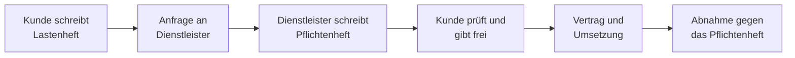

## Worum geht es?

Bevor ein Dienstleister etwas baut, müssen beide Seiten dasselbe meinen. Dafür gibt es zwei
Dokumente:

| | **[Lastenheft](glossar:lastenheft)** | **Pflichtenheft** |
| --- | --- | --- |
| Wer schreibt es? | **Auftraggeber** (Kunde) | **Auftragnehmer** (Dienstleister) |
| Frage | **Was** und **wofür**? | **Wie** und **womit**? |
| Inhalt | Anforderungen aus Kundensicht | Umsetzung, die diese Anforderungen erfüllt |
| Zeitpunkt | vor der Anfrage / Ausschreibung | nach dem Lastenheft, vor der Umsetzung |

Eselsbrücke: **L**astenheft = **L**eistungswunsch des Kunden, **P**flichtenheft = **P**lan des
Dienstleisters.

## Wie funktioniert es?

### Der Weg vom Wunsch zum Vertrag

### Beispiel: Archivlösung für einen Kunden

| Lastenheft (Kunde) | Pflichtenheft (ArchivTech) |
| --- | --- |
| „Wir müssen 40 TB Dokumente 10 Jahre revisionssicher aufbewahren.“ | Speicher-Appliance mit 96 TB, unveränderbare Ablage (WORM) |
| „Mitarbeitende sollen Dokumente in Sekunden finden.“ | Volltextsuche, Abrufzeit unter 2 Sekunden bei 50 gleichzeitigen Nutzern |
| „Die Daten dürfen bei Brand nicht verloren gehen.“ | tägliche Replikation in das zweite Rechenzentrum |

### Typischer Inhalt

| Lastenheft | Pflichtenheft |
| --- | --- |
| Ausgangslage und Ziele | Zusammenfassung des Lastenhefts |
| funktionale Anforderungen | technische Lösung je Anforderung |
| nicht-funktionale Anforderungen (Leistung, Sicherheit) | Architektur, Hardware, Software |
| Rahmenbedingungen (Budget, Termine, Normen) | Projektplan, Tests, Abnahmekriterien |

> **Halten wir kurz fest:**
>
> 1. Lastenheft: Kunde, was und wofür.
> 2. Pflichtenheft: Dienstleister, wie und womit.
> 3. Abgenommen wird gegen das freigegebene Pflichtenheft.

## Warum ist es so?

Kunde und Dienstleister sprechen verschiedene Sprachen. Das Lastenheft hält fest, was der Kunde
**braucht**. Das Pflichtenheft übersetzt es in **Technik** – und der Kunde bestätigt, dass die
Übersetzung stimmt.

Warum ist das Pflichtenheft bei der Abnahme so wichtig?

Es ist der Maßstab, gegen den geprüft wird. Steht dort „Abrufzeit unter 2 Sekunden“, lässt sich das
messen. Stand nur im Lastenheft „schnell“, gibt es Streit. Deshalb sollten Anforderungen im
Pflichtenheft prüfbar formuliert sein – wie SMART-Ziele.

## Praxisbezug im Betrieb

- **Ausschreibungen** großer Kunden enthalten oft ein Lastenheft.
- **Interne Projekte** profitieren ebenfalls: Der Fachbereich beschreibt den Bedarf, die IT die Lösung.
- **Agile Projekte** ersetzen das große Pflichtenheft oft durch ein Product Backlog – der Gedanke
  dahinter bleibt.

## Typische Prüfungsfalle

- **Urheber vertauscht:** Lastenheft = Auftrag**geber**, Pflichtenheft = Auftrag**nehmer**.
- **Technik im Lastenheft:** Der Kunde beschreibt das Ziel, nicht die Lösung.
- **Pflichtenheft ohne Bezug:** Jede Anforderung des Lastenhefts braucht eine Antwort.
- **Nicht prüfbare Formulierungen:** „schnell“, „benutzerfreundlich“ ohne Messgröße.

## Nicht verwechseln

| Begriff | Bedeutung |
| --- | --- |
| Lastenheft | Anforderungen des Auftraggebers (was, wofür) |
| Pflichtenheft | Umsetzungskonzept des Auftragnehmers (wie, womit) |
| funktionale Anforderung | was das System tun soll |
| nicht-funktionale Anforderung | wie gut es das tun soll (Leistung, Sicherheit) |
| Abnahme | Prüfung des Ergebnisses gegen das Vereinbarte |

## Merksatz

**Lastenheft: Der Kunde sagt, was er braucht. Pflichtenheft: Wir sagen, wie wir es liefern – und
daran wird am Ende gemessen.**
