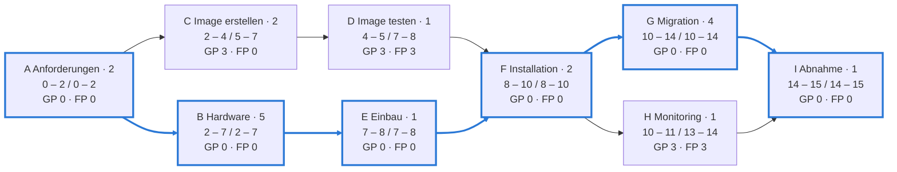

## Worum geht es?

Der **[Netzplan](glossar:netzplan)** beantwortet zwei Fragen, die jede Projektleitung stellt:

- **Wie lange dauert das Projekt mindestens?**
- **Welche Vorgänge dürfen sich nicht verzögern?** Das ist der [kritische Pfad](glossar:kritischer-pfad).

Der Netzplan ist ein Dauerbrenner der AP1 – rund **35 Punkte** in den bisherigen Prüfungen.
Wir rechnen mit der Vorgangsliste aus dem letzten Kapitel (Archivserver, Vorgänge A bis I).

## Wie funktioniert es?

### Der Vorgangsknoten

Jeder Vorgang ist ein Kasten mit sechs Werten. Ein verbreiteter Aufbau:

| FAZ | Dauer | FEZ |
| :---: | :---: | :---: |
| **Nr.** | **Vorgang** | |
| **SAZ** | **GP · FP** | **SEZ** |

| Abkürzung | Bedeutung |
| --- | --- |
| FAZ / FEZ | frühester Anfangs- / Endzeitpunkt |
| SAZ / SEZ | spätester Anfangs- / Endzeitpunkt |
| GP | [Gesamtpuffer](glossar:gesamtpuffer) |
| FP | [freier Puffer](glossar:freier-puffer) |

Die Anordnung im Kasten gibt die Prüfung in einer **Legende** vor – immer zuerst ansehen.

### Schritt 1: Vorwärtsrechnung

Von links nach rechts – wann kann **frühestens** angefangen und aufgehört werden?

1. Der erste Vorgang beginnt bei **FAZ = 0**.
2. **FEZ = FAZ + Dauer**
3. **FAZ = größter FEZ aller Vorgänger** (erst wenn alle fertig sind)

| Vorgang | Dauer | FAZ | Rechnung | FEZ |
| --- | ---: | ---: | --- | ---: |
| A | 2 | 0 | 0 + 2 | 2 |
| B | 5 | 2 | 2 + 5 | 7 |
| C | 2 | 2 | 2 + 2 | 4 |
| D | 1 | 4 | 4 + 1 | 5 |
| E | 1 | 7 | 7 + 1 | 8 |
| F | 2 | max(5; 8) = 8 | 8 + 2 | 10 |
| G | 4 | 10 | 10 + 4 | 14 |
| H | 1 | 10 | 10 + 1 | 11 |
| I | 1 | max(14; 11) = 14 | 14 + 1 | 15 |

Das Projekt dauert mindestens **15 Tage**.

### Schritt 2: Rückwärtsrechnung

Von rechts nach links – wann muss **spätestens** angefangen werden, damit Tag 15 hält?

1. Beim letzten Vorgang gilt **SEZ = FEZ** (hier 15).
2. **SAZ = SEZ − Dauer**
3. **SEZ = kleinster SAZ aller Nachfolger**

| Vorgang | Dauer | SEZ | Rechnung | SAZ |
| --- | ---: | ---: | --- | ---: |
| I | 1 | 15 | 15 − 1 | 14 |
| H | 1 | 14 | 14 − 1 | 13 |
| G | 4 | 14 | 14 − 4 | 10 |
| F | 2 | min(10; 13) = 10 | 10 − 2 | 8 |
| E | 1 | 8 | 8 − 1 | 7 |
| D | 1 | 8 | 8 − 1 | 7 |
| C | 2 | 7 | 7 − 2 | 5 |
| B | 5 | 7 | 7 − 5 | 2 |
| A | 2 | min(2; 5) = 2 | 2 − 2 | 0 |

### Schritt 3: Puffer berechnen

- **Gesamtpuffer GP = SAZ − FAZ** (oder SEZ − FEZ): So weit darf sich der Vorgang verschieben,
  ohne das **Projektende** zu gefährden.
- **Freier Puffer FP = kleinster FAZ der Nachfolger − eigener FEZ**: So weit darf er sich
  verschieben, ohne einen **Nachfolger** zu verschieben.

| Vorgang | GP = SAZ − FAZ | FP = FAZ Nachfolger − FEZ |
| --- | --- | --- |
| A | 0 − 0 = **0** | min(2; 2) − 2 = **0** |
| B | 2 − 2 = **0** | 7 − 7 = **0** |
| C | 5 − 2 = **3** | 4 − 4 = **0** |
| D | 7 − 4 = **3** | 8 − 5 = **3** |
| E | 7 − 7 = **0** | 8 − 8 = **0** |
| F | 8 − 8 = **0** | min(10; 10) − 10 = **0** |
| G | 10 − 10 = **0** | 14 − 14 = **0** |
| H | 13 − 10 = **3** | 14 − 11 = **3** |
| I | 14 − 14 = **0** | Ende – **0** |

Spannend ist C: 3 Tage Gesamtpuffer, aber **kein** freier Puffer. Verschiebt sich C, verschiebt sich
D mit – das Projektende aber nicht.

### Schritt 4: Der kritische Pfad

Alle Vorgänge mit **GP = 0** bilden den kritischen Pfad: **A → B → E → F → G → I**.

Im Kasten: früheste Lage (FAZ – FEZ) / späteste Lage (SAZ – SEZ). Probe: 2 + 5 + 1 + 2 + 4 + 1 =
**15** – die Dauer des kritischen Pfads ist die Projektdauer.

> **Halten wir kurz fest:**
>
> 1. Vorwärts: FEZ = FAZ + Dauer, bei mehreren Vorgängern das **Maximum**.
> 2. Rückwärts: SAZ = SEZ − Dauer, bei mehreren Nachfolgern das **Minimum**.
> 3. GP = SAZ − FAZ, FP = kleinster FAZ der Nachfolger − FEZ. Kritisch ist, was GP = 0 hat.

## Warum ist es so?

Ein Vorgang kann erst starten, wenn **alle** Vorgänger fertig sind. Deshalb zählt in der
Vorwärtsrechnung der späteste von ihnen – das Maximum.

Warum in der Rückwärtsrechnung das Minimum?

Ein Vorgang muss so früh fertig sein, dass **jeder** Nachfolger noch rechtzeitig starten kann.
Der Nachfolger mit dem frühesten spätesten Start (dem kleinsten SAZ) gibt die Grenze vor. F muss
bis Tag 10 fertig sein, weil G sonst nicht rechtzeitig beginnt – auch wenn H bis Tag 13 Zeit hätte.

Warum ist der freie Puffer nie größer als der Gesamtpuffer?

Der freie Puffer schützt nur den direkten Nachfolger in **frühester** Lage. Der Gesamtpuffer nutzt
auch die Luft dahinter. Im Beispiel teilen sich C und D drei Tage Puffer: Verbraucht C sie, bleibt
für D nichts mehr übrig. Deshalb gilt immer: FP ≤ GP.

Warum beginnt die Rechnung bei 0 und nicht bei 1?

Die Werte sind **Zeitpunkte**: FAZ 0 heißt „zu Beginn“, FEZ 2 heißt „nach 2 Tagen“. Manche Bücher
zählen **Tage** und rechnen FEZ = FAZ + Dauer − 1. Beide Wege führen zur selben Projektdauer, nur
die Zahlen im Kasten unterscheiden sich. Halte dich an die Vorgabe der Aufgabe und mische die Wege nie.

## Praxisbezug im Betrieb

- **Wo du drängelst:** Verzögert sich die Hardware (B, kritisch), verschiebt sich das ganze Projekt.
  Nachfragen beim Lieferanten lohnt sich also hier, nicht beim Monitoring (H, 3 Tage Puffer).
- **Ressourcen verschieben:** Wer an H arbeitet, kann bei Engpässen kurz bei G helfen.
- **Werkzeuge:** Projektsoftware rechnet den Netzplan automatisch. Die Prüfung will sehen, dass du
  verstehst, was sie rechnet.

## Typische Prüfungsfalle

- **Maximum und Minimum vertauscht:** vorwärts Maximum, rückwärts Minimum.
- **Freier Puffer mit SAZ gerechnet:** FP nutzt den **frühesten** Anfang des Nachfolgers (FAZ).
- **Nur einen Nachfolger angesehen:** Bei mehreren Nachfolgern den kleinsten FAZ bzw. SAZ nehmen.
- **Zählweisen gemischt:** FEZ = FAZ + Dauer und FEZ = FAZ + Dauer − 1 nie im selben Netzplan.
- **Kritischer Pfad ohne Probe:** Summe der Dauern auf dem Pfad = Projektdauer. Passt das nicht,
  steckt ein Rechenfehler drin.

## Nicht verwechseln

| Begriff | Bedeutung |
| --- | --- |
| Gesamtpuffer (GP) | Verschiebung ohne Folgen für das **Projektende** |
| Freier Puffer (FP) | Verschiebung ohne Folgen für den **nächsten Vorgang** |
| Kritischer Pfad | Kette der Vorgänge mit GP = 0, bestimmt die Projektdauer |
| Vorwärtsrechnung | FAZ und FEZ, mit Maximum |
| Rückwärtsrechnung | SAZ und SEZ, mit Minimum |

## Merksatz

**Vorwärts das Maximum, rückwärts das Minimum. Gesamtpuffer schützt das Projektende, freier Puffer
den Nachfolger – und wo der Gesamtpuffer null ist, liegt der kritische Pfad.**
