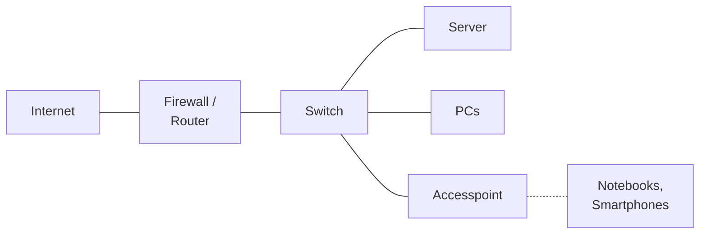

## Worum geht es?

Ein Netzwerk besteht aus Geräten mit klar getrennten Aufgaben. Wer weiß, welches Gerät auf welcher
Schicht arbeitet, plant richtig und findet Fehler schneller.

| Gerät | Aufgabe in einem Satz |
| --- | --- |
| **Switch** | verbindet Geräte im **selben** Netz |
| **Router** | verbindet **verschiedene** Netze |
| **Accesspoint** | bringt WLAN-Geräte ins kabelgebundene Netz |
| **Gateway** | Übergang in ein anderes Netz, oft mit Protokollumsetzung |

## Wie funktioniert es?

### Das große Bild: ein typisches Firmennetz

### Die Geräte im Detail

| Gerät | OSI-Schicht | arbeitet mit | Besonderheit |
| --- | ---: | --- | --- |
| Hub (veraltet) | 1 | Signalen | schickt alles an alle Ports |
| Repeater | 1 | Signalen | verstärkt Signale über längere Strecken |
| **Switch** | 2 | MAC-Adressen | lernt, welche MAC an welchem Port hängt |
| **Accesspoint** | 2 | MAC-Adressen | Brücke zwischen WLAN und LAN |
| **Router** | 3 | IP-Adressen | wählt den Weg anhand der Routing-Tabelle |
| Layer-3-Switch | 2 und 3 | MAC und IP | Switch mit Routing zwischen VLANs |
| Firewall | 3–7 | IP, Ports, Inhalte | filtert Verkehr nach Regeln |
| **Gateway** | bis 7 | je nach Aufgabe | z. B. Standardgateway, VoIP- oder Mail-Gateway |

**Standardgateway** heißt im Alltag einfach: der Router, an den ein Rechner alles schickt, was nicht im
eigenen Netz liegt.

### Managed oder unmanaged?

| | unmanaged Switch | managed Switch |
| --- | --- | --- |
| Konfiguration | keine, einstecken und los | Weboberfläche, SSH |
| VLANs | nein | ja |
| Überwachung | nein | SNMP, Port-Statistiken |
| Einsatz | Homeoffice, kleiner Tisch | Firmennetz, Rechenzentrum |

### Power over Ethernet (PoE)

Accesspoints, IP-Kameras und Telefone bekommen Strom **über das Netzwerkkabel**:

| Standard | Leistung am Switch-Port (je Port) |
| --- | ---: |
| 802.3af (PoE) | 15,4 W |
| 802.3at (PoE+) | 30 W |
| 802.3bt (PoE++) | bis 90 W |

Beim Kauf prüfen: Reicht das **Gesamtbudget** des Switches für alle Geräte?

> **Halten wir kurz fest:**
>
> 1. Switch = Schicht 2 (MAC), Router = Schicht 3 (IP), Accesspoint = WLAN ins LAN.
> 2. Standardgateway = Router für alles außerhalb des eigenen Netzes.
> 3. Managed Switches können VLANs und Überwachung; PoE versorgt Geräte über das Kabel.

## Warum ist es so?

Ein Switch muss nur im eigenen Netz zustellen – dafür reicht die MAC-Adresse. Erst zwischen Netzen
braucht es IP-Adressen und Wegentscheidungen. So bleibt jedes Gerät einfach und schnell.

Was macht der „WLAN-Router“ zu Hause dann alles?

Er ist ein Kombigerät: Router (Internet ↔ Heimnetz), Switch (LAN-Buchsen), Accesspoint (WLAN),
DHCP-Server, Firewall und oft Modem. In Firmen sind diese Aufgaben auf eigene Geräte verteilt –
leistungsfähiger und einzeln wartbar.

## Praxisbezug im Betrieb

- **VLANs** trennen Server, Clients und Gäste auf denselben Switches; geroutet wird am Layer-3-Switch
  oder an der Firewall.
- **Port-Dokumentation:** Welche Dose hängt an welchem Switch-Port – spart bei Störungen Zeit.
- **PoE-Budget** bei Accesspoints und Kameras von Anfang an einplanen.

## Typische Prüfungsfalle

- **Switch auf Schicht 3 gesetzt:** Ein normaler Switch arbeitet auf Schicht 2.
- **Accesspoint = Router:** Ein reiner Accesspoint routet nicht.
- **Hub empfohlen:** veraltet, alle Geräte teilen sich die Bandbreite.
- **Gateway nur als Router:** Ein Gateway kann auch Protokolle übersetzen.

## Nicht verwechseln

| Begriff | Bedeutung |
| --- | --- |
| Switch | verbindet Geräte im selben Netz über MAC-Adressen |
| Router | verbindet Netze über IP-Adressen |
| Accesspoint | Funkzugang ins kabelgebundene Netz |
| Gateway | Übergang zwischen Netzen oder Protokollen |
| Repeater | verstärkt Signale |
| PoE | Stromversorgung über das Netzwerkkabel |

## Merksatz

**Switch im Netz, Router zwischen Netzen, Accesspoint in die Luft – und das Gateway ist die Tür nach
draußen.**
