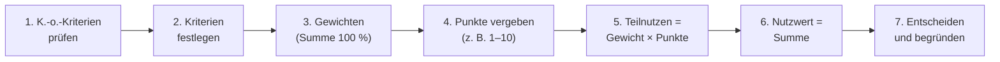

## Worum geht es?

Der günstigste Preis ist nicht automatisch das beste Angebot. Was ist mit Garantie, Lieferzeit,
Akkulaufzeit, Gewicht? Die [Nutzwertanalyse](glossar:nutzwertanalyse) macht solche
unterschiedlichen Kriterien **vergleichbar**: Jedes Kriterium bekommt ein Gewicht, jedes Angebot
Punkte je Kriterium – am Ende steht eine einzige Zahl, der **Nutzwert**.

Sie ist das **punktstärkste Einzelthema** der bisherigen AP1-Prüfungen. Es lohnt sich, sie im Schlaf
zu können.

Wir machen weiter mit den drei Notebook-Angeboten aus der letzten Lektion (A, B, C) für den
Vertrieb der ArchivTech GmbH.

## Wie funktioniert es?

### Der Ablauf

1. **[K.-o.-Kriterien](glossar:ko-kriterium) prüfen:** Was **muss** erfüllt sein? Fällt ein Angebot
   durch, scheidet es aus – egal, wie gut es sonst ist. Beispiel: „USB-C mit Bildausgabe“, weil
   die Dockingstationen sonst nicht funktionieren.
2. **Bewertungskriterien festlegen:** messbar und möglichst unabhängig voneinander (nicht „Preis“
   und „Kosten“ doppelt).
3. **Gewichten:** Wie wichtig ist jedes Kriterium? Die Gewichte ergeben zusammen **100 %**.
4. **Punkte vergeben:** Wie gut erfüllt jedes Angebot das Kriterium? Feste Skala, z. B. 1 (schlecht)
   bis 10 (sehr gut). **Mehr Punkte = besser**, auch beim Preis (günstig = viele Punkte).
5. **Teilnutzen berechnen:** Gewicht × Punkte.
6. **Nutzwert berechnen:** Summe aller Teilnutzen eines Angebots.
7. **Entscheiden:** höchster Nutzwert gewinnt – mit kurzer Begründung.

### Rechenbeispiel: drei Notebooks

Schritt 1: Alle drei Angebote haben USB-C mit DisplayPort Alt Mode – keins fällt raus.

Schritte 2–4:

| Kriterium | Gewicht | A Punkte | B Punkte | C Punkte |
| --- | ---: | ---: | ---: | ---: |
| Preis (Bezugspreis) | 30 % | 7 | 6 | 9 |
| Garantie und Service | 20 % | 9 | 5 | 4 |
| Display | 15 % | 8 | 6 | 7 |
| Akkulaufzeit | 15 % | 6 | 9 | 7 |
| Gewicht | 10 % | 7 | 9 | 6 |
| Lieferzeit | 10 % | 8 | 10 | 3 |
| **Summe Gewichte** | **100 %** | | | |

Schritte 5–6 (Teilnutzen = Gewicht × Punkte, Gewicht als Dezimalzahl):

| Kriterium | A | B | C |
| --- | ---: | ---: | ---: |
| Preis | 0,30 × 7 = 2,10 | 0,30 × 6 = 1,80 | 0,30 × 9 = 2,70 |
| Garantie und Service | 0,20 × 9 = 1,80 | 0,20 × 5 = 1,00 | 0,20 × 4 = 0,80 |
| Display | 0,15 × 8 = 1,20 | 0,15 × 6 = 0,90 | 0,15 × 7 = 1,05 |
| Akkulaufzeit | 0,15 × 6 = 0,90 | 0,15 × 9 = 1,35 | 0,15 × 7 = 1,05 |
| Gewicht | 0,10 × 7 = 0,70 | 0,10 × 9 = 0,90 | 0,10 × 6 = 0,60 |
| Lieferzeit | 0,10 × 8 = 0,80 | 0,10 × 10 = 1,00 | 0,10 × 3 = 0,30 |
| **Nutzwert** | **7,50** | **6,95** | **6,50** |
| **Rang** | **1** | 2 | 3 |

Schritt 7: **Angebot A** hat den höchsten Nutzwert. Begründung: Es ist nicht das billigste
(das ist C), gleicht das aber durch deutlich besseren Service und kurze Lieferzeit aus – beides
war dem Vertrieb wichtig (zusammen 30 % Gewicht). C ist günstig, fällt aber bei Service und
Lieferzeit stark ab.

Rechnest du mit Gewichten in Prozentpunkten (30 statt 0,30), kommen 750, 695 und 650 heraus –
die Rangfolge ist dieselbe.

**Halten wir kurz fest:**

1. Erst K.-o.-Kriterien, dann bewerten.
2. Gewichte summieren sich auf 100 %.
3. Teilnutzen = Gewicht × Punkte, Nutzwert = Summe der Teilnutzen.
4. Mehr Punkte heißt immer „besser“ – auch beim Preis.

### Preis in Punkte umrechnen

Statt Punkte für den Preis zu schätzen, kannst du sie berechnen, zum Beispiel:
**Punkte = 10 × günstigster Preis ÷ eigener Preis**

- C: 10 × 7.758,60 ÷ 7.758,60 = **10,0**
- A: 10 × 7.758,60 ÷ 7.978,18 = **9,7**
- B: 10 × 7.758,60 ÷ 8.065,50 = **9,6**

Hier zeigt sich: Die Preise liegen nur rund 4 % auseinander. Gibt man C beim Preis 9 und A nur 7
Punkte (wie oben), verstärkt man den Preisunterschied künstlich. Welche Methode gilt, gibt meist
die Aufgabe vor.

## Warum ist es so?

Warum dieser Aufwand, statt einfach „aus dem Bauch“ zu entscheiden? Weil eine Entscheidung im
Unternehmen **nachvollziehbar** sein muss: Der Vorgesetzte, der Einkauf oder später ein Prüfer soll
sehen können, **warum** Angebot A gewonnen hat.

Warum braucht es Gewichte?

Nicht jedes Kriterium ist gleich wichtig. Ohne Gewichte würde ein Kriterium wie „Gewicht des
Notebooks“ genauso viel zählen wie „Service bei Ausfall“ – für ein Vertriebsteam, das beim Kunden
präsentiert, wäre das falsch. Die Gewichte übersetzen die Prioritäten des Unternehmens in Zahlen.

Und warum muss die Summe 100 % ergeben?

Damit die Nutzwerte auf derselben Skala liegen wie die Punkte (hier 0 bis 10) und man sie vergleichen
kann. Summieren die Gewichte zu 110 %, wird jedes Angebot rechnerisch besser, als es ist – und wer
ein Kriterium nachträglich hinzufügt, verschiebt unbemerkt alle anderen.

Warum ist die Nutzwertanalyse trotzdem nicht „objektiv“?

Gewichte und Punkte legen Menschen fest. Wer ein bestimmtes Ergebnis will, kann die Gewichte so
wählen, dass es herauskommt. Die Methode macht die Entscheidung also nicht objektiv, aber
**transparent**: Jeder sieht die Annahmen und kann sie diskutieren. Deshalb prüft man am Ende, ob
das Ergebnis stabil bleibt, wenn man ein Gewicht etwas ändert (Sensitivitätsanalyse).

## Praxisbezug im Betrieb

- Typische Einsätze: Auswahl von Hardware, Software, Cloud-Anbietern, Dienstleistern, aber auch
  von Tools (z. B. welches Ticketsystem, welche CI-Plattform).
- **Gewichte vorher festlegen**, am besten mit den späteren Nutzern – nicht erst, wenn die Angebote
  da sind. Sonst entsteht schnell der Verdacht, das Ergebnis sei zurechtgerückt.
- Bei der Auswahl einer Archivierungs- oder Speicherlösung wären typische Kriterien:
  Kosten pro TB, Zugriffszeit, Langzeitlesbarkeit der Formate, Zertifizierungen, Support.

## Typische Prüfungsfalle

- **Gewichte ergeben nicht 100 %** – immer nachrechnen, bevor du weiterrechnest.
- **Skala beim Preis falsch herum:** Der teuerste Anbieter bekommt die meisten Punkte. Falsch!
- **Nur Punkte addieren, nicht gewichten.**
- **K.-o.-Kriterium übersehen:** Ein Angebot, das ein Muss-Kriterium nicht erfüllt, darf nicht
  gewinnen, auch mit dem höchsten Nutzwert.
- **Keine Begründung:** Bei „Empfehlen Sie …“ oder „Begründen Sie …“ gibt es Punkte für den Satz
  danach, nicht nur für die Tabelle.

## Nicht verwechseln

| Begriff | Bedeutung |
| --- | --- |
| Gewicht | Wichtigkeit des Kriteriums (alle zusammen 100 %) |
| Punkte / Erfüllungsgrad | wie gut ein Angebot das Kriterium erfüllt |
| Teilnutzen | Gewicht × Punkte für ein Kriterium |
| Nutzwert | Summe der Teilnutzen eines Angebots |
| K.-o.-Kriterium | Muss-Kriterium; nicht erfüllt = ausgeschieden |
| quantitativer Vergleich | rechnet nur mit Preisen (Bezugspreis) |
| qualitativer Vergleich | bewertet auch nicht-monetäre Kriterien (Nutzwertanalyse) |

## Merksatz

**Erst K.-o., dann gewichten (Summe 100 %), Punkte mal Gewicht, aufsummieren – der höchste
Nutzwert gewinnt, und die Begründung bringt die letzten Punkte.**
