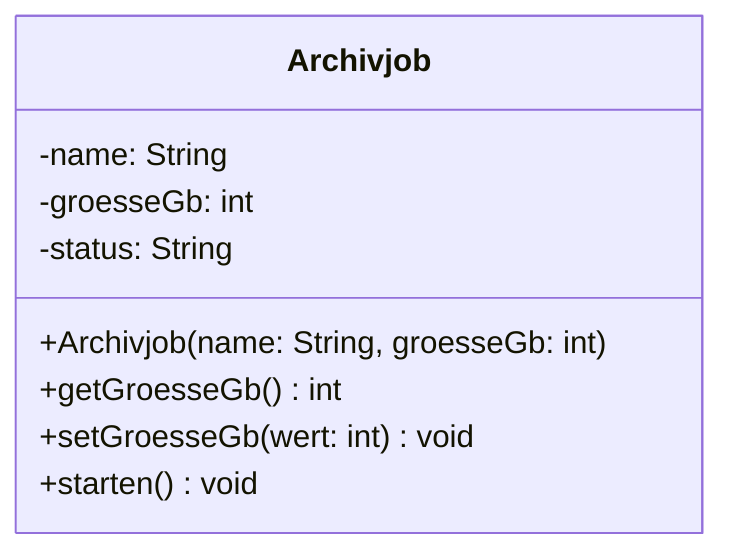

## Worum geht es?

Nicht jeder soll alles an einem Objekt ändern dürfen. Sonst setzt irgendein Codeteil die Größe eines
Archivjobs auf −50 GB. **Sichtbarkeit** regelt den Zugriff, **[Kapselung](glossar:kapselung)** ist
das Prinzip dahinter.

| UML | Schlüsselwort | Zugriff von … |
| :---: | --- | --- |
| `+` | public | überall |
| `-` | private | nur innerhalb der eigenen Klasse |
| `#` | protected | eigener Klasse und abgeleiteten Klassen |
| `~` | package | Klassen im selben Paket (Java) |

Für die AP1 zählen vor allem **public** und **private**.

## Wie funktioniert es?

### Das Prinzip: Attribute privat, Methoden öffentlich



- **Attribute** sind `-` privat: Niemand von außen ändert sie direkt.
- **Methoden** sind `+` öffentlich: Sie sind die erlaubten Wege hinein und heraus.
- Analogie: ein **Fahrkartenautomat**. Du bedienst Knöpfe (Methoden), an die Geldkassette
  (Attribute) kommst du nicht.

### Getter und Setter

Zum Lesen und Ändern privater Attribute gibt es eigene Methoden:

- **Getter** liest: `getGroesseGb()` gibt den Wert zurück.
- **Setter** ändert: `setGroesseGb(wert)` – und **prüft** vorher.

```python
class Archivjob:
    def __init__(self, name, groesse_gb):
        self._name = name
        self.set_groesse_gb(groesse_gb)

    def get_groesse_gb(self):
        return self._groesse_gb

    def set_groesse_gb(self, wert):
        if wert < 0:
            raise ValueError("Größe darf nicht negativ sein")
        self._groesse_gb = wert
```

`Archivjob("Test", -50)` bricht jetzt mit einer Fehlermeldung ab, statt still falsche Daten zu
speichern.

### Sichtbarkeit in Python und Java

| | Java | Python |
| --- | --- | --- |
| öffentlich | `public int x;` | `self.x` |
| privat | `private int x;` – Compiler verbietet Zugriff | `self._x` – nur **Konvention** |
| stark privat | – | `self.__x` – Name wird umbenannt (name mangling) |

Python verlässt sich auf Absprachen: Ein führender Unterstrich heißt „bitte nicht von außen
benutzen“. Java erzwingt die Sichtbarkeit beim Übersetzen.

> **Halten wir kurz fest:**
>
> 1. `+` public, `-` private, `#` protected.
> 2. Kapselung: Attribute privat, Zugriff über öffentliche Methoden.
> 3. Setter prüfen Werte, bevor sie gespeichert werden.

## Warum ist es so?

Wenn nur die eigenen Methoden ein Attribut ändern dürfen, gibt es **eine Stelle**, an der Regeln
geprüft werden. Ein Fehler lässt sich dann gezielt finden.

<details>
<summary>Warum sind öffentliche Attribute riskant, wenn doch alle Kollegen vorsichtig sind?</summary>

Weil sich Code ändert. Heute speichert die Klasse die Größe in GB, morgen vielleicht in Byte. Greifen
zwanzig Stellen direkt auf das Attribut zu, müssen alle angepasst werden. Mit Getter und Setter
änderst du nur das Innere der Klasse – die Schnittstelle nach außen bleibt gleich.

</details>

## Praxisbezug im Betrieb

- **Konfigurationsobjekte** prüfen im Setter, ob ein Port zwischen 1 und 65535 liegt.
- **Linter** wie ruff warnen, wenn Code von außen auf `_private` Attribute zugreift.
- **Code-Review:** Öffentliche Attribute ohne Prüfung sind ein typischer Kommentar im Review.

## Typische Prüfungsfalle

- **Symbole verwechselt:** `-` ist private, `#` ist protected.
- **Alles privat, auch Methoden:** Dann kann niemand das Objekt benutzen. Die Schnittstelle bleibt
  öffentlich.
- **Getter mit Parameter:** Ein Getter liest nur, er braucht keinen Parameter; der Setter bekommt den
  neuen Wert.
- **Kapselung = Verschlüsselung:** Nein – es geht um Zugriffsrechte im Code, nicht um Geheimhaltung.

## Nicht verwechseln

| Begriff | Bedeutung |
| --- | --- |
| Kapselung | Daten verbergen, Zugriff nur über definierte Methoden |
| Sichtbarkeit | Regel, wer auf ein Attribut oder eine Methode zugreifen darf |
| Getter | Methode, die einen Attributwert zurückgibt |
| Setter | Methode, die einen Attributwert prüft und setzt |
| private (`-`) | nur in der eigenen Klasse |
| public (`+`) | von überall |

## Merksatz

**Plus ist für alle, Minus nur für mich, Raute für die Familie. Attribute privat, Methoden öffentlich –
und der Setter schaut nach, bevor er speichert.**
