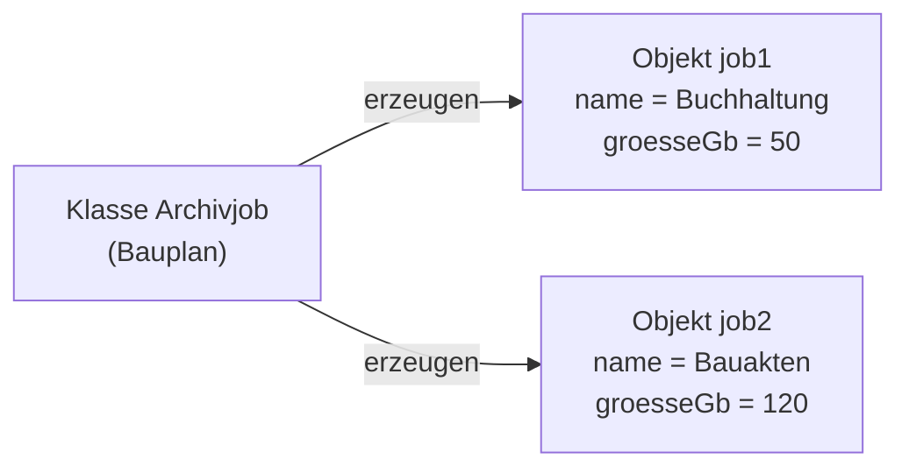
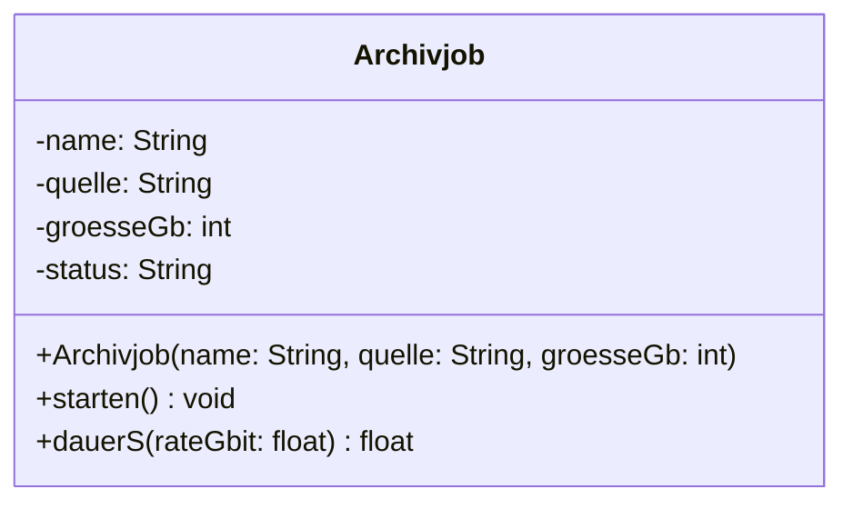

## Worum geht es?

Objektorientierte Programmierung (OOP) bündelt **Daten** und das, was man **mit ihnen tun kann**, in
einer Einheit. Python, Java und C# arbeiten so.

| Begriff | kurz | Beispiel |
| --- | --- | --- |
| [Klasse](glossar:klasse) | Bauplan | `Archivjob` |
| Objekt | konkretes Exemplar nach dem Bauplan | der Job „Buchhaltung“ |
| Attribut | Eigenschaft, Daten | `name`, `groesseGb` |
| Methode | Fähigkeit, Funktion der Klasse | `starten()` |

Vererbung ist seit 2025 nicht mehr AP1-Stoff. Hier geht es um die Grundlagen.

## Wie funktioniert es?

### Klasse und Objekt



Die **Klasse** legt fest, **welche** Attribute und Methoden es gibt. Jedes **Objekt** hat
**eigene Werte** für die Attribute.

Analogie: Die Klasse ist das Formular „Archivauftrag“, jedes ausgefüllte Formular ein Objekt.

### Die Klasse im Code

```python
class Archivjob:
    def __init__(self, name, quelle, groesse_gb):  # Konstruktor
        self.name = name
        self.quelle = quelle
        self.groesse_gb = groesse_gb
        self.status = "neu"

    def starten(self):
        self.status = "läuft"

    def dauer_s(self, rate_gbit):
        return self.groesse_gb * 8 / rate_gbit
```

- Der **Konstruktor** (`__init__`) läuft beim Erzeugen und setzt die Startwerte.
- `self` ist das Objekt, auf dem die Methode gerade arbeitet.
- `dauer_s` nutzt die Formel aus „Übertragungszeit“.

### Objekte erzeugen und benutzen

```python
job1 = Archivjob("Buchhaltung", "/data/buha", 50)
job2 = Archivjob("Bauakten", "/data/bau", 120)

job1.starten()
print(job1.status)  # läuft
print(job2.status)  # neu
print(job1.dauer_s(1))  # 400.0
```

`job1.starten()` ändert **nur** `job1`. `job2` bleibt unberührt – jedes Objekt hat seinen eigenen
Zustand.

### Das Klassendiagramm (UML)

In der Prüfung erscheinen Klassen oft als **UML-Klassendiagramm**: drei Fächer für Name, Attribute,
Methoden.



- `-` und `+` zeigen die **Sichtbarkeit** – Thema des nächsten Kapitels.
- Hinter dem Doppelpunkt steht der **Datentyp**, bei Methoden der **Rückgabetyp**.

> **Halten wir kurz fest:**
>
> 1. Klasse = Bauplan, Objekt = Exemplar mit eigenen Werten.
> 2. Attribute = Daten, Methoden = Verhalten, Konstruktor = setzt Startwerte.
> 3. UML-Klasse: Name / Attribute / Methoden, mit Typen.

## Warum ist es so?

Daten und die Funktionen, die zu ihnen gehören, liegen zusammen. Wer einen Archivjob ändern will,
findet alles an einer Stelle – statt verstreuter Variablen und Funktionen.

<details>
<summary>Warum nicht einfach ein Dictionary und ein paar Funktionen?</summary>

Bei einem Job geht das. Bei hundert Jobs mit Prüfregeln, Statuswechseln und Logging verliert man den
Überblick: Welche Funktion darf welches Feld ändern? Die Klasse legt fest, was es gibt und was man
damit tun darf. Das macht Code wartbar und testbar.

</details>

## Praxisbezug im Betrieb

- **Bibliotheken:** Fast jede Python-Bibliothek liefert Klassen – etwa `pathlib.Path` oder ein
  HTTP-Client. Du erzeugst Objekte und rufst Methoden auf.
- **Automatisierung:** Ein Skript für viele Server profitiert von einer Klasse `Server` mit Methoden
  wie `pruefen()` oder `neustarten()`.
- **Lesen statt schreiben:** Auch als Admin liest du Code anderer – mit diesen Begriffen verstehst du
  ihn schneller.

## Typische Prüfungsfalle

- **Klasse und Objekt vertauscht:** Klasse = allgemein (Bauplan), Objekt = konkret (mit Werten).
- **Attribut und Methode verwechselt:** Methoden erkennst du an den Klammern `()`.
- **Konstruktor vergessen:** Im Klassendiagramm heißt er wie die Klasse.
- **Rückgabetyp fehlt:** Gibt eine Methode nichts zurück, steht `void` (bzw. nichts).

## Nicht verwechseln

| Begriff | Bedeutung |
| --- | --- |
| Klasse | Bauplan mit Attributen und Methoden |
| Objekt (Instanz) | konkretes Exemplar einer Klasse |
| Attribut | Eigenschaft, speichert einen Wert |
| Methode | Funktion, die zur Klasse gehört |
| Konstruktor | spezielle Methode, die ein Objekt erzeugt und Startwerte setzt |
| Instanziieren | ein Objekt aus einer Klasse erzeugen |

## Merksatz

**Die Klasse ist der Bauplan, das Objekt das gebaute Haus. Attribute sagen, was es hat, Methoden, was
es kann – und der Konstruktor baut es auf.**
