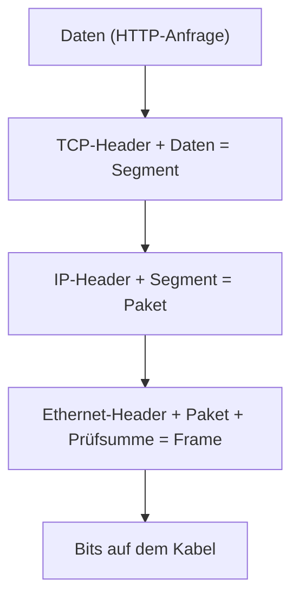

## Worum geht es?

Wenn du eine Webseite aufrufst, arbeiten viele Techniken zusammen: Kabel, Switch, IP-Adressen,
TCP, HTTPS. Das **[OSI-Modell](glossar:osi-modell)** sortiert sie in **sieben Schichten**.

- Jede Schicht hat **eine** Aufgabe und nutzt die Schicht darunter.
- Mit dem Modell ordnest du Protokolle und Geräte ein – und suchst Fehler systematisch.
- Dieses Kapitel: das Modell. Die nächsten zwei: die wichtigsten Protokolle.

## Wie funktioniert es?

### Das große Bild: sieben Schichten

| Nr. | Schicht | Aufgabe | Beispiele | Dateneinheit |
| ---: | --- | --- | --- | --- |
| 7 | Anwendung (Application) | Dienste für Programme | HTTP, DNS, SMTP | Daten |
| 6 | Darstellung (Presentation) | Format, Kodierung, Verschlüsselung | TLS*, UTF-8, JPEG | Daten |
| 5 | Sitzung (Session) | Sitzungen auf- und abbauen | | Daten |
| 4 | Transport | Ende-zu-Ende zwischen Programmen, Ports | TCP, UDP | Segment |
| 3 | Vermittlung (Network) | logische Adressen, Wege durchs Netz | IP, ICMP | Paket |
| 2 | Sicherung (Data Link) | Rahmen im lokalen Netz, MAC-Adressen | Ethernet, WLAN | Frame (Rahmen) |
| 1 | Bitübertragung (Physical) | Bits als Signal auf dem Medium | Kabel, Funk, Stecker | Bit |

\* TLS lässt sich nicht sauber einer Schicht zuordnen; meist wird es bei 5–6 einsortiert.

Eselsbrücke von 7 nach 1: **„Alle deutschen Studenten trinken verschiedene Sorten Bier.“**

### Kapselung: Umschlag im Umschlag

Beim Senden packt jede Schicht die Daten von oben ein und klebt **ihren Header** davor:

Beim Empfänger läuft es **umgekehrt**: Jede Schicht liest ihren Header, entfernt ihn und gibt den
Rest nach oben.

Analogie: Ein Brief (Daten) steckt in einem Umschlag mit Abteilung (Port), der in einem Paket mit
Postanschrift (IP) steckt, das auf einem Lkw mit Kennzeichen (MAC) fährt.

### Geräte und ihre Schicht

| Gerät | Schicht | arbeitet mit |
| --- | --- | --- |
| Repeater, Hub | 1 | Signalen, ohne Adressen |
| Switch | 2 | MAC-Adressen |
| Router | 3 | IP-Adressen |
| Firewall | 3–7 | je nach Typ: IP/Port bis Anwendungsinhalt |
| Layer-3-Switch | 2 und 3 | MAC- und IP-Adressen |

### OSI und TCP/IP

Im Internet gilt in der Praxis das **TCP/IP-Modell** mit vier Schichten. OSI ist das feinere
Lehrmodell.

| TCP/IP-Modell | OSI-Schichten |
| --- | --- |
| Anwendung | 5, 6, 7 |
| Transport | 4 |
| Internet | 3 |
| Netzzugang (Link) | 1, 2 |

> **Halten wir kurz fest:**
>
> 1. Sieben Schichten, von oben: Anwendung, Darstellung, Sitzung, Transport, Vermittlung, Sicherung,
>    Bitübertragung.
> 2. Dateneinheiten: Segment (4), Paket (3), Frame (2), Bit (1).
> 3. Switch = Schicht 2 (MAC), Router = Schicht 3 (IP).

## Warum ist es so?

Schichten machen Technik **austauschbar**: Ob dein Rechner per Kabel oder WLAN angebunden ist, merkt
der Browser nicht. Nur Schicht 1 und 2 ändern sich.

Warum hilft das Modell bei der Fehlersuche?

Du prüfst von unten nach oben: Link-LED an (1)? Switch-Port aktiv (2)? IP-Adresse und Gateway
richtig (3)? Port erreichbar (4)? Dienst antwortet (7)? So schließt du Schicht für Schicht aus,
statt wild zu raten.

Warum gibt es zwei Modelle?

OSI wurde in den 1980ern als Norm entworfen, TCP/IP ist parallel im Internet gewachsen und hat sich
durchgesetzt. OSI blieb als gemeinsame **Sprache**: „Ein Layer-2-Problem“ versteht jeder
Netzwerker.

## Praxisbezug im Betrieb

- **Ticket eingrenzen:** „Ping geht, Webseite nicht“ heißt: Schicht 3 ist in Ordnung, der Fehler
  liegt bei 4 oder darüber (Port, Dienst, Firewall).
- **Container und OpenShift:** Auch virtuelle Netze bilden die Schichten nach – virtuelle Switches
  (2) und Router (3).
- **Firewall-Regeln** formulierst du meist mit Schicht-3- und Schicht-4-Angaben: IP-Adresse und Port.

## Typische Prüfungsfalle

- **Reihenfolge verdreht:** Schicht 1 ist unten (Kabel), Schicht 7 oben (Anwendung).
- **Switch und Router verwechselt:** Switch → MAC → Schicht 2. Router → IP → Schicht 3.
- **Dateneinheiten falsch:** Paket gehört zu Schicht 3, nicht zu 2.
- **Schichten 5 und 6 überbewertet:** Im TCP/IP-Modell gibt es sie nicht einzeln; Beispiele sind
  dort umstritten. Gefragt wird meist 1–4 und 7.

## Nicht verwechseln

| Begriff | Bedeutung |
| --- | --- |
| Frame | Dateneinheit auf Schicht 2, mit MAC-Adressen |
| Paket | Dateneinheit auf Schicht 3, mit IP-Adressen |
| Segment | Dateneinheit auf Schicht 4 (TCP), mit Ports |
| Switch | verbindet Geräte im **selben** Netz (Schicht 2) |
| Router | verbindet **verschiedene** Netze (Schicht 3) |
| OSI-Modell | Lehr- und Referenzmodell, 7 Schichten |
| TCP/IP-Modell | Praxismodell des Internets, 4 Schichten |

## Merksatz

**Alle deutschen Studenten trinken verschiedene Sorten Bier: 7 bis 1. Beim Senden wird eingepackt,
beim Empfangen ausgepackt – Switch denkt in MAC, Router in IP.**
