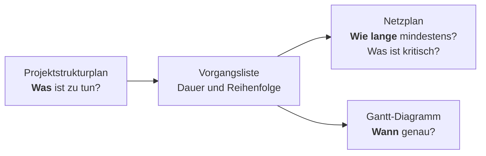
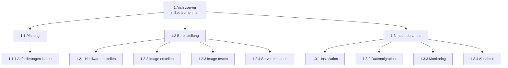

## Worum geht es?

Ein Projekt ohne Plan endet mit „Ach, daran hat keiner gedacht“. Die Projektplanung beantwortet
drei Fragen – mit drei Werkzeugen:

Dieses Kapitel: Projektstrukturplan und Vorgangsliste. Danach folgen Netzplan und Gantt-Diagramm.
Alle drei nutzen dasselbe Beispiel.

Beispiel: Die ArchivTech GmbH nimmt einen **neuen Archivserver** in Betrieb.

## Wie funktioniert es?

### Der Projektstrukturplan

Der **[Projektstrukturplan](glossar:projektstrukturplan)** (PSP) zerlegt das Projekt in einen Baum.
Ganz unten stehen die **[Arbeitspakete](glossar:arbeitspaket)**.

- **Oben:** das Projekt als Ganzes.
- **Mitte:** Teilaufgaben, die Arbeit bündeln.
- **Unten:** Arbeitspakete. Die Nummern (1.2.3) zeigen, wo ein Paket im Baum hängt.

### Was ist ein gutes Arbeitspaket?

Ein Arbeitspaket ist die kleinste Einheit im PSP. Es ist gut, wenn es …

- ein **klares Ergebnis** hat („Image getestet“),
- **eine Person verantwortlich** ist,
- Aufwand und Dauer sich **schätzen** lassen,
- es sich **unabhängig abschließen** lässt.

Faustregel: Formuliere Arbeitspakete mit Verb – „Image erstellen“, nicht nur „Image“.

### Drei Arten zu gliedern

| Gliederung | Ebene 2 ordnet nach … | Beispiel |
| --- | --- | --- |
| phasenorientiert | zeitlichen Abschnitten | Planung, Bereitstellung, Inbetriebnahme |
| objektorientiert | Bestandteilen des Ergebnisses | Hardware, Betriebssystem, Daten |
| funktionsorientiert | Tätigkeiten oder Abteilungen | Einkauf, Systembetrieb, Fachbereich |

Mischformen sind erlaubt. Unser Beispiel ist **phasenorientiert**.

### Vom PSP zur Vorgangsliste

Der PSP sagt **nicht**, in welcher Reihenfolge gearbeitet wird. Dafür gibt es die
**Vorgangsliste**: je Arbeitspaket Dauer und direkte Vorgänger.

| Nr. | Vorgang | Dauer (Tage) | Vorgänger |
| --- | --- | ---: | --- |
| A | Anforderungen klären | 2 | – |
| B | Hardware bestellen und liefern lassen | 5 | A |
| C | Installations-Image erstellen | 2 | A |
| D | Image testen | 1 | C |
| E | Server einbauen und verkabeln | 1 | B |
| F | Installation und Konfiguration | 2 | D, E |
| G | Datenmigration | 4 | F |
| H | Monitoring einrichten | 1 | F |
| I | Abnahme | 1 | G, H |

„Vorgänger D, E“ heißt: F beginnt erst, wenn D **und** E fertig sind.

> **Halten wir kurz fest:**
>
> 1. PSP = **was**, als Baum bis hinunter zu den Arbeitspaketen.
> 2. Der PSP enthält keine Reihenfolge und keine Termine.
> 3. Die Vorgangsliste ergänzt Dauer und Vorgänger – sie ist die Grundlage für Netzplan und Gantt.

## Warum ist es so?

Große Aufgaben kann niemand schätzen. „Archivserver in Betrieb nehmen“ – wie lange dauert das?
Für „Image testen“ dagegen hast du sofort ein Gefühl. Zerlegen macht schätzbar.

Warum muss der PSP vollständig sein?

Was nicht im PSP steht, wird nicht geplant, nicht bezahlt und nicht erledigt. Deshalb gilt die
**100-%-Regel**: Die Teile einer Ebene ergeben zusammen genau die Ebene darüber – nicht mehr, nicht
weniger. Fehlt die Abnahme im PSP, fehlt sie später auch im Zeitplan.

Warum keine Reihenfolge im PSP?

Der PSP soll die Arbeit **vollständig erfassen**, ohne dass man gleichzeitig über Abhängigkeiten
nachdenken muss. Reihenfolge und Dauer sind eine zweite Frage. Getrennt bleiben beide übersichtlich.

## Praxisbezug im Betrieb

- **Tickets:** Ein Epic im Ticketsystem entspricht einer Teilaufgabe, ein Ticket einem Arbeitspaket.
- **Change-Planung:** Für eine Serverumstellung listest du vorab alle Schritte – inklusive Rückfallplan.
- **Abhängigkeiten früh sehen:** Hardware mit 5 Tagen Lieferzeit gehört ganz an den Anfang.

## Typische Prüfungsfalle

- **PSP mit Pfeilen zwischen Arbeitspaketen:** Pfeile für die Reihenfolge gehören in den Netzplan,
  nicht in den PSP.
- **Ebenen vermischt:** „Hardware“ (Objekt) neben „Planung“ (Phase) auf derselben Ebene nur, wenn die
  Aufgabe eine Mischform erlaubt.
- **Indirekte Vorgänger:** Bei F stehen nur D und E, nicht auch A, B und C.
- **Arbeitspakete ohne Verb:** „Server“ ist kein Arbeitspaket, „Server einbauen“ schon.

## Nicht verwechseln

| Begriff | Bedeutung |
| --- | --- |
| Projektstrukturplan | Baum aller Aufgaben, ohne Reihenfolge |
| Teilaufgabe | Zwischenebene, bündelt Arbeitspakete |
| Arbeitspaket | kleinste Einheit im PSP, mit Ergebnis und Verantwortlichem |
| Vorgang | Arbeitspaket mit Dauer und Vorgängern im Ablaufplan |
| Meilenstein | Zeitpunkt mit besonderer Bedeutung, Dauer 0 |
| Vorgangsliste | Tabelle: Vorgang, Dauer, direkte Vorgänger |

## Merksatz

**Der PSP sagt, was zu tun ist – die Vorgangsliste sagt, wie lange und wonach. Reihenfolge gehört
nie in den Baum.**
