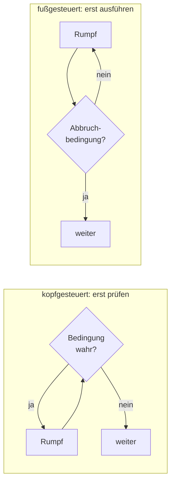

## Worum geht es?

Eine [Schleife](glossar:schleife) wiederholt Anweisungen, bis ein Ziel erreicht ist.
Ohne Schleifen müsstest du jede Datei einzeln abarbeiten.

- Es gibt **drei Schleifenarten**: kopfgesteuert, fußgesteuert und die Zählschleife.
- Mit Schleifen durchläufst du **Felder** (Listen von Werten).
- Wiederkehrende Abläufe packst du in **Funktionen**.

Das brauchst du gleich für den [Schreibtischtest](glossar:schreibtischtest): Dort verfolgst du
genau solche Schleifen Schritt für Schritt.

## Wie funktioniert es?

### Das große Bild: wo wird geprüft?



| Schleife | Prüfung | läuft mindestens | typisch für |
| --- | --- | --- | --- |
| kopfgesteuert (`while`) | vor dem Rumpf | 0-mal | „solange etwas gilt“ |
| fußgesteuert (`repeat … until`) | nach dem Rumpf | 1-mal | Eingabe prüfen |
| Zählschleife (`for`) | vor dem Rumpf | 0-mal | feste Anzahl, Felder |

### Kopfgesteuert: while

Ein Upload ins Artefakt-Repository soll höchstens dreimal versucht werden:

```text
versuch ← 1
erfolg ← false
while versuch ≤ 3 and not erfolg do
    erfolg ← upload(datei)
    versuch ← versuch + 1
end while
if not erfolg then
    output "Upload dreimal gescheitert"
end if
```

- Vor jedem Durchlauf wird die Bedingung geprüft.
- Klappt der erste Upload, ist `not erfolg` falsch – die Schleife endet nach einem Durchlauf.
- Ohne `versuch ← versuch + 1` liefe sie bei Fehlern **endlos**.

### Fußgesteuert: repeat … until

Ein Admin soll einen Port eingeben. Gefragt wird **mindestens einmal**:

```text
repeat
    input port
until port ≥ 1 and port ≤ 65535
```

Achtung: Bei der [fußgesteuerten Schleife](glossar:fussgesteuerte-schleife) mit `until` steht dahinter die **Abbruchbedingung**. Die Schleife läuft, solange sie falsch ist.

Manche schreiben fußgesteuert als `do … while`. Dann steht dort die **Weiterlaufbedingung** –
also genau das Gegenteil:

```text
do
    input port
while port < 1 or port > 65535
```

Beide Varianten tun dasselbe.

<details>
<summary>Warum wird aus „and“ beim Umdrehen ein „or“?</summary>

„Gültig“ heißt: `port ≥ 1 and port ≤ 65535`. „Ungültig“ ist das Gegenteil davon. Nach den
De-Morganschen Regeln wird `not (a and b)` zu `(not a) or (not b)`, also
`port < 1 or port > 65535`. Ein Port ist schon ungültig, wenn **eine** Grenze verletzt ist.

</details>

### Zählschleife: for

Weißt du vorher, wie oft etwas laufen soll, nimm die Zählschleife:

```text
for tag ← 1 to 7 do
    output "Prüfe Sicherung von Tag " + tag
end for
```

- `tag` startet bei 1 und wird nach jedem Durchlauf um 1 erhöht.
- Die Grenze 7 ist **eingeschlossen**: 7 Durchläufe.
- Mit `step 2` zählst du in Zweierschritten.

### Felder durchlaufen

Ein [Feld](glossar:array) (Array) speichert mehrere Werte unter einem Namen. Der Index beginnt hier
bei **0**:

```text
groessen ← [120, 450, 80, 300]     // GB je Verzeichnis
summe ← 0
max ← groessen[0]
for i ← 0 to laenge(groessen) - 1 do
    summe ← summe + groessen[i]
    if groessen[i] > max then
        max ← groessen[i]
    end if
end for
output summe, max
```

| i | groessen[i] | summe | max |
| ---: | ---: | ---: | ---: |
| Start | – | 0 | 120 |
| 0 | 120 | 120 | 120 |
| 1 | 450 | 570 | 450 |
| 2 | 80 | 650 | 450 |
| 3 | 300 | 950 | 450 |

Ausgabe: **950** und **450**. Das Feld hat 4 Werte, also laufen die Indizes von 0 bis 3.

### Funktionen mit Parameter und Rückgabe

Eine **Funktion** bekommt Werte (Parameter) und gibt ein Ergebnis zurück:

```text
function summe(werte)
    s ← 0
    for i ← 0 to laenge(werte) - 1 do
        s ← s + werte[i]
    end for
    return s
end function

gesamt ← summe([120, 450, 80, 300])    // gesamt = 950
```

`return` beendet die Funktion **sofort** und liefert den Wert an die Stelle des Aufrufs.

> **Halten wir kurz fest:**
>
> 1. `while` prüft vorher, `repeat … until` prüft nachher und läuft mindestens einmal.
> 2. `until` = Abbruchbedingung, `while` = Weiterlaufbedingung.
> 3. Feld mit n Werten: Indizes 0 bis n − 1.

## Warum ist es so?

Drei Schleifenarten, weil Abläufe unterschiedlich enden: nach fester Anzahl, wenn etwas eintritt,
oder erst nach dem ersten Versuch.

<details>
<summary>Warum braucht es überhaupt eine fußgesteuerte Schleife?</summary>

Manche Dinge kann man erst prüfen, **nachdem** sie einmal passiert sind: Eine Eingabe ist erst da,
wenn jemand etwas eingegeben hat. Mit `while` müsstest du die Eingabe vor der Schleife doppelt
schreiben. Die fußgesteuerte Schleife spart diese Wiederholung.

</details>

<details>
<summary>Warum beginnen Indizes meist bei 0?</summary>

Der Index ist der **Abstand vom Anfang** des Felds im Speicher. Das erste Element hat den Abstand
0. Sprachen wie C, Java und Python übernehmen das. In Pseudocode kann eine Aufgabe auch bei 1
beginnen – deshalb immer prüfen, welche Zählung gilt.

</details>

## Praxisbezug im Betrieb

- **Wiederholversuche:** Uploads, API-Aufrufe und Netzwerkzugriffe bekommen eine `while`-Schleife
  mit Höchstzahl, damit ein Job nicht hängen bleibt.
- **Dateien verarbeiten:** Ein Archivskript läuft mit einer Schleife über alle Dateien eines
  Verzeichnisses.
- **Python kennt kein `repeat … until`:** Dort schreibst du `while True:` und brichst mit `break`
  ab, sobald die Eingabe passt.

## Typische Prüfungsfalle

- **`until` wie `while` gelesen:** Hinter `until` steht, wann **Schluss** ist.
- **Um eins daneben (Off-by-one):** `for i ← 0 to laenge(feld)` greift auf einen Index zu, den es
  nicht gibt. Richtig ist `laenge(feld) - 1`.
- **Zähler vergessen:** Wird die Bedingung im Rumpf nie geändert, läuft die Schleife endlos.
- **Startwert in der Schleife:** `summe ← 0` gehört **vor** die Schleife, sonst beginnt jeder
  Durchlauf wieder bei 0.
- **Mindestens einmal:** Fragt die Aufgabe, wie oft der Rumpf bei falscher Bedingung läuft:
  `while` 0-mal, `repeat … until` 1-mal.

## Nicht verwechseln

| Begriff | Bedeutung |
| --- | --- |
| `while` (kopfgesteuert) | prüft vorher, läuft solange **wahr** |
| `repeat … until` (fußgesteuert) | prüft nachher, läuft bis **wahr** |
| `do … while` (fußgesteuert) | prüft nachher, läuft solange **wahr** |
| `for i ← 1 to 5` (Pseudocode) | 1, 2, 3, 4, 5 – Grenze eingeschlossen |
| `for i in range(1, 5)` (Python) | 1, 2, 3, 4 – Grenze **ausgeschlossen** |
| `output` | zeigt etwas an, Funktion läuft weiter |
| `return` | gibt einen Wert zurück und beendet die Funktion |

## Merksatz

**Kopf prüft vorher, Fuß prüft nachher und läuft mindestens einmal. Until heißt „bis“, while heißt
„solange“ – und ein Feld mit n Werten endet bei n − 1.**
