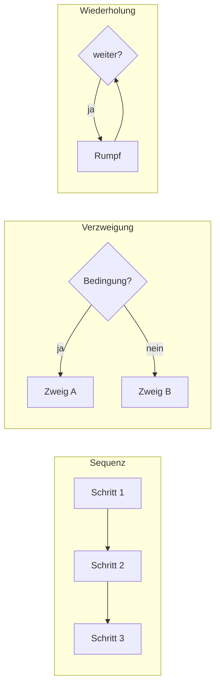

## Worum geht es?

**[Pseudocode](glossar:pseudocode)** beschreibt einen Ablauf in strukturierter Umgangssprache –
so genau wie ein Programm, aber ohne die Regeln einer echten Programmiersprache.

- Seit dem Katalog 2025 bildest du Kontrollstrukturen in der AP1 **nur noch mit Pseudocode** ab.
  Struktogramm und Programmablaufplan sind entfallen.
- In der Prüfung musst du Pseudocode **lesen**, **ergänzen** oder **selbst schreiben**.
- Dieses Kapitel: Bausteine und Verzweigungen. Das nächste: Schleifen.

Unser Beispiel: Die ArchivTech GmbH schiebt jede Nacht Daten ins Archiv. Ein Skript soll vorher
entscheiden, ob genug Platz da ist.

## Wie funktioniert es?

### Das große Bild: drei Bausteine

Jeder Algorithmus lässt sich aus drei [Kontrollstrukturen](glossar:kontrollstruktur) bauen:



| Baustein | Bedeutung | Pseudocode |
| --- | --- | --- |
| Sequenz | Anweisungen nacheinander | Zeile für Zeile |
| Verzweigung | je nach Bedingung ein Zweig | `if … then … else … end if` |
| Wiederholung (Schleife) | Rumpf mehrfach ausführen | `while`, `repeat … until`, `for` |

### Die Schreibweise in diesem Kurs

Eine **Norm für Pseudocode gibt es nicht**. Wichtig ist: eindeutig und durchgehend gleich.
Wir verwenden englische Schlüsselwörter wie in echtem Code:

| Was | Schreibweise | Beispiel |
| --- | --- | --- |
| Zuweisung | `←` | `frei ← 1200` |
| Eingabe | `input` | `input groesse` |
| Ausgabe | `output` | `output "fertig"` |
| Vergleich | `=`, `≠`, `<`, `≤`, `>`, `≥` | `if frei ≥ groesse` |
| Kommentar | `//` | `// Angaben in GB` |
| Blockende | `end if`, `end while` … | |

Deutsche Wörter (`WENN … DANN … SONST`) sind genauso richtig.

<details>
<summary>Warum ein Pfeil für die Zuweisung?</summary>

In vielen Sprachen bedeutet `=` „speichere“, in der Mathematik „ist gleich“. Der Pfeil `frei ← 1200`
liest sich eindeutig: „Der Wert 1200 wandert in die Variable frei.“ So kann `=` für den Vergleich
reserviert bleiben.

</details>

### Verzweigung mit zwei Zweigen

Das Skript prüft, ob der Archivjob starten darf:

```text
// Angaben in GB
input groesse            // Größe der Tagesdaten
input frei               // freier Platz im Archiv
if frei ≥ groesse then
    output "Archivierung startet"
else
    output "Zu wenig Platz – Admin informieren"
end if
```

So liest du es:

1. Die Bedingung `frei ≥ groesse` ist entweder **wahr** oder **falsch**.
2. Wahr: Nur der `then`-Zweig läuft.
3. Falsch: Nur der `else`-Zweig läuft.
4. Danach geht es nach `end if` weiter.

Der `else`-Zweig ist **optional**. Fehlt er, passiert bei „falsch“ einfach nichts.

### Mehrfache Verzweigung

Die Daten sollen je nach Alter auf die passende Speicherklasse:

```text
input alterTage
if alterTage < 30 then
    klasse ← "hot"        // schnelle SSD
else if alterTage < 365 then
    klasse ← "warm"       // HDD
else
    klasse ← "cold"       // Band
end if
output klasse
```

Geprüft wird **von oben nach unten**. Die erste wahre Bedingung gewinnt, alle weiteren werden
übersprungen.

Rechnen wir nach:

| alterTage | `< 30`? | `< 365`? | klasse |
| ---: | --- | --- | --- |
| 12 | ja | – | hot |
| 30 | nein | ja | warm |
| 400 | nein | nein | cold |

<details>
<summary>Und was ist mit switch/case?</summary>

Vergleichst du **eine** Variable mit festen Werten, ist eine Auswahl übersichtlicher:

```text
switch tag
    case "Sa", "So": output "Vollsicherung"
    default:         output "Differenzsicherung"
end switch
```

Sie macht nichts, was `else if` nicht auch kann. Bereiche wie „unter 30“ passen besser in eine
`else if`-Kette.

</details>

### Bedingungen verknüpfen

| Operator | wahr, wenn … | Beispiel |
| --- | --- | --- |
| `and` | beide Teile wahr sind | `frei ≥ groesse and netzOk` |
| `or` | mindestens ein Teil wahr ist | `tag = "Sa" or tag = "So"` |
| `not` | der Teil falsch ist | `not wartung` |

Setz bei gemischten Verknüpfungen **Klammern**: `(a or b) and c` ist etwas anderes als
`a or (b and c)`.

> **Halten wir kurz fest:**
>
> 1. Drei Bausteine: Sequenz, Verzweigung, Wiederholung.
> 2. `←` speichert, `=` vergleicht.
> 3. In einer `else if`-Kette gewinnt die erste wahre Bedingung.

## Warum ist es so?

Pseudocode trennt das **Was** vom **Wie**: Erst stimmt die Logik, dann kommt die Sprache.
Ein Kollege mit Java, eine mit Python und der Fachbereich können denselben Pseudocode lesen.

<details>
<summary>Warum reichen drei Bausteine für jedes Programm?</summary>

Böhm und Jacopini haben 1966 gezeigt: Jeder berechenbare Ablauf lässt sich allein mit Folge,
Auswahl und Wiederholung ausdrücken (Strukturtheorem). Sprünge kreuz und quer („goto“) braucht es
nicht. Darauf baut die **strukturierte Programmierung** auf – und deshalb fragt die Prüfung genau
diese drei Bausteine ab.

</details>

<details>
<summary>Warum schreibt man end if, wenn doch eingerückt ist?</summary>

Handschrift auf Papier verrutscht schnell. Ohne Blockende ist bei verschachtelten Verzweigungen
unklar, zu welchem `if` ein `else` gehört („dangling else“). `end if` macht das Ende eindeutig.
Python löst dasselbe Problem allein über die Einrückung.

</details>

## Praxisbezug im Betrieb

- **Vor dem Skript:** Eine Jenkins-Pipeline oder ein Python-Skript erst als Pseudocode skizzieren.
  Logikfehler fallen auf, bevor du debuggen musst.
- **Im Ticket:** Ein paar Zeilen Pseudocode erklären einen Ablauf schneller als ein langer Text.
- **Mit dem Fachbereich:** Regeln wie „Daten älter als ein Jahr auf Band“ lassen sich gemeinsam
  prüfen, ohne dass jemand Python können muss.

## Typische Prüfungsfalle

- **Grenzwert falsch:** „ab 30 Tagen“ heißt `≥ 30`, „über 30 Tagen“ heißt `> 30`.
  Prüfe immer genau den Grenzwert.
- **Reihenfolge in der Kette:** Steht `alterTage < 365` vor `alterTage < 30`, wird nie „hot“
  vergeben. Die engste Bedingung gehört nach oben.
- **Zuweisung statt Vergleich:** `if klasse ← "hot"` ist sinnlos – im `if` steht ein Vergleich.
- **Ausgabe vergessen:** Verlangt die Aufgabe eine Ausgabe, gehört `output` in den Code.
- **Notation:** Gibt die Aufgabe eine Schreibweise vor, nutze genau diese.

## Nicht verwechseln

| Begriff | Bedeutung |
| --- | --- |
| Zuweisung `x ← 5` | speichert einen Wert in einer Variablen |
| Vergleich `x = 5` | prüft und liefert wahr oder falsch |
| Verzweigung | läuft **höchstens einmal** in einen Zweig |
| Schleife | läuft **mehrmals**, solange die Bedingung es verlangt |
| `else if`-Kette | genau ein Zweig, erste wahre Bedingung gewinnt |
| mehrere einzelne `if` | jedes `if` wird geprüft, mehrere Zweige möglich |

## Merksatz

**Folge, Auswahl, Wiederholung – mehr braucht kein Programm. Pfeil speichert, Gleichheitszeichen
vergleicht, und in der Kette gewinnt die erste wahre Bedingung.**
