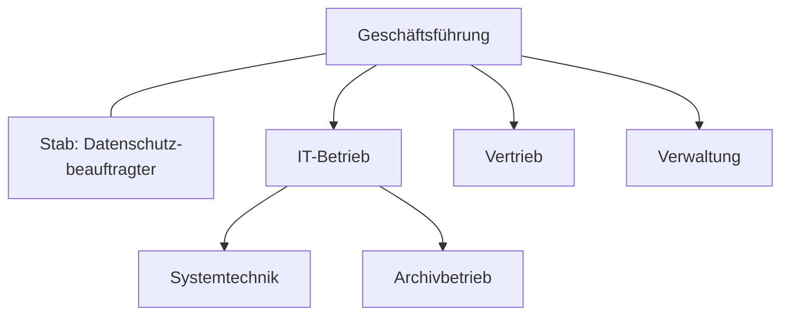

## Worum geht es?

> **Zusatzthema:** Rechtsformen und Aufbauorganisation stehen nicht im AP1-Katalog 2025, gehören aber
> zum kaufmännischen Grundwissen und tauchen in Fallbeschreibungen auf („Die ArchivTech GmbH …“).

- **Rechtsform:** Wer haftet, wer entscheidet, wie viel Kapital braucht man?
- **Aufbauorganisation:** Wer ist wem unterstellt?

## Wie funktioniert es?

### Rechtsformen im Überblick

| Rechtsform | Gründer | Mindestkapital | Haftung |
| --- | --- | --- | --- |
| Einzelunternehmen | 1 Person | keins | unbeschränkt mit Privatvermögen |
| GbR | mind. 2 | keins | Gesellschafter persönlich, unbeschränkt |
| OHG | mind. 2 | keins | alle Gesellschafter unbeschränkt |
| KG | mind. 2 | keins | Komplementär unbeschränkt, Kommanditist nur mit Einlage |
| **GmbH** | 1 oder mehr | **25.000 €** | nur Gesellschaftsvermögen |
| UG (haftungsbeschränkt) | 1 oder mehr | ab 1 € | nur Gesellschaftsvermögen |
| AG | 1 oder mehr | **50.000 €** | nur Gesellschaftsvermögen |

**Personengesellschaften** (GbR, OHG, KG): Mindestens ein Gesellschafter haftet persönlich.
**Kapitalgesellschaften** (GmbH, UG, AG): Es haftet das Gesellschaftsvermögen.

### Aufbauorganisation: vier Grundformen

| Form | Prinzip | Vorteil | Nachteil |
| --- | --- | --- | --- |
| **Einlinienorganisation** | jeder hat genau einen Vorgesetzten | klare Zuständigkeit | lange Dienstwege |
| **Mehrlinienorganisation** | mehrere fachliche Vorgesetzte | kurze Wege, Spezialwissen | widersprüchliche Anweisungen |
| **Stablinienorganisation** | Einlinie plus beratende Stabsstellen ohne Weisungsrecht | Fachwissen für die Leitung | Stab hat keine Entscheidungsmacht |
| **Matrixorganisation** | zwei Dimensionen, z. B. Fachabteilung und Projekt | flexibel, für Projekte geeignet | Konflikte zwischen zwei Vorgesetzten |

### Beispiel: Stablinie bei der ArchivTech

Der Datenschutzbeauftragte berät die Geschäftsführung, darf den Abteilungen aber keine Anweisungen
geben – eine typische **Stabsstelle**.

> **Halten wir kurz fest:**
>
> 1. GmbH 25.000 €, AG 50.000 €, UG ab 1 €; Kapitalgesellschaften haften mit dem Gesellschaftsvermögen.
> 2. Bei OHG und GbR haften Gesellschafter persönlich und unbeschränkt.
> 3. Einlinie, Mehrlinie, Stablinie, Matrix – Stabsstellen beraten ohne Weisungsrecht.

## Warum ist es so?

Wer mehr Risiko für das Unternehmen trägt, hat in der Regel mehr Mitsprache. Kapitalgesellschaften
begrenzen die Haftung, verlangen dafür Mindestkapital und mehr Formalitäten.

Warum arbeiten IT-Projekte oft in einer Matrix?

Ein Projekt braucht Leute aus mehreren Abteilungen: Systemtechnik, Entwicklung, Vertrieb. In der Matrix
bleiben sie fachlich in ihrer Abteilung, arbeiten aber für die Projektleitung. Das nutzt Wissen
flexibel, erfordert aber klare Absprachen zwischen beiden Vorgesetzten.

## Praxisbezug im Betrieb

- **Vertragspartner prüfen:** Bei einer UG oder GmbH haftet nur das Gesellschaftsvermögen.
- **Organigramm** zeigt, wer Freigaben erteilt – wichtig für Bestellungen und Changes.
- **Stabsstellen** in der IT: Informationssicherheit, Datenschutz.

## Typische Prüfungsfalle

- **GmbH-Gesellschafter haften privat:** In der Regel nicht.
- **Stab mit Weisungsrecht:** Stabsstellen beraten nur.
- **Mehrlinie und Matrix gleichgesetzt:** Matrix kombiniert zwei Dimensionen dauerhaft.

## Nicht verwechseln

| Begriff | Bedeutung |
| --- | --- |
| Personengesellschaft | mindestens ein Gesellschafter haftet persönlich |
| Kapitalgesellschaft | Haftung mit dem Gesellschaftsvermögen |
| Komplementär | haftet in der KG unbeschränkt |
| Kommanditist | haftet in der KG nur mit seiner Einlage |
| Stabsstelle | berät, ohne Weisungsrecht |

## Merksatz

**GmbH fünfundzwanzig-, AG fünfzigtausend, UG ab einem Euro. Einlinie ist klar, Matrix flexibel – und
der Stab berät nur.**
