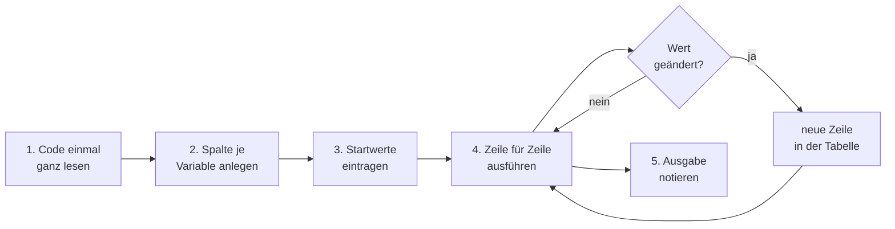

## Worum geht es?

Beim **[Schreibtischtest](glossar:schreibtischtest)** führst du ein Programm **auf Papier** aus.
Du gehst den Code Zeile für Zeile durch und schreibst jede Änderung einer Variablen in eine Tabelle.

- Der Katalog 2025 nennt ihn ausdrücklich: „Schreibtischtest mit einem gegebenen Quellcode
  durchführen“.
- In den bisherigen Prüfungen brachte das Thema rund **41 Punkte**.
- Gegeben ist Pseudocode oder echter Code, oft mit Startwerten. Gefragt sind Tabelle und Ausgabe.

## Wie funktioniert es?

### Das Vorgehen



1. **Ganz lesen:** Was soll der Code tun? Wo sind Schleifen und Verzweigungen?
2. **Spalten anlegen:** eine Spalte je Variable, dazu oft eine für die Bedingung und eine für die
   Ausgabe.
3. **Startwerte:** die erste Zeile vor der Schleife.
4. **Ausführen:** Jede Wertänderung bekommt eine neue Zeile. Nichts im Kopf behalten!
5. **Ausgabe:** Was zeigt der Code am Ende an?

### Rechenbeispiel: Wann ist das Archiv voll?

Die ArchivTech GmbH hat ein Archiv mit 1.000 TB. Belegt sind 600 TB. Der monatliche Zuwachs steigt
jeden Monat um 10 TB.

```text
1  kapazitaet ← 1000
2  belegt ← 600
3  zuwachs ← 50
4  monate ← 0
5  while belegt + zuwachs ≤ kapazitaet do
6      belegt ← belegt + zuwachs
7      zuwachs ← zuwachs + 10
8      monate ← monate + 1
9  end while
10 output monate
```

Welche Zahl gibt das Programm aus?

### Die Tabelle Zeile für Zeile

| Durchlauf | Bedingung (Zeile 5) | belegt | zuwachs | monate |
| --- | --- | ---: | ---: | ---: |
| Start | – | 600 | 50 | 0 |
| 1 | 600 + 50 = 650 ≤ 1000 ✔ | 650 | 60 | 1 |
| 2 | 650 + 60 = 710 ≤ 1000 ✔ | 710 | 70 | 2 |
| 3 | 710 + 70 = 780 ≤ 1000 ✔ | 780 | 80 | 3 |
| 4 | 780 + 80 = 860 ≤ 1000 ✔ | 860 | 90 | 4 |
| 5 | 860 + 90 = 950 ≤ 1000 ✔ | 950 | 100 | 5 |
| Ende | 950 + 100 = 1050 ≤ 1000 ✘ | 950 | 100 | 5 |

Ausgabe: **5**. Nach fünf Monaten passt der nächste Zuwachs nicht mehr hinein.

Achte auf die letzte Zeile: Die Bedingung wird **noch einmal** geprüft. Erst dann endet die Schleife.

### Zweites Beispiel: echter Python-Code

Der Code kann auch in einer echten Sprache gegeben sein. Diese Funktion berechnet eine Prüfziffer:

```python
1  def pruefziffer(ziffern):
2      summe = 0
3      for i in range(len(ziffern)):
4          if i % 2 == 0:
5              summe += ziffern[i]
6          else:
7              summe += ziffern[i] * 3
8      return (10 - summe % 10) % 10
```

Aufruf: `pruefziffer([4, 0, 1, 2, 3])`

- `%` ist der **Rest** einer Ganzzahldivision (Modulo): `14 % 10` ergibt 4.
- `i % 2 == 0` ist wahr für gerade Indizes (0, 2, 4).

### Tabelle zum Python-Beispiel

| i | ziffern[i] | i % 2 == 0? | Rechnung | summe |
| ---: | ---: | --- | --- | ---: |
| Start | – | – | – | 0 |
| 0 | 4 | ja | 0 + 4 | 4 |
| 1 | 0 | nein | 4 + 0 × 3 | 4 |
| 2 | 1 | ja | 4 + 1 | 5 |
| 3 | 2 | nein | 5 + 2 × 3 | 11 |
| 4 | 3 | ja | 11 + 3 | 14 |

Rückgabe in Zeile 8, von innen nach außen:

1. `summe % 10` = 14 % 10 = **4**
2. `10 - 4` = **6**
3. `6 % 10` = **6**

Ergebnis: **6**.

<details>
<summary>Warum steht am Ende noch einmal % 10?</summary>

Ist die Summe ein Vielfaches von 10 (z. B. 20), ergibt `10 - 0` den Wert 10. Eine Prüfziffer
soll aber eine Ziffer von 0 bis 9 sein. Das äußere `% 10` macht aus 10 eine 0 und lässt alle
anderen Werte unverändert.

</details>

> **Halten wir kurz fest:**
>
> 1. Eine Spalte je Variable, eine neue Zeile je Änderung.
> 2. Die Schleifenbedingung wird nach dem letzten Durchlauf noch einmal geprüft.
> 3. Verschachtelte Ausdrücke von innen nach außen auswerten.

## Warum ist es so?

Im Kopf verliert man nach drei Durchläufen den Überblick. Die Tabelle zwingt dich, jeden Schritt
aufzuschreiben – so sieht man genau, **wo** ein Wert anders wird als erwartet.

<details>
<summary>Warum fragt die Prüfung das bei allen IT-Berufen ab?</summary>

Auch wer nicht entwickelt, liest Code: Skripte von Kollegen, Konfigurationen, Automatisierungen.
Der Schreibtischtest zeigt, ob du Code **verstehst**, ohne ihn auszuführen. Das ist auch nötig, wenn
der Code auf einem Produktivsystem läuft, wo man nicht einfach ausprobieren darf.

</details>

## Praxisbezug im Betrieb

- **Code-Review:** Bei einem Pull Request rechnest du kritische Stellen kurz mit einem Beispielwert
  durch.
- **Debugger:** Ein Debugger ist ein automatischer Schreibtischtest. Er zeigt nach jeder Zeile die
  Werte der Variablen.
- **Testfälle finden:** Werte, bei denen du in der Tabelle unsicher wirst, sind gute Kandidaten für
  einen Unit-Test.

## Typische Prüfungsfalle

- **Letzte Prüfung vergessen:** Die Bedingung, an der die Schleife endet, gehört in die Tabelle.
- **Reihenfolge im Rumpf:** In Zeile 6 wird `belegt` mit dem **alten** `zuwachs` erhöht, erst in
  Zeile 7 steigt der Zuwachs. Vertauscht man die Zeilen, ändert sich das Ergebnis.
- **Modulo verwechselt:** `%` liefert den Rest, nicht das Ergebnis der Division.
- **Ganzzahldivision:** In Python ist `7 // 2` gleich 3, aber `7 / 2` gleich 3.5.
- **Ausgabe in der Schleife:** Steht `output` im Rumpf, gibt es eine Ausgabe **je Durchlauf**.

## Nicht verwechseln

| Begriff | Bedeutung |
| --- | --- |
| Schreibtischtest | Code von Hand mit Tabelle durchrechnen |
| Debugger | Werkzeug, das Code schrittweise ausführt und Werte zeigt |
| Unit-Test | automatischer Test, der ein Ergebnis mit dem erwarteten vergleicht |
| Code-Review | andere lesen den Code vor dem Zusammenführen |
| `/` (Python) | Division mit Kommazahl: `7 / 2` = 3.5 |
| `//` (Python) | Ganzzahldivision: `7 // 2` = 3 |
| `%` (Python) | Rest: `7 % 2` = 1 |

## Merksatz

**Spalte je Variable, Zeile je Änderung, nichts im Kopf behalten – und die Bedingung, an der die
Schleife endet, gehört auch in die Tabelle.**
