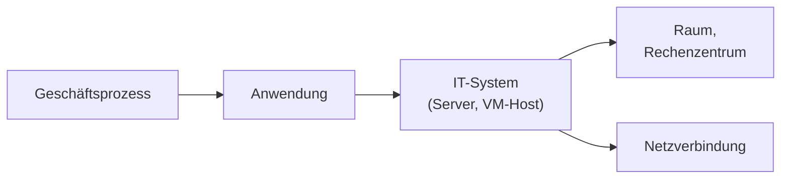

## Worum geht es?

Im letzten Kapitel hast du den Schutzbedarf einer **Anwendung** bestimmt. Aber Anwendungen laufen
auf **Servern**, Server stehen in **Räumen**. Welchen Schutzbedarf hat der Server?

Das BSI beantwortet das mit drei Regeln:

| Regel | Wirkung |
| --- | --- |
| **Maximumprinzip** | Das Objekt übernimmt den höchsten Schutzbedarf der Anwendungen darauf. |
| **Kumulationseffekt** | Viele kleine Schäden zusammen → Schutzbedarf **steigt**. |
| **Verteilungseffekt** | Redundanz oder nur unwichtige Teile → Schutzbedarf **sinkt**. |

## Wie funktioniert es?

### Die Vererbungskette

Der Schutzbedarf wird **von links nach rechts weitergegeben** – je Schutzziel getrennt.

### Maximumprinzip

Auf dem Server `arch01` laufen zwei Anwendungen:

| Anwendung | Vertraulichkeit | Integrität | Verfügbarkeit |
| --- | --- | --- | --- |
| Kundenarchiv | hoch | hoch | normal |
| internes Wiki | normal | normal | normal |
| **Server arch01** | **hoch** | **hoch** | **normal** |

Der Server übernimmt je Schutzziel den **höchsten** Wert. Wer an den Server kommt, kommt auch an
das Archiv.

### Kumulationseffekt

Auf einem Virtualisierungshost laufen **20 VMs**, jede mit Verfügbarkeit **normal**. Fällt eine VM
einen Tag aus, ist das tragbar.

Fällt aber der **Host** aus, sind alle 20 gleichzeitig weg: Vertrieb, Buchhaltung, Ticketsystem,
Telefonie. Die Summe ist beträchtlich – die Verfügbarkeit des Hosts ist **hoch**, obwohl keine
einzelne VM „hoch“ hat.

### Verteilungseffekt

Das Kundenportal hat Verfügbarkeit **hoch**. Es läuft auf **zwei** Servern im Cluster; fällt einer
aus, übernimmt der andere.

Für **jeden einzelnen** Server lässt sich die Verfügbarkeit deshalb auf **normal** senken – der
Ausfall eines Knotens verursacht keinen beträchtlichen Schaden. Das muss begründet und dokumentiert
werden.

> **Halten wir kurz fest:**
>
> 1. Maximumprinzip: höchster Wert der Anwendungen gilt für das System.
> 2. Kumulation: Viele normale Schäden zusammen können „hoch“ ergeben.
> 3. Verteilung: Redundanz kann den Schutzbedarf einzelner Systeme senken.

### Drei Wege der Absicherung

Der BSI-Standard 200-2 bietet drei Vorgehensweisen:

| Vorgehensweise | Idee | passt für |
| --- | --- | --- |
| Basis-Absicherung | breite Grundsicherung aller Prozesse, schneller Einstieg | Einsteiger, normaler Bedarf |
| Kern-Absicherung | die „Kronjuwelen“ gezielt tief absichern | wenige, sehr wichtige Prozesse |
| Standard-Absicherung | umfassend und tief, bevorzugte Vorgehensweise des BSI | Ziel für die meisten Institutionen |

Die Anforderungen dazu stehen als **Bausteine** im IT-Grundschutz-Kompendium.

## Warum ist es so?

Ein System ist nur so gut geschützt wie das wichtigste, was darauf läuft. Ein Angreifer sucht sich
nicht die harmlose Anwendung aus, sondern nutzt den Server, um an die wertvollen Daten zu kommen.

Warum darf Redundanz den Schutzbedarf senken – ist das nicht gefährlich?

Der Schutzbedarf beschreibt den **Schaden**. Wenn ein Knoten ausfällt und der andere übernimmt,
entsteht kaum Schaden. Gefährlich wird es nur, wenn die Redundanz nicht funktioniert. Deshalb muss
sie getestet und dokumentiert sein – und der Verteilungseffekt gilt nur für die Verfügbarkeit, nicht
für die Vertraulichkeit: Jeder Knoten enthält ja alle Daten.

## Praxisbezug im Betrieb

- **Wiki auf den Archivserver?** Das Maximumprinzip zeigt: Dann gelten die strengen Regeln des
  Archivs auch für das Wiki. Oft ist eine eigene VM günstiger.
- **Konsolidierung auf wenige Hosts** spart Geld, erhöht aber durch Kumulation den Schutzbedarf.
- **OpenShift und Cluster** nutzen den Verteilungseffekt: Einzelne Knoten dürfen ausfallen.

## Typische Prüfungsfalle

- **Durchschnitt gebildet:** Es gilt das **Maximum**, nicht der Mittelwert.
- **Kumulation und Verteilung verwechselt:** Kumulation erhöht, Verteilung senkt.
- **Verteilungseffekt auf Vertraulichkeit angewendet:** Redundanz schützt vor Ausfall, nicht vor
  Ausspähen.
- **Schutzziele vermischt:** Auch die Vererbung erfolgt je Schutzziel einzeln.

## Nicht verwechseln

| Begriff | Bedeutung |
| --- | --- |
| Maximumprinzip | höchster Schutzbedarf der Anwendungen wird übernommen |
| Kumulationseffekt | viele kleine Schäden summieren sich → höher |
| Verteilungseffekt | Redundanz oder Unwichtiges → niedriger |
| Basis-Absicherung | breiter, schneller Einstieg |
| Kern-Absicherung | nur die Kronjuwelen, dafür tief |
| Standard-Absicherung | umfassend, bevorzugt vom BSI |

## Merksatz

**Das Wichtigste bestimmt den Schutz (Maximum), viele Kleine machen groß (Kumulation), Redundanz
entlastet den Einzelnen (Verteilung).**
