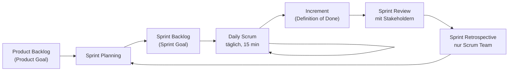

## Worum geht es?

**[Scrum](glossar:scrum)** ist das bekannteste agile Rahmenwerk. Es ist bewusst schlank – und genau
deshalb fragt die Prüfung die Begriffe **exakt** ab:

- **3 Verantwortlichkeiten:** Product Owner, Scrum Master, Developers
- **5 Events:** Sprint, Sprint Planning, Daily Scrum, Sprint Review, Sprint Retrospective
- **3 Artefakte:** Product Backlog, Sprint Backlog, Increment

Die Events verwechselt man leicht. Am Ende gibt es deshalb eine klare Abgrenzung.

## Wie funktioniert es?

### Das große Bild: ein Sprint

Ein **[Sprint](glossar:sprint)** dauert **höchstens einen Monat**, meist zwei bis vier Wochen.
Alle anderen Events finden **innerhalb** des Sprints statt. Der nächste Sprint beginnt direkt nach
dem vorigen.

### Drei Verantwortlichkeiten

Ein Scrum Team hat in der Regel **10 oder weniger** Personen.

| Verantwortlichkeit | Aufgabe | Analogie |
| --- | --- | --- |
| **Product Owner** | maximiert den Wert des Produkts, pflegt und ordnet das Product Backlog – **eine** Person | Kapitän: entscheidet, wohin |
| **Scrum Master** | sorgt dafür, dass Scrum verstanden und gelebt wird, räumt Hindernisse weg | Trainer: sorgt für gutes Spiel |
| **Developers** | erstellen in jedem Sprint ein nutzbares Increment | Mannschaft: spielt |

„Developers“ heißt nicht nur Programmierer – auch Admins, Tester oder Designer gehören dazu.

### Fünf Events

| Event | Timebox (Sprint von 1 Monat) | wer | Frage |
| --- | --- | --- | --- |
| Sprint | ≤ 1 Monat | alle | Rahmen für alle Events |
| Sprint Planning | ≤ 8 h | Scrum Team | **Warum**, **was**, **wie** in diesem Sprint? |
| Daily Scrum | 15 min | Developers | Wie kommen wir dem Sprint Goal heute näher? |
| Sprint Review | ≤ 4 h | Scrum Team + Stakeholder | **Was** wurde geschafft – passt das Produkt? |
| Sprint Retrospective | ≤ 3 h | Scrum Team | **Wie** haben wir gearbeitet – was verbessern wir? |

Bei kürzeren Sprints sind Planning, Review und Retrospektive meist kürzer.

### Drei Artefakte mit je einer Verpflichtung

| Artefakt | Inhalt | Verpflichtung (Commitment) |
| --- | --- | --- |
| Product Backlog | geordnete Liste von allem, was das Produkt braucht | **Product Goal** |
| Sprint Backlog | Sprint Goal + ausgewählte Einträge + Plan | **Sprint Goal** |
| Increment | nutzbares Ergebnis, das den Qualitätsstandard erfüllt | **Definition of Done** |

Die **Definition of Done** legt fest, wann etwas wirklich fertig ist – z. B. „getestet, dokumentiert,
in der Pipeline grün“.

> **Halten wir kurz fest:**
>
> 1. Product Owner = Wert und Backlog, Scrum Master = Scrum und Hindernisse, Developers = Increment.
> 2. Review = **Produkt** mit Stakeholdern, Retrospektive = **Zusammenarbeit** im Team.
> 3. Product Goal → Product Backlog, Sprint Goal → Sprint Backlog, Definition of Done → Increment.

## Warum ist es so?

Scrum beruht auf **Empirie**: Wissen entsteht aus Erfahrung. Darum gibt es feste Punkte zum
**Überprüfen** und **Anpassen** – das Daily für den Tag, die Review für das Produkt, die
Retrospektive für die Arbeitsweise.

Warum feste Timeboxen?

Ohne Zeitgrenze werden Besprechungen länger und länger. Die Timebox zwingt zur Konzentration auf das
Wesentliche. Beim Sprint selbst sorgt die feste Länge für einen gleichmäßigen Takt, in dem das Team
lernt, realistisch zu planen.

Warum nur ein Product Owner?

Gäbe es mehrere, bekäme das Team widersprüchliche Prioritäten. Eine Person entscheidet über die
Reihenfolge im Product Backlog. Wünsche anderer laufen über sie – sie kann sie nicht ignorieren,
muss sie aber abwägen.

## Praxisbezug im Betrieb

- **Ticketsystem als Backlog:** Epics und Tickets bilden das Product Backlog, ein Board zeigt den Sprint.
- **Definition of Done für Infrastruktur:** „Monitoring eingerichtet, Doku im Wiki, Rollback getestet“.
- **Retrospektive ernst nehmen:** Hier entstehen die Verbesserungen, etwa ein neuer Check in der
  Jenkins-Pipeline.

## Typische Prüfungsfalle

- **Review und Retrospektive vertauscht:** Review = Ergebnis mit Stakeholdern, Retro = Arbeitsweise
  im Team.
- **Daily als Statusbericht an den Chef:** Das Daily ist für die **Developers**, um den Tag zu planen.
- **Scrum Master als Projektleiter:** Er führt nicht fachlich, er sorgt für funktionierendes Scrum.
- **„Weekly Stand-up“:** Gibt es in Scrum nicht – das Event heißt **Daily** Scrum.
- **Sprint länger als ein Monat:** Höchstens ein Monat.
- **Rollen oder Verantwortlichkeiten?** Der Scrum Guide 2020 sagt Verantwortlichkeiten, ältere
  Fassungen sagten Rollen – gemeint sind dieselben drei.

## Nicht verwechseln

| Event | Wer? | Worüber? | Ergebnis |
| --- | --- | --- | --- |
| Sprint Planning | Scrum Team | was und wie im nächsten Sprint | Sprint Backlog mit Sprint Goal |
| Daily Scrum | Developers | Fortschritt zum Sprint Goal | Plan für die nächsten 24 h |
| Sprint Review | Team + Stakeholder | das **Increment** | angepasstes Product Backlog |
| Sprint Retrospective | Scrum Team | **Zusammenarbeit**, Prozesse, Werkzeuge | Verbesserungsmaßnahmen |

## Merksatz

**Planning plant, Daily synchronisiert, Review zeigt das Produkt, Retro verbessert das Team – und
alles passiert im Sprint von höchstens einem Monat.**
