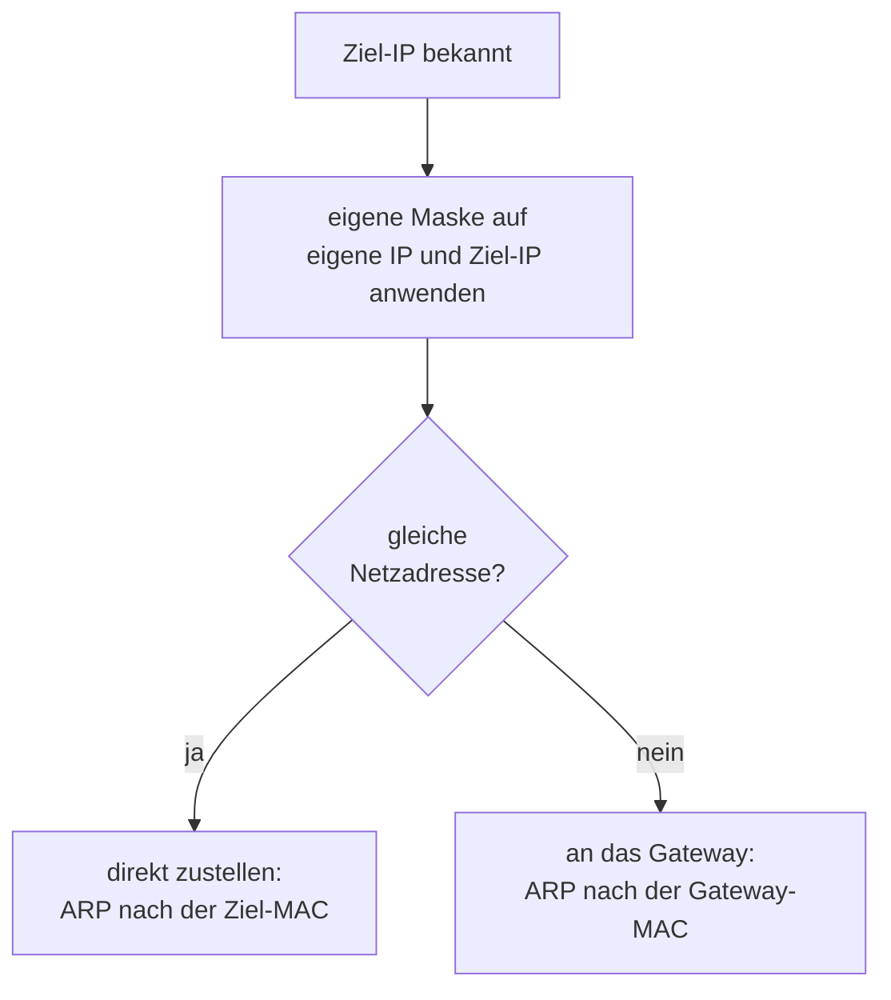

## Worum geht es?

Zwei Fragen aus dem Betriebsalltag – und aus der Prüfung:

- **Kann mein Rechner das Ziel direkt erreichen, oder muss das Paket zum Gateway?**
- **Wie teile ich ein Netz auf, wenn die Abteilungen unterschiedlich groß sind?** Das ist VLSM
  (Variable Length Subnet Mask).

## Wie funktioniert es?

### Die Entscheidung des Absenders

Wichtig: Der Absender rechnet mit **seiner eigenen** Maske. Die Maske des Ziels kennt er nicht.

### Rechenbeispiel: PC und Server

Ein PC hat **10.20.0.140/26** und will den Server **10.20.0.100** erreichen.

| | 4. Oktett dual | UND 192 | Netzadresse |
| --- | --- | --- | --- |
| PC (eigene IP) | 10001100 | 10000000 | 10.20.0.**128** |
| Ziel | 01100100 | 01000000 | 10.20.0.**64** |

128 ≠ 64 → **verschiedene Netze**. Der PC schickt das Paket an sein Gateway, obwohl beide Adressen
mit 10.20.0 beginnen.

Bei 10.20.0.180 wäre es anders: 180 UND 192 = 128 → gleiches Netz, direkte Zustellung.

### VLSM: der größte Bedarf zuerst

Die ArchivTech hat **10.20.0.0/24** und braucht:

| Bereich | Hosts | kleinstes passendes Netz |
| --- | ---: | --- |
| Server | 100 | 2⁷ − 2 = 126 → /25 |
| Clients | 50 | 2⁶ − 2 = 62 → /26 |
| Drucker | 20 | 2⁵ − 2 = 30 → /27 |
| Router-Verbindung | 2 | 2² − 2 = 2 → /30 |

Regel: **vom größten zum kleinsten** vergeben, jedes Netz direkt hinter das vorige.

### Die fertige Aufteilung

| Bereich | Netz | Hosts von – bis | Broadcast |
| --- | --- | --- | --- |
| Server | 10.20.0.0/25 | .1 – .126 | .127 |
| Clients | 10.20.0.128/26 | .129 – .190 | .191 |
| Drucker | 10.20.0.192/27 | .193 – .222 | .223 |
| Router-Verbindung | 10.20.0.224/30 | .225 – .226 | .227 |
| frei | ab 10.20.0.228 | | |

Jede Netzadresse ist ein Vielfaches der eigenen Netzgröße: 0, 128 (= 2 × 64), 192 (= 6 × 32),
224 (= 56 × 4). So überschneidet sich nichts.

> **Halten wir kurz fest:**
>
> 1. Gleiches Netz? Eigene Maske auf beide Adressen, Netzadressen vergleichen.
> 2. Verschieden → Paket ans Gateway, ARP fragt nach der Gateway-MAC.
> 3. VLSM: größtes Netz zuerst, jedes auf einer passenden Grenze.

## Warum ist es so?

Direkt zustellen kann ein Rechner nur im eigenen Netz – nur dort erreicht ihn ein ARP-Broadcast.
Alles andere muss ein Router weitertragen.

Warum vergibt man bei VLSM das größte Netz zuerst?

Ein Netz muss auf einer Adresse beginnen, die ein Vielfaches seiner Größe ist. Fängst du mit dem
kleinen /30 bei .0 an, kann das /25 erst bei .128 beginnen – und belegt dann den Rest. Für Clients und
Drucker ist kein Platz mehr. Groß zuerst füllt den Bereich lückenlos.

Warum /30 für eine Router-Verbindung?

Zwischen zwei Routern gibt es genau zwei Geräte. /30 bietet genau 2 nutzbare Adressen und
verschwendet nichts. Moderne Router unterstützen auch /31 (RFC 3021) ganz ohne Netz- und
Broadcastadresse – für die Prüfung bleib bei /30.

## Praxisbezug im Betrieb

- **„Ping ins Nachbarnetz geht nicht“:** Prüfe zuerst Maske und Gateway am Client – mit falscher
  Maske hält er ein fremdes Netz für das eigene und fragt per ARP ins Leere.
- **Adressplan erweitern:** Freie Bereiche hinter den vergebenen Netzen notieren, damit spätere
  Subnetze passen.
- **`ip route`** zeigt, welche Netze direkt erreichbar sind und welches Gateway für den Rest gilt.

## Typische Prüfungsfalle

- **Nur die ersten Oktette vergleichen:** 10.20.0.140 und 10.20.0.100 sehen gleich aus, liegen bei
  /26 aber in verschiedenen Netzen.
- **Maske des Ziels benutzt:** Es zählt die Maske des **Absenders**.
- **VLSM klein zuerst:** führt zu Lücken und Überschneidungen.
- **Netz nicht auf seiner Grenze:** Ein /27 kann nicht bei .200 beginnen – nur bei Vielfachen von 32.

## Nicht verwechseln

| Begriff | Bedeutung |
| --- | --- |
| gleiche Netzadresse | direkte Zustellung im eigenen Netz |
| Gateway | Router, der Pakete in fremde Netze weiterleitet |
| FLSM | alle Subnetze gleich groß (letztes Kapitel) |
| VLSM | Subnetze unterschiedlich groß, nach Bedarf |
| /30 | 2 Hosts, typisch für Router-Verbindungen |

## Merksatz

**Eigene Maske auf beide Adressen – gleiches Netz heißt direkt, sonst ab zum Gateway. Bei VLSM kommt
das Größte zuerst, und jedes Netz startet auf seinem Vielfachen.**
