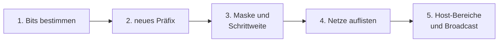

## Worum geht es?

Ein großes Netz mit Hunderten Rechnern wird unübersichtlich und langsam: Jeder Broadcast erreicht
alle. Darum teilt man es in **Subnetze** – etwa je Abteilung oder je Serverzone.

Typische Prüfungsaufgabe:

- Gegeben: ein Netz und eine Anzahl Subnetze **oder** eine Anzahl Hosts je Subnetz.
- Gesucht: neue Maske, Netzadressen, erster/letzter Host, Broadcast.

## Wie funktioniert es?

### Das Vorgehen in fünf Schritten

| Gegeben | Bits bestimmen | Formel |
| --- | --- | --- |
| Anzahl Subnetze | kleinstes n mit 2ⁿ ≥ Subnetze | n Bits vom Hostanteil **leihen** |
| Hosts je Subnetz | kleinstes h mit 2ʰ − 2 ≥ Hosts | h Bits **behalten** |

Die **Schrittweite** ist der Abstand zwischen zwei Subnetzen: 256 − Wert der Maske im Oktett, in dem
sich die Grenze befindet.

### Beispiel 1: 192.168.10.0/24 in 4 Subnetze

1. **Bits:** 2² = 4 ≥ 4 → n = **2** Bits leihen.
2. **Präfix:** 24 + 2 = **/26**.
3. **Maske:** 255.255.255.**192** (`11000000`), Schrittweite 256 − 192 = **64**.
4. **Netze:** bei 0, 64, 128, 192.

| Subnetz | Netzadresse | erster Host | letzter Host | Broadcast |
| ---: | --- | --- | --- | --- |
| 1 | 192.168.10.0 | .1 | .62 | .63 |
| 2 | 192.168.10.64 | .65 | .126 | .127 |
| 3 | 192.168.10.128 | .129 | .190 | .191 |
| 4 | 192.168.10.192 | .193 | .254 | .255 |

Je Subnetz: 2⁶ − 2 = **62** Hosts. Der Broadcast liegt immer **eins vor** dem nächsten Netz.

### Beispiel 2: nach Hostanzahl im 3. Oktett

Die ArchivTech hat **172.16.48.0/20** und braucht Subnetze mit mindestens **500 Hosts**.

1. **Bits:** 2⁸ − 2 = 254 (zu wenig), 2⁹ − 2 = **510** ≥ 500 → h = **9** Hostbits.
2. **Präfix:** 32 − 9 = **/23**.
3. **Maske:** 255.255.**254**.0 → die Grenze liegt im 3. Oktett, Schrittweite 256 − 254 = **2**.
4. **Anzahl:** 23 − 20 = 3 geliehene Bits → 2³ = **8** Subnetze.

| Subnetz | Netzadresse | erster Host | letzter Host | Broadcast |
| ---: | --- | --- | --- | --- |
| 1 | 172.16.48.0 | 172.16.48.1 | 172.16.49.254 | 172.16.49.255 |
| 2 | 172.16.50.0 | 172.16.50.1 | 172.16.51.254 | 172.16.51.255 |
| 3 | 172.16.52.0 | 172.16.52.1 | 172.16.53.254 | 172.16.53.255 |
| … | … | … | … | … |
| 8 | 172.16.62.0 | 172.16.62.1 | 172.16.63.254 | 172.16.63.255 |

Ein Subnetz umfasst hier **zwei** Werte im 3. Oktett (48 und 49). Hosts wie 172.16.48.255 sind
deshalb gültig – nur die letzte Adresse 172.16.49.255 ist der Broadcast.

> **Halten wir kurz fest:**
>
> 1. Subnetze gegeben → 2ⁿ ≥ Anzahl. Hosts gegeben → 2ʰ − 2 ≥ Anzahl.
> 2. Schrittweite = 256 − Maskenwert im Grenz-Oktett.
> 3. Broadcast = nächste Netzadresse minus 1.

## Warum ist es so?

Jedes geliehene Bit **verdoppelt** die Zahl der Subnetze und **halbiert** ihre Größe. Mehr als 2ⁿ
Kombinationen geben n Bits nicht her – deshalb immer Zweierpotenzen.

Warum ist die Schrittweite 256 minus Maskenwert?

Im Grenz-Oktett bleiben nach den Netzbits noch einige Hostbits übrig. Ihr Wertebereich ist die Größe
eines Subnetzes in diesem Oktett. Bei Maske 192 (`11000000`) sind das 6 Bit = 64 Werte. 256 − 192 =
64 liefert genau diese Zahl, ohne dass du die Bits zählen musst.

Warum teilt man überhaupt auf, statt ein großes Netz zu nehmen?

Kleinere Netze heißen weniger Broadcast-Verkehr, klarere Firewall-Regeln zwischen Zonen und Fehler,
die auf ein Subnetz begrenzt bleiben. Oft gehört zu jedem Subnetz ein eigenes **VLAN**. Zwischen
VLANs muss geroutet werden – genau dort setzt man die Firewall-Regeln.

## Praxisbezug im Betrieb

- **IP-Adressplan (IPAM):** Jedes Subnetz bekommt Zweck, VLAN, Gateway und Verantwortliche.
- **Reserve einplanen:** Ein Subnetz für 60 Rechner als /26 ist sofort voll, wenn zwei neue
  Drucker dazukommen.
- **Python prüft mit:** `ipaddress.ip_network("172.16.48.0/20").subnets(new_prefix=23)` listet
  alle acht Netze.

## Typische Prüfungsfalle

- **2ⁿ und 2ʰ − 2 vertauscht:** Bei **Subnetzen** ohne − 2, bei **Hosts** mit − 2.
- **Grenz-Oktett übersehen:** Bei /23 liegt die Schrittweite im 3. Oktett, nicht im 4.
- **.255 immer als Broadcast:** Bei /23 ist 172.16.48.255 ein normaler Host.
- **Schrittweite falsch gezählt:** Netze bei 0, 64, 128, 192 – nicht bei 1, 65 …

## Nicht verwechseln

| Begriff | Bedeutung |
| --- | --- |
| geliehene Bits | vom Hostanteil abgezweigt, ergeben 2ⁿ Subnetze |
| Hostbits | übrig gebliebene Bits, ergeben 2ʰ − 2 Hosts |
| Schrittweite | Abstand zwischen zwei Netzadressen |
| Subnetz | Teilnetz mit eigener Netz- und Broadcastadresse |
| VLAN | logisch getrenntes Netz auf Schicht 2, oft ein Subnetz je VLAN |

## Merksatz

**Bits leihen für Netze (2ⁿ), Bits behalten für Hosts (2ʰ − 2). Schrittweite ist 256 minus Maske,
und der Broadcast steht direkt vor dem nächsten Netz.**
