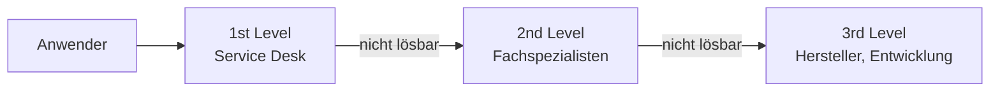

## Worum geht es?

Wenn bei Kunden oder Kollegen etwas nicht funktioniert, landet das beim **Support**. Damit nichts
verloren geht, läuft alles über ein **Ticketsystem**. Und wenn viele neue Geräte auf einmal kommen,
braucht es einen geplanten **Rollout**.

## Wie funktioniert es?

### Die Support-Level

| Level | Wer | Aufgaben | Beispiel |
| --- | --- | --- | --- |
| **1st** | Service Desk, zentrale Anlaufstelle (SPOC) | annehmen, erfassen, Standardlösungen, weiterleiten | Passwort zurücksetzen |
| **2nd** | Fachspezialisten der IT | tiefere Analyse, Konfiguration | Archivserver erreicht Speicher nicht |
| **3rd** | Hersteller, Entwickler | Fehler in Produkt oder Code beheben | Firmwarefehler der Appliance |

**Funktionale Eskalation:** an das nächste Level mit mehr Fachwissen. **Hierarchische Eskalation:** an
eine höhere Führungsebene, etwa wenn eine Frist aus dem **SLA** (Service Level Agreement) droht.

### Was steht in einem Ticket?

| Feld | Beispiel |
| --- | --- |
| Melder, Kontakt | Kunde Nord GmbH, Frau M. |
| Kategorie | Incident (Störung) / Service Request (Anfrage) |
| Beschreibung, Fehlermeldung | „Download bricht bei 80 % ab“ |
| Priorität (Auswirkung × Dringlichkeit) | hoch |
| Status | neu → in Bearbeitung → gelöst → geschlossen |
| Verlauf, Lösung | alle Schritte dokumentiert |

| Begriff | Bedeutung |
| --- | --- |
| Incident | Störung: etwas funktioniert nicht wie vereinbart |
| Service Request | Anfrage: etwas Neues wird gewünscht (Zugang, Software) |
| Problem | Ursache hinter einem oder mehreren Incidents |

### KI-Unterstützung im Support

- **Tickets vorsortieren:** Kategorie und Priorität vorschlagen
- **Wissensdatenbank durchsuchen:** passende Lösungen anbieten
- **Chatbot im 1st Level:** Standardfragen rund um die Uhr
- **Grenzen:** Antworten prüfen, keine vertraulichen Daten in fremde Dienste, Mensch entscheidet

### Rollout planen

Beispiel: **60 neue Notebooks** ausrollen.

| Phase | Inhalt |
| --- | --- |
| Planung | Image, Software, Zeitplan, Budget, Kommunikation |
| Pilot | 5 Geräte bei ausgewählten Nutzern, Rückmeldungen sammeln |
| Rollout in Wellen | z. B. 15 Geräte pro Tag, Abteilung für Abteilung |
| Nacharbeit | Altgeräte einsammeln, Daten löschen, Inventar pflegen |

Budget (Annahmen): 60 × 1.000 € Geräte + 60 × 0,5 h × 69 €/h Einrichtung = 60.000 € + 2.070 € =
**62.070 €**.

> **Halten wir kurz fest:**
>
> 1. 1st Level nimmt an und löst Standardfälle, 2nd Level analysiert, 3rd Level ist Hersteller/Entwicklung.
> 2. Ticket: Melder, Kategorie, Beschreibung, Priorität, Status, Verlauf.
> 3. Rollout: planen, Pilot, Wellen, Nacharbeit – mit Budget.

## Warum ist es so?

Die meisten Anfragen sind Standardfälle. Wenn der 1st Level sie schnell löst, haben Spezialisten Zeit
für die schweren Fälle. Das Ticketsystem sorgt dafür, dass nichts vergessen wird und jeder den Stand
sieht.

Warum ein Pilot vor dem großen Rollout?

Fehler im Image oder fehlende Software betreffen sonst gleich 60 Personen. Im Pilot fallen sie bei
wenigen, vorbereiteten Nutzern auf und lassen sich vor dem großen Ausrollen beheben.

## Praxisbezug im Betrieb

- **Gute Tickets** enthalten Fehlermeldung, Zeitpunkt, betroffene Systeme und schon getestete Schritte.
- **Wissensdatenbank:** Gelöste Tickets werden zu Anleitungen für den 1st Level.
- **Rollout-Liste:** wer, welches Gerät, Seriennummer, wann, unterschrieben.

## Typische Prüfungsfalle

- **Level vertauscht:** Der Hersteller ist 3rd Level.
- **Incident und Problem verwechselt:** Problem = Ursache, Incident = Symptom.
- **Funktionale und hierarchische Eskalation vertauscht:** Fachwissen gegenüber Führungsebene.
- **Rollout ohne Pilot oder ohne Altgeräte-Prozess.**

## Nicht verwechseln

| Begriff | Bedeutung |
| --- | --- |
| SPOC | Single Point of Contact, eine Anlaufstelle |
| SLA | vereinbarte Servicequalität, z. B. Reaktionszeit |
| funktionale Eskalation | an mehr Fachwissen |
| hierarchische Eskalation | an höhere Führungsebene |
| Rollout | geplante Verteilung von Hard- oder Software |

## Merksatz

**Erst der Service Desk, dann die Spezialisten, zuletzt der Hersteller – alles im Ticket dokumentiert.
Und kein Rollout ohne Pilot.**
