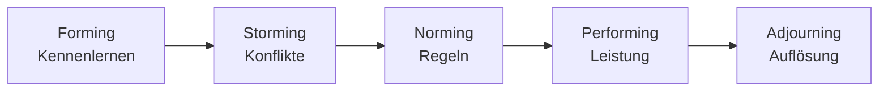

## Worum geht es?

Ein neues Projektteam arbeitet nicht vom ersten Tag an reibungslos. Der Psychologe Bruce Tuckman hat
beschrieben, welche **Phasen** Teams typischerweise durchlaufen.

| Phase | deutsch | Stimmung |
| --- | --- | --- |
| Forming | Orientierung | höflich, abwartend |
| Storming | Konflikt | Reibung, Machtfragen |
| Norming | Regeln finden | Zusammenhalt wächst |
| Performing | Leistung | produktiv, selbstständig |
| Adjourning | Auflösung | Abschluss, Abschied |

Die letzte Phase kam 1977 hinzu.

## Wie funktioniert es?

### Das große Bild

### Die Phasen im Archivserver-Projekt

| Phase | Was passiert | Was die Projektleitung tut |
| --- | --- | --- |
| **Forming** | Man stellt sich vor, Rollen sind unklar, alle sind vorsichtig | Ziele und Rollen klären, Kick-off |
| **Storming** | Streit über Vorgehen: Image selbst bauen oder Herstellervorlage? | Konflikte offen ansprechen, moderieren |
| **Norming** | Team einigt sich auf Regeln: tägliches Kurztreffen, Doku im Wiki | Regeln festhalten, Team stärken |
| **Performing** | Team arbeitet selbstständig, hilft sich gegenseitig | wenig eingreifen, Hindernisse beseitigen |
| **Adjourning** | Projekt endet, Team löst sich auf | Erfolge würdigen, Erfahrungen sichern |

> **Halten wir kurz fest:**
>
> 1. Fünf Phasen: Forming, Storming, Norming, Performing, Adjourning.
> 2. Storming ist normal – Konflikte gehören dazu.
> 3. Die Führung passt sich an: am Anfang viel steuern, später wenig.

## Warum ist es so?

Menschen müssen erst klären, wer welche Rolle hat und wie man zusammenarbeitet. Diese Klärung erzeugt
Reibung. Erst wenn sie geschafft ist, kann sich das Team auf die Aufgabe konzentrieren.

Laufen die Phasen immer in dieser Reihenfolge?

Nicht immer. Kommt ein neues Teammitglied dazu oder ändert sich das Ziel, kann ein Team zurück ins
Storming fallen. Das Modell beschreibt eine typische Entwicklung, kein festes Gesetz.

## Praxisbezug im Betrieb

- **Kick-off** nutzt die Forming-Phase: Ziele, Rollen und Erwartungen klären.
- **Retrospektiven** (Scrum) helfen beim Norming – Regeln werden gemeinsam angepasst.
- **Abschlusstreffen** würdigt die Arbeit und sichert Erfahrungen für das nächste Projekt.

## Typische Prüfungsfalle

- **Reihenfolge vertauscht:** Storming kommt **vor** Norming.
- **Storming als Fehler:** Es ist eine normale Phase, kein Scheitern.
- **Adjourning vergessen:** Die fünfte Phase gehört dazu.
- **Phase ohne Merkmal:** Zu jeder Phase ein typisches Verhalten nennen.

## Nicht verwechseln

| Phase | Kennzeichen |
| --- | --- |
| Forming | Unsicherheit, Höflichkeit, Orientierung |
| Storming | Konflikte, Machtkämpfe, Widerstand |
| Norming | Regeln, Vertrauen, Zusammenhalt |
| Performing | hohe Leistung, Selbstständigkeit |
| Adjourning | Abschluss und Auflösung |

## Merksatz

**Erst kennenlernen, dann streiten, dann einigen, dann leisten – und am Ende gemeinsam abschließen.**
