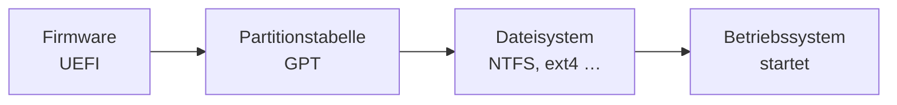

## Worum geht es?

Bevor ein Betriebssystem startet, arbeitet die **Firmware**: früher das BIOS, heute **[UEFI](glossar:uefi)**.
Und bevor Daten auf einer Platte landen, braucht sie eine **Partitionstabelle** und ein
**Dateisystem**.

## Wie funktioniert es?

### BIOS und UEFI

| | BIOS (Legacy) | UEFI |
| --- | --- | --- |
| Alter | seit den 1980ern | Nachfolger, heute Standard |
| Partitionstabelle | MBR | GPT (MBR im Kompatibilitätsmodus) |
| Secure Boot | nein | ja: startet nur signierte Bootloader |
| Bedienung | Textmenü, Tastatur | grafisch, Maus möglich |
| Netzwerk beim Start | eingeschränkt | Netzwerkboot, Treiber integriert |

### Typische Einstellungen

- **Bootreihenfolge**: zuerst USB-Stick für die Installation
- **Secure Boot** ein/aus
- **Virtualisierung** (Intel VT-x, AMD-V) für Hypervisoren aktivieren
- **TPM** für Festplattenverschlüsselung aktivieren
- **Passwort** für Firmware-Einstellungen setzen
- Uhrzeit, Lüfter, Energiesparen, Onboard-Geräte

### MBR und GPT

| | MBR | GPT |
| --- | --- | --- |
| maximale Plattengröße | 2 TiB (bei 512-Byte-Sektoren) | praktisch unbegrenzt |
| Partitionen | 4 primäre (oder 3 + erweiterte) | unter Windows bis 128 |
| Sicherheit | eine Kopie am Anfang | Kopie am Anfang **und** Ende, Prüfsummen |

Die 2-TiB-Grenze: 2³² Sektoren × 512 Byte = 2.199.023.255.552 Byte = **2 TiB**.

### Dateisysteme im Vergleich

| Dateisystem | System | max. Dateigröße | Besonderheiten |
| --- | --- | --- | --- |
| **FAT32** | überall lesbar | **4 GiB − 1 Byte** | kein Journaling, keine Rechte; USB-Sticks, UEFI-Systempartition |
| **exFAT** | Windows, macOS, Linux | sehr groß | für große Wechseldatenträger |
| **NTFS** | Windows | sehr groß | Rechte (ACL), Journaling, Verschlüsselung, Komprimierung |
| **APFS** | macOS, iOS | sehr groß | Snapshots, Verschlüsselung, für SSDs optimiert |
| **ext4** | Linux | 16 TiB (bei 4-KiB-Blöcken) | Journaling, Unix-Rechte; Standard vieler Distributionen |

RHEL nutzt als Standard **XFS**; ext4 ist ebenso verbreitet.

> **Halten wir kurz fest:**
>
> 1. UEFI löst BIOS ab: GPT, Secure Boot, grafisch.
> 2. MBR: max. 2 TiB und 4 primäre Partitionen; GPT: praktisch keine Grenzen.
> 3. FAT32 nur bis 4 GiB pro Datei; NTFS (Windows), APFS (Apple), ext4 (Linux) mit Rechten und Journaling.

## Warum ist es so?

Das BIOS stammt aus einer Zeit kleiner Festplatten. Mit 32-Bit-Sektoradressen im MBR war bei 2 TiB
Schluss. GPT nutzt 64-Bit-Adressen – damit ist die Grenze weit jenseits heutiger Platten.

Was bringt Journaling?

Das Dateisystem schreibt zuerst in ein Protokoll (Journal), was es ändern will, und erst dann die
Änderung selbst. Fällt mitten im Schreiben der Strom aus, kann es beim Neustart nachsehen, was
unvollständig war, und den Zustand schnell reparieren. FAT32 hat das nicht.

Warum ist FAT32 dann noch im Einsatz?

Weil es fast jedes Gerät lesen kann: Kameras, Drucker, Fernseher, Firmware. Die UEFI-Spezifikation
schreibt für die EFI-Systempartition ein FAT-Dateisystem vor. Für eine 6-GB-ISO-Datei auf einem
USB-Stick braucht man aber exFAT oder NTFS.

## Praxisbezug im Betrieb

- **Server neu installieren:** UEFI-Modus, GPT, Secure Boot an – Standard bei neuer Hardware.
- **USB-Stick für Linux und Windows:** exFAT als gemeinsamer Nenner.
- **`lsblk -f`** zeigt auf Linux Partitionen und Dateisysteme, **`diskpart`** oder die
  Datenträgerverwaltung unter Windows.

## Typische Prüfungsfalle

- **FAT32 für große Dateien:** Grenze 4 GiB pro Datei.
- **MBR auf 4-TB-Platte:** Nur 2 TiB nutzbar – GPT verwenden.
- **Secure Boot verhindert jedes Linux:** Viele Distributionen haben signierte Bootloader.
- **Dateisystem und Partitionstabelle verwechselt:** GPT teilt die Platte auf, NTFS organisiert
  Dateien in einer Partition.

## Nicht verwechseln

| Begriff | Bedeutung |
| --- | --- |
| BIOS / UEFI | Firmware, die beim Einschalten startet |
| MBR / GPT | Partitionstabelle: wie die Platte aufgeteilt ist |
| Partition | abgegrenzter Bereich einer Platte |
| Formatieren | Dateisystem auf einer Partition anlegen |
| Dateisystem | organisiert Dateien, Ordner und Rechte |
| Secure Boot | startet nur signierte Bootloader |

## Merksatz

**UEFI startet, GPT teilt auf, das Dateisystem ordnet. FAT32 versteht jeder, schluckt aber keine
Datei über 4 GiB.**
