## Worum geht es?

Das **Aktivitätsdiagramm** ist 2025 neu im Katalog. Es zeigt einen **Ablauf** Schritt für Schritt –
einen Geschäftsprozess genauso wie einen Algorithmus. Es übernimmt damit die Rolle, die früher
Programmablaufplan und Struktogramm hatten.

Du sollst Aktivitätsdiagramme **lesen**, **vervollständigen** und **selbst zeichnen** können.

## Wie funktioniert es?

### Die Bausteine

| Element | Darstellung | Bedeutung |
| --- | --- | --- |
| Startknoten | gefüllter Kreis ● | Beginn |
| Aktion | Rechteck mit runden Ecken | ein Schritt |
| Kontrollfluss | Pfeil | Reihenfolge |
| Verzweigung | Raute ◇, ausgehende Pfeile mit `[Bedingung]` | genau ein Weg wird genommen |
| Zusammenführung | Raute ◇ | Wege laufen wieder zusammen |
| Gabelung (Fork) | dicker Balken | ab hier **parallel** |
| Vereinigung (Join) | dicker Balken | warten, bis alle parallelen Wege fertig sind |
| Endknoten | Kreis mit Punkt ◉ | Ende der Aktivität |
| Partition (Swimlane) | Spalte oder Zeile | wer die Aktion ausführt |

### Beispiel 1: Archivjob mit Verzweigung und Parallelität

```mermaid
flowchart TD
  S((" ")) --> A["Datenmenge ermitteln"]
  A --> D{" "}
  D -- "[frei ≥ Datenmenge]" --> F[["Gabelung"]]
  D -- "[sonst]" --> M["Admin benachrichtigen"]
  F --> P1["Daten kopieren"]
  F --> P2["Prüfsummen berechnen"]
  P1 --> J[["Vereinigung"]]
  P2 --> J
  J --> L["Protokoll schreiben"]
  M --> Z{" "}
  L --> Z
  Z --> E(("◉"))
  style S fill:#333,stroke:#333
```

- Gabelung und Vereinigung sind hier als Kasten angedeutet; auf Papier zeichnest du sie als dicken
  **Balken**.
- Die Bedingungen in **eckigen Klammern** schließen sich gegenseitig aus.
- Zwischen Gabelung und Vereinigung laufen beide Aktionen **gleichzeitig**.
- An der Zusammenführung treffen sich die Wege, bevor es zum Ende geht.

### Beispiel 2: ein Algorithmus mit Schleife

Die Summe der Verzeichnisgrößen (aus „Pseudocode: Schleifen“) als Aktivitätsdiagramm:

```mermaid
flowchart TD
  S((" ")) --> A["summe ← 0<br/>i ← 0"]
  A --> M{" "}
  M --> D{" "}
  D -- "[i < laenge(groessen)]" --> B["summe ← summe + groessen[i]"]
  B --> C["i ← i + 1"]
  C --> M
  D -- "[sonst]" --> O["summe ausgeben"]
  O --> E(("◉"))
  style S fill:#333,stroke:#333
```

Eine **Schleife** ist ein Rückpfeil zu einer Zusammenführung vor der Verzweigung.

### Swimlanes: wer macht was?

| Kunde | Portal | Archivar |
| --- | --- | --- |
| Löschung beantragen | Antrag speichern, Archivar benachrichtigen | Aufbewahrungsfrist prüfen |
| | Kunde informieren | löschen oder sperren |

Im Diagramm sind das Spalten; jede Aktion steht in der Spalte dessen, der sie ausführt.

> **Halten wir kurz fest:**
>
> 1. Start ●, Aktion, Raute mit `[Bedingungen]`, Ende ◉.
> 2. Balken = Gabelung (parallel los) und Vereinigung (auf alle warten).
> 3. Schleife = Rückpfeil zur Zusammenführung vor der Verzweigung; Swimlanes zeigen Zuständigkeit.

## Warum ist es so?

Aktivitätsdiagramme können mehr als ein Programmablaufplan: **Parallelität** und **Zuständigkeiten**
lassen sich direkt darstellen. Darum eignen sie sich für Software und Geschäftsprozesse gleichermaßen.

Warum braucht man eine Vereinigung, reicht nicht eine Zusammenführung?

Eine **Zusammenführung** (Raute) lässt den Ablauf weiterlaufen, sobald **ein** Weg ankommt – richtig
nach einer Entweder-oder-Verzweigung. Eine **Vereinigung** (Balken) wartet, bis **alle** parallelen
Wege fertig sind. Nach dem Kopieren darf das Protokoll erst geschrieben werden, wenn auch die
Prüfsummen fertig sind.

## Praxisbezug im Betrieb

- **Prozesse dokumentieren:** Ablauf einer Benutzeranlage oder eines Notfall-Restores.
- **CI/CD-Pipelines** sind Aktivitätsdiagramme: Stages laufen nacheinander oder parallel.
- **Vor dem Skript:** Ablauf zeichnen, dann programmieren – Fehler fallen früher auf.

## Typische Prüfungsfalle

- **Bedingungen ohne Klammern** oder nicht vollständig (Fall „sonst“ fehlt).
- **Raute statt Balken bei Parallelität:** Gleichzeitig = Balken.
- **Endknoten vergessen** oder mit dem Startknoten verwechselt.
- **Schleife ohne Abbruchbedingung:** Jede Schleife braucht einen Ausgang.

## Nicht verwechseln

| Element | Bedeutung |
| --- | --- |
| Verzweigung (Raute) | entweder – oder |
| Zusammenführung (Raute) | Wege laufen zusammen, kein Warten |
| Gabelung (Balken) | parallel weiter |
| Vereinigung (Balken) | warten auf alle |
| Swimlane | Zuständigkeit |

## Merksatz

**Kreis voll beginnt, Kreis mit Punkt endet. Raute entscheidet, Balken teilt und sammelt – und eine
Schleife ist nur ein Pfeil zurück.**
