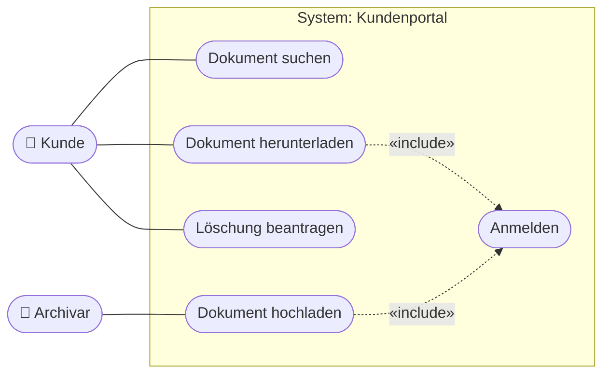
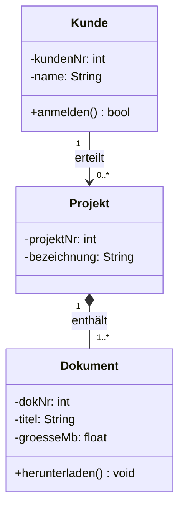

## Worum geht es?

Die **[UML](glossar:uml)** (Unified Modeling Language) ist eine genormte Bildsprache für Software und
Abläufe. Der Katalog nennt drei Diagramme:

| Diagramm | Frage | Kapitel |
| --- | --- | --- |
| Anwendungsfalldiagramm (Use Case) | **Wer** macht **was** mit dem System? | dieses |
| Klassendiagramm | **Woraus** besteht die Software? | dieses |
| Aktivitätsdiagramm | **Wie** läuft ein Vorgang ab? | nächstes |

Beispiel: das **Kundenportal** des ArchivTech-Archivs.

## Wie funktioniert es?

### Anwendungsfalldiagramm: die Bausteine

| Element | Darstellung | Bedeutung |
| --- | --- | --- |
| Akteur | Strichmännchen | Person oder System **außerhalb**, das etwas will |
| Anwendungsfall | Ellipse | etwas, das das System für den Akteur tut |
| Systemgrenze | Rechteck um die Anwendungsfälle | was zum System gehört |
| Assoziation | Linie | Akteur nutzt den Anwendungsfall |
| «include» | gestrichelter Pfeil zum eingeschlossenen Fall | wird **immer** mit ausgeführt |
| «extend» | gestrichelter Pfeil zum Basisfall | wird **manchmal** zusätzlich ausgeführt |

### Anwendungsfalldiagramm: das Kundenportal

Auf Papier zeichnest du Akteure als Strichmännchen und Anwendungsfälle als Ellipsen.

Lesart: „Dokument herunterladen“ schließt „Anmelden“ **immer** ein. Der Pfeil zeigt vom Basisfall zum
eingeschlossenen Fall.

### Klassendiagramm: Klassen und Beziehungen

Eine Klasse kennst du schon aus „Objektorientierung“: Name, Attribute, Methoden. Neu sind die
**Beziehungen** mit **Multiplizitäten**:

### Multiplizitäten lesen

| Angabe | Bedeutung |
| --- | --- |
| `1` | genau eins |
| `0..1` | keins oder eins |
| `0..*` oder `*` | beliebig viele, auch keins |
| `1..*` | mindestens eins |

Lies **von der anderen Seite her**: Ein Kunde erteilt `0..*` Projekte; ein Projekt gehört zu genau
`1` Kunden.

### Assoziation, Aggregation, Komposition

| Beziehung | Symbol | Bedeutung | Beispiel |
| --- | --- | --- | --- |
| Assoziation | Linie | kennt sich | Kunde – Projekt |
| Aggregation | leere Raute ◇ | Teil-Ganzes, Teil kann allein existieren | Team ◇– Mitarbeiter |
| Komposition | volle Raute ◆ | Teil existiert nur mit dem Ganzen | Projekt ◆– Dokument |

> **Halten wir kurz fest:**
>
> 1. Use Case: Akteur, Anwendungsfall, Systemgrenze; include = immer, extend = manchmal.
> 2. Klassendiagramm: Klassen mit Attributen, Methoden, Sichtbarkeit und Beziehungen.
> 3. Multiplizität von der Gegenseite lesen; volle Raute = Komposition.

## Warum ist es so?

Ein Bild zeigt Zusammenhänge schneller als Text. Weil die UML genormt ist, verstehen Entwickler,
Admins und Fachbereich dieselben Symbole gleich.

Warum gehört der Akteur nicht ins System?

Das Anwendungsfalldiagramm grenzt ab, **was** gebaut wird. Der Kunde wird nicht programmiert – er
nutzt das System. Auch ein anderes System, etwa ein Mailserver, kann Akteur sein, wenn es von außen
mit dem Portal spricht.

## Praxisbezug im Betrieb

- **Anforderungen klären:** Ein Use-Case-Diagramm im Lastenheft zeigt auf einen Blick, wer was darf.
- **Datenmodell besprechen:** Das Klassendiagramm ähnelt dem ERM – nur mit Methoden.
- **Werkzeuge:** Diagramme als Text (z. B. Mermaid oder PlantUML) lassen sich wie Code versionieren.

## Typische Prüfungsfalle

- **Akteur im System:** Akteure stehen außerhalb der Systemgrenze.
- **include und extend vertauscht:** include = immer, extend = optional unter Bedingung.
- **Multiplizität auf der falschen Seite:** Sie steht bei der Klasse, deren Anzahl gemeint ist.
- **Aggregation und Komposition verwechselt:** volle Raute = Teil stirbt mit dem Ganzen.

## Nicht verwechseln

| Begriff | Bedeutung |
| --- | --- |
| Akteur | Rolle außerhalb des Systems |
| Anwendungsfall | Funktion des Systems aus Nutzersicht |
| «include» | immer eingeschlossen |
| «extend» | optional erweitert |
| Multiplizität | wie viele Objekte an einer Beziehung beteiligt sind |
| Komposition | starke Teil-Ganzes-Beziehung |

## Merksatz

**Use Case zeigt, wer was will; Klassendiagramm zeigt, woraus es besteht. Include immer, extend
manchmal – und die Multiplizität liest man von drüben.**
