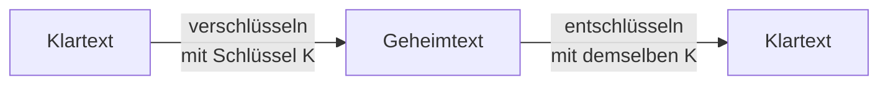
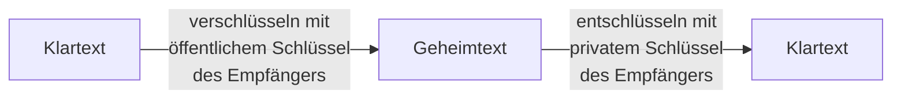
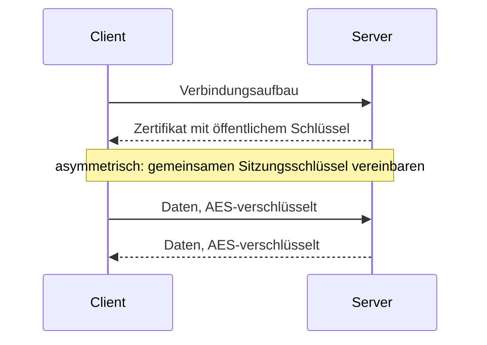

## Worum geht es?

Verschlüsselung macht Daten für Unbefugte unlesbar. Es gibt drei Grundideen – und die Prüfung will,
dass du sie **unterscheiden** und **begründen** kannst:

| Verfahren | Schlüssel | Stärke | Schwäche |
| --- | --- | --- | --- |
| symmetrisch | ein gemeinsamer | schnell | Wie kommt der Schlüssel sicher zum Partner? |
| asymmetrisch | Schlüsselpaar: öffentlich + privat | kein geheimer Austausch nötig | langsam |
| hybrid | beide kombiniert | schnell **und** sicherer Austausch | etwas komplexer |

Beispiel: Die ArchivTech überträgt Kundendaten an ein externes Rechenzentrum.

## Wie funktioniert es?

### Symmetrisch: ein Schlüssel für beide

- Sender und Empfänger nutzen **denselben** Schlüssel.
- Standard heute: **[AES](glossar:symmetrische-verschluesselung)** mit 128, 192 oder 256 Bit.
- Sehr schnell, auch für Terabytes an Archivdaten geeignet.

**Das Problem:** Der Schlüssel muss vorher **geheim** zum Partner. Per E-Mail? Dann kann ihn jeder
mitlesen, der die Mail abfängt.

Und es braucht viele Schlüssel: Jedes Paar braucht einen eigenen. Bei n Partnern sind das
n × (n − 1) ÷ 2. Für 10 Partner: 10 × 9 ÷ 2 = **45 Schlüssel**.

### Asymmetrisch: ein Schlüsselpaar je Person

Jeder hat **zwei** Schlüssel, die mathematisch zusammengehören:

- **öffentlicher Schlüssel** (Public Key): darf jeder kennen
- **privater Schlüssel** (Private Key): verlässt nie den Besitzer

Was mit dem öffentlichen Schlüssel verschlüsselt wurde, kann **nur** der private wieder öffnen.
Verfahren: **RSA**, Verfahren auf **elliptischen Kurven** (ECC).

Analogie: Der öffentliche Schlüssel ist ein **offenes Vorhängeschloss**, das du verteilst. Jeder kann
damit eine Kiste zuschnappen lassen, aufschließen kannst nur du.

Schlüsselanzahl bei 10 Partnern: je 2 → **20 Schlüssel**, davon nur 10 geheim.

### Hybrid: das Beste aus beiden

Hybride Verfahren nutzen die asymmetrische Technik nur, um einen **symmetrischen Sitzungsschlüssel**
sicher zu vereinbaren. Die eigentlichen Daten laufen dann schnell symmetrisch.

So arbeiten **HTTPS (TLS)**, **SSH** und **VPNs**.

Wie genau entsteht der Sitzungsschlüssel?

Klassisch erzeugt der Client einen zufälligen Sitzungsschlüssel, verschlüsselt ihn mit dem
öffentlichen Schlüssel des Servers und schickt ihn hin. TLS 1.3 nutzt stattdessen den
**Diffie-Hellman-Schlüsselaustausch**: Beide berechnen denselben Schlüssel, ohne ihn je zu
übertragen. Der asymmetrische Schlüssel im Zertifikat beweist dabei, dass der Server echt ist. Die
Idee bleibt hybrid: asymmetrisch vereinbaren, symmetrisch übertragen.

> **Halten wir kurz fest:**
>
> 1. Symmetrisch = ein Schlüssel, schnell, Problem Schlüsselaustausch, n(n − 1)/2 Schlüssel.
> 2. Asymmetrisch = Schlüsselpaar, mit öffentlichem verschlüsseln, mit privatem entschlüsseln.
> 3. Hybrid = asymmetrisch den Sitzungsschlüssel, symmetrisch die Daten.

## Warum ist es so?

Asymmetrische Verfahren beruhen auf Rechenaufgaben, die in eine Richtung leicht und rückwärts fast
unlösbar sind – etwa große Zahlen in Primfaktoren zerlegen (RSA). Diese Rechnungen sind teuer.

Warum ist asymmetrisch so viel langsamer?

AES besteht aus einfachen Bit-Operationen, die moderne CPUs sogar per Befehlssatz (AES-NI) direkt
ausführen. RSA rechnet mit Zahlen von Tausenden Bit Länge. Daher der hybride Weg: die teure Technik
nur für wenige Byte Schlüssel, die schnelle für die Masse.

## Praxisbezug im Betrieb

- **Archiv-Backups** werden symmetrisch verschlüsselt (z. B. AES-256); den Schlüssel verwaltet ein
  Schlüsselmanagement, nicht das Backup selbst.
- **SSH-Zugang** zu RHEL-Servern: Dein öffentlicher Schlüssel liegt in `~/.ssh/authorized_keys`, der
  private bleibt auf deinem Rechner.
- **Welche Verfahren und Längen?** Das BSI veröffentlicht dazu jährlich die Technische Richtlinie
  TR-02102.

## Typische Prüfungsfalle

- **Mit dem privaten Schlüssel verschlüsselt, damit es geheim bleibt:** Falsch – für Vertraulichkeit
  mit dem **öffentlichen Schlüssel des Empfängers** verschlüsseln.
- **Eigenen statt fremden Schlüssel genommen:** Du verschlüsselst mit dem Schlüssel dessen, der
  lesen soll.
- **Hybrid nur als „beides“ beschrieben:** Nenne, **wofür** welches Verfahren genutzt wird.
- **Schlüsselanzahl:** symmetrisch n(n − 1)/2, asymmetrisch 2n.

## Nicht verwechseln

| Begriff | Bedeutung |
| --- | --- |
| symmetrisch | ein gemeinsamer geheimer Schlüssel (AES) |
| asymmetrisch | öffentlicher + privater Schlüssel (RSA, ECC) |
| hybrid | asymmetrisch Schlüssel vereinbaren, symmetrisch Daten |
| Sitzungsschlüssel | symmetrischer Schlüssel nur für eine Verbindung |
| Verschlüsseln | Vertraulichkeit – umkehrbar mit Schlüssel |
| Hashen | Integrität – nicht umkehrbar (nächstes Kapitel) |

## Merksatz

**Symmetrisch ist schnell, aber der Schlüssel muss rüber. Asymmetrisch: öffentlich zu, privat auf.
Hybrid vereinbart asymmetrisch und überträgt symmetrisch.**
