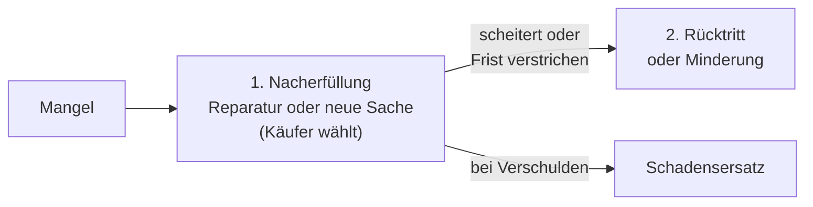

## Worum geht es?

IT-Dienstleister verkaufen Hardware, erstellen Software, betreuen Systeme. Jedes Mal steckt ein
**anderer Vertragstyp** dahinter – mit anderen Pflichten. Und manchmal läuft etwas schief:
**Vertragsstörungen**.

- vier Vertragsarten, die in der IT ständig vorkommen
- was in einen Vertrag gehört
- was bei Verzug und Mängeln passiert

## Wie funktioniert es?

### Vier Vertragsarten

| Vertrag | geschuldet ist … | IT-Beispiel | BGB |
| --- | --- | --- | --- |
| **Kaufvertrag** | Übergabe einer mangelfreien Sache und Eigentum | 10 Notebooks | § 433 |
| **[Werkvertrag](glossar:werkvertrag)** | ein **Erfolg**, ein fertiges Werk | Archivserver betriebsbereit einrichten | § 631 |
| **Dienstvertrag** | eine **Tätigkeit**, kein Erfolg | Admin-Stunden nach Aufwand, Schulung | § 611 |
| **Mietvertrag** | Gebrauch auf Zeit | Server für eine Messe | § 535 |

Die wichtigste Unterscheidung: **Werkvertrag = Erfolg**, **Dienstvertrag = Bemühen**.

### Was in einen Vertrag gehört

| Bestandteil | Beispiel |
| --- | --- |
| Vertragspartner | ArchivTech GmbH und Kunde |
| Leistungsbeschreibung | Pflichtenheft als Anlage |
| Termine | Fertigstellung bis 29.01.2027 |
| Entgelt und Zahlungsbedingungen | 2.760 € netto, 30 Tage netto |
| Abnahme | Abnahmeprotokoll nach erfolgreichem Test |
| Konventionalstrafe (Vertragsstrafe, § 339) | 200 € je Tag Verzug, höchstens 5 % |
| Gewährleistung, Haftung, Gerichtsstand | |

### Vertragsstörungen

| Störung | Wer? | Beispiel |
| --- | --- | --- |
| **Lieferverzug** | Verkäufer | Server kommt nach dem vereinbarten Termin (§ 286) |
| **mangelhafte Lieferung** | Verkäufer | Netzteil defekt, falsches Modell geliefert |
| **Annahmeverzug** | Käufer | Kunde nimmt die Lieferung nicht an (§ 293) |
| **Zahlungsverzug** | Käufer | Rechnung nach Fristablauf nicht bezahlt |

### Mangelhafte Lieferung: die Rechte des Käufers

Eine Sache ist mangelhaft, wenn sie nicht der Vereinbarung oder dem Üblichen entspricht. Auch eine
**Falschlieferung** (andere Sache) steht einem Mangel gleich (§ 434 Abs. 5).

- **Vorrang der Nacherfüllung:** Der Verkäufer bekommt zuerst eine Chance (§ 439).
- **Frist:** Mängelansprüche verjähren bei beweglichen Sachen in der Regel nach **2 Jahren ab
  Ablieferung** (§ 438).
- **Zwischen Kaufleuten:** Ware **unverzüglich prüfen** und Mängel rügen (§ 377 HGB), sonst gehen die
  Rechte verloren.

> **Halten wir kurz fest:**
>
> 1. Kauf = Sache, Werk = Erfolg, Dienst = Tätigkeit, Miete = Gebrauch auf Zeit.
> 2. Vertrag: Leistung, Termine, Entgelt, Abnahme, Vertragsstrafe.
> 3. Mangel: erst Nacherfüllung, dann Rücktritt oder Minderung, bei Verschulden Schadensersatz.

## Warum ist es so?

Der Vertragstyp bestimmt, wofür ein Dienstleister haftet. Beim Werkvertrag schuldet er das
funktionierende Ergebnis – beim Dienstvertrag „nur“ sorgfältige Arbeit.

Warum ist Gewährleistung etwas anderes als Garantie?

Die **Gewährleistung** ist gesetzlich: Der Verkäufer haftet dafür, dass die Sache bei Übergabe
mangelfrei ist. Eine **Garantie** ist ein freiwilliges Zusatzversprechen (§ 443), oft vom Hersteller,
mit eigenen Bedingungen. Sie gilt zusätzlich, ersetzt die Gewährleistung aber nicht.

Und wenn zu wenig geliefert wird?

Kommen nur 8 statt 10 Notebooks, verlangt der Käufer die fehlenden 2 nach. Ob eine Zuweniglieferung
rechtlich als Sachmangel oder als nur teilweise erbrachte Leistung gilt, wird seit der BGB-Reform 2022
unterschiedlich beurteilt. Für die Praxis zählt: sofort prüfen, rügen und dokumentieren.

## Praxisbezug im Betrieb

- **Wareneingang prüfen:** Anzahl, Modell, Schäden – sofort, nicht erst bei der Installation (§ 377 HGB).
- **Werk oder Dienst?** Ein Festpreis für „Server betriebsbereit“ ist meist ein Werkvertrag; „40
  Stunden Unterstützung“ ein Dienstvertrag.
- **Vertragsstrafen** stehen oft in Kundenverträgen – Termine im Projektplan entsprechend absichern.

## Typische Prüfungsfalle

- **Werk- und Dienstvertrag vertauscht:** Erfolg oder Tätigkeit?
- **Sofort Rücktritt verlangt:** Zuerst kommt die Nacherfüllung.
- **Annahmeverzug beim Verkäufer:** Annahmeverzug betrifft den **Käufer**.
- **Garantie = Gewährleistung:** Garantie ist freiwillig, Gewährleistung gesetzlich.

## Nicht verwechseln

| Begriff | Bedeutung |
| --- | --- |
| Werkvertrag | Erfolg geschuldet, Abnahme nötig |
| Dienstvertrag | Tätigkeit geschuldet, kein Erfolg |
| Lieferverzug | Verkäufer liefert zu spät |
| Annahmeverzug | Käufer nimmt nicht an |
| Gewährleistung | gesetzliche Mängelhaftung des Verkäufers |
| Garantie | freiwilliges Zusatzversprechen |
| Konventionalstrafe | vereinbarte Strafe, z. B. bei Verzug |

## Merksatz

**Kauf liefert eine Sache, Werk einen Erfolg, Dienst eine Tätigkeit. Bei Mängeln darf der Verkäufer
zuerst nachbessern – erst danach kommen Rücktritt oder Minderung.**
