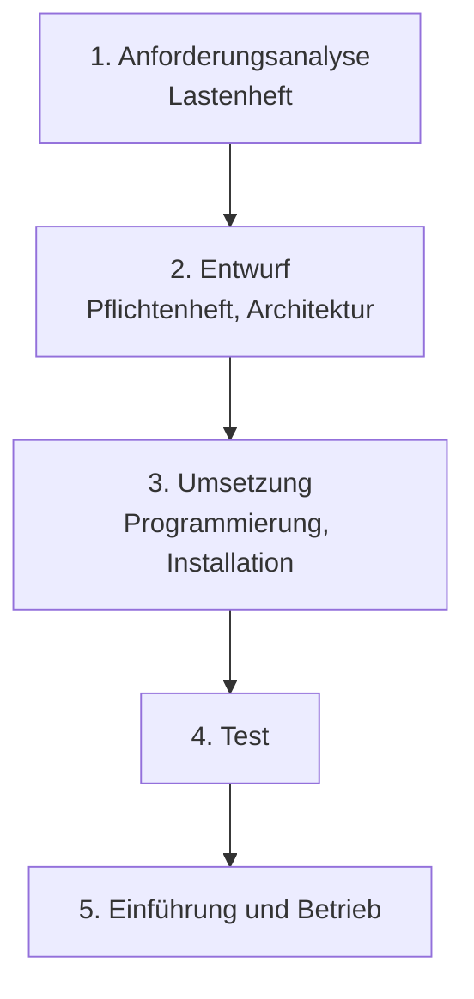
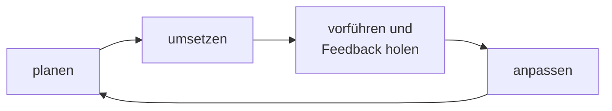

## Worum geht es?

Wie läuft ein IT-Projekt ab? Der Katalog 2025 nennt genau zwei Antworten:

- das **[Wasserfallmodell](glossar:wasserfallmodell)**: Phase für Phase, nach Plan
- **Scrum** als agiles Vorgehen: in kurzen Runden, mit ständigem Nachsteuern

Andere Modelle (V-Modell, Spiralmodell, Kanban …) sind 2025 aus dem AP1-Katalog gestrichen worden.
Dieses Kapitel vergleicht die beiden Denkweisen, das nächste erklärt Scrum im Detail.

## Wie funktioniert es?

### Das Wasserfallmodell

- Jede Phase **endet mit einem Ergebnis** (Dokument, Meilenstein), bevor die nächste beginnt.
- Zurück geht es nur im Ausnahmefall – wie Wasser, das nicht bergauf fließt.
- Die Phasennamen unterscheiden sich je nach Buch; das Prinzip bleibt.

### Agil: in kurzen Schleifen

Statt alles vorab festzulegen, liefert das Team in **kurzen Abständen** ein nutzbares Teilergebnis.
Der Kunde sieht früh etwas und kann umsteuern.

Das **agile Manifest** (2001) stellt vier Werte voran:

| mehr Wert auf … | als auf … |
| --- | --- |
| Individuen und Interaktionen | Prozesse und Werkzeuge |
| funktionierende Software | umfassende Dokumentation |
| Zusammenarbeit mit dem Kunden | Vertragsverhandlung |
| Reagieren auf Veränderung | Befolgen eines Plans |

Die rechte Seite ist nicht wertlos – die linke wiegt nur schwerer.

### Vor- und Nachteile

| | Wasserfall | Agil (Scrum) |
| --- | --- | --- |
| Planung | vollständig vorab | rollierend, Sprint für Sprint |
| Änderungen | teuer, spät | erwünscht, jederzeit eingeplant |
| Ergebnis sichtbar | am Ende | nach jedem Sprint |
| Kosten und Termin | früh absehbar | Umfang flexibel |
| Dokumentation | umfangreich | so viel wie nötig |
| Risiko | Fehler fallen spät auf | Fehler fallen früh auf |

### Wann verwende ich was?

| Situation | passt besser |
| --- | --- |
| Anforderungen klar und stabil, z. B. 50 gleiche Arbeitsplätze ausrollen | Wasserfall |
| fester Preis und fester Termin im Vertrag | Wasserfall |
| Anforderungen unklar oder ändern sich, z. B. neues Kundenportal | agil |
| Kunde will früh mitreden und testen | agil |

> **Halten wir kurz fest:**
>
> 1. Wasserfall: Phasen nacheinander, Ergebnis am Ende, Änderungen teuer.
> 2. Agil: kurze Schleifen, Feedback nach jeder Runde, Änderungen willkommen.
> 3. Klare, stabile Anforderungen → Wasserfall. Unklare → agil.

## Warum ist es so?

Je später ein Fehler entdeckt wird, desto teurer wird er. Beim Wasserfall sieht der Kunde das
Ergebnis erst am Ende. Agile Verfahren holen das Feedback deshalb **früh und oft**.

Warum gibt es den Wasserfall dann überhaupt noch?

Manche Projekte haben wirklich feste Anforderungen: eine Serverumstellung, ein Hardware-Rollout, ein
Umzug ins neue Rechenzentrum. Dort hilft ein vollständiger Plan, Termine und Kosten zuzusagen.
Agilität bringt vor allem dann etwas, wenn man erst unterwegs lernt, was gebraucht wird.

## Praxisbezug im Betrieb

- **Infrastrukturprojekte** (Archivserver, Netzumbau) laufen oft nach Plan in Phasen.
- **Software und Automatisierung** (Pipelines, interne Tools) entstehen meist agil in Sprints.
- **Mischformen** sind Alltag: Grobplanung in Phasen, Umsetzung in Sprints.

## Typische Prüfungsfalle

- **Nur Vorteile von agil:** Agil heißt nicht „ohne Plan“ – Umfang und Endtermin sind schwerer
  zuzusagen.
- **Wasserfall ohne Rücksprung:** In der Praxis gibt es Rücksprünge, aber sie sind teuer und die
  Ausnahme.
- **Begründung fehlt:** Bei „Welches Modell empfehlen Sie?“ immer mit der Situation begründen
  (Anforderungen stabil? Kunde verfügbar?).
- **Gestrichene Modelle:** V-Modell und Spiralmodell sind seit 2025 nicht mehr AP1-Stoff.

## Nicht verwechseln

| Begriff | Bedeutung |
| --- | --- |
| Wasserfallmodell | sequenzielles Vorgehen in Phasen |
| agil | Denkweise: kurze Zyklen, Feedback, Anpassung |
| Scrum | konkretes agiles Rahmenwerk mit Rollen, Events, Artefakten |
| Meilenstein | Ergebnis am Ende einer Wasserfall-Phase |
| Inkrement | nutzbares Teilergebnis am Ende eines Sprints |

## Merksatz

**Wasserfall fließt nur bergab: erst planen, dann bauen, am Ende sehen. Agil dreht kleine Runden und
fragt nach jeder: Passt es noch?**
